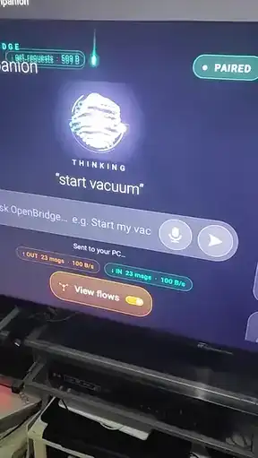
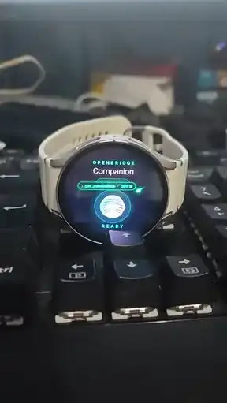
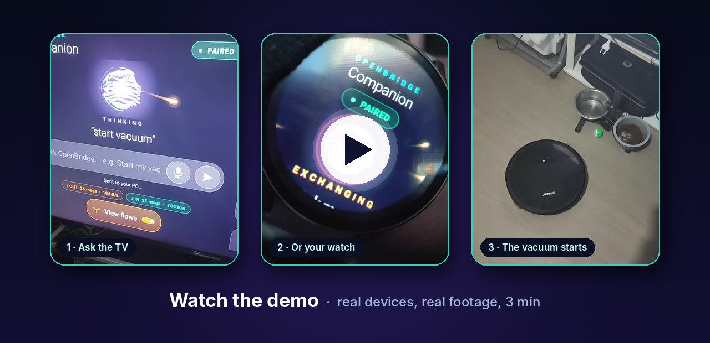
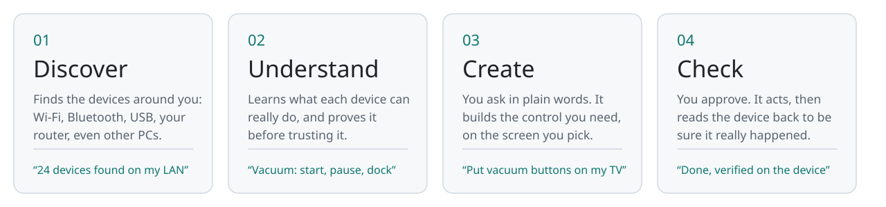

<p align="center">
  
</p>

<h1 align="center">Donnez à votre matériel des pouvoirs qu'il n'a jamais eus.</h1>

<h3 align="center">Dites ce que vous voulez. Vos appareils s'organisent ensemble, et chaque résultat est vérifié sur l'appareil réel.</h3>

<p align="center">
  <a href="#for-device-makers"></a>
  <a href="https://toskaman.github.io/openbridge/try.html"></a>
</p>

<p align="center"><sub><a href="README.md">Read in English</a> · <a href="https://toskaman.github.io/openbridge/">Site web</a></sub></p>

<p align="center">
  
  <br><sub><i>Certaines scènes sont des concepts. Ce qui est vérifié sur du vrai matériel est listé dans <a href="#prouvé-sur-du-vrai-matériel">Prouvé sur du vrai matériel</a>.</i></sub>
</p>

<table align="center">
  <tr>
    <td align="center" width="20%"><b>38</b><br><sub>tests d'appareils vérifiés</sub></td>
    <td align="center" width="20%"><b>28</b><br><sub>sur du vrai matériel</sub></td>
    <td align="center" width="20%"><b>6</b><br><sub>familles : TV, montre, téléphone, box, robot, PC</sub></td>
    <td align="center" width="20%"><b>IA locale</b><br><sub>sur votre propre machine</sub></td>
    <td align="center" width="20%"><b>Relecture</b><br><sub>chaque action revérifiée sur l'appareil</sub></td>
  </tr>
</table>

<!-- partners:start (promised to partners, checked in CI: see docs/partners/COMMITMENTS.md) -->
<p align="center">
  <sub><b>ILS NOUS FONT CONFIANCE</b></sub>
  <br><br>
  <a href="https://www.engoeyewear.com"><picture><source media="(prefers-color-scheme: dark)" srcset="docs/assets/partners/engo-white.png"></picture></a>
  &nbsp;&nbsp;&nbsp;&nbsp;&nbsp;&nbsp;
  <a href="https://www.activelook.net"><picture><source media="(prefers-color-scheme: dark)" srcset="docs/assets/partners/activelook-white.svg"></picture></a>
  &nbsp;&nbsp;&nbsp;&nbsp;&nbsp;&nbsp;
  <a href="https://heltec.cn/"><picture><source media="(prefers-color-scheme: dark)" srcset="docs/assets/partners/heltec-white.svg"></picture></a>
  &nbsp;&nbsp;&nbsp;&nbsp;&nbsp;&nbsp;
  <a href="https://www.elecrow.com"></a>
  <br><sub><a href="https://www.engoeyewear.com">ENGO</a> × <a href="https://www.activelook.net">ActiveLook</a> · <a href="https://heltec.cn/">Heltec</a> <a href="https://heltec.org/project/wifi-lora-32-v4/">WiFi LoRa 32 V4</a> · <a href="https://www.elecrow.com">Elecrow</a> <a href="https://www.elecrow.com/crowpanel-advance-4-3-hmi-esp32-800x480-ai-display-ips-touch-artificial-intelligent-screen.html">CrowPanel Advance 4,3 pouces</a> + ESP32-H2</sub>
</p>
<!-- partners:end -->

---

## Nouveautés

<!-- whatsnew:start (newest first, "YYYY-MM-DD HH:MM" Paris time; update on EVERY change, see AGENTS.md) -->

- `2026-11-25 12:50` **Boutons sur mesure :** créez vos propres boutons pour votre TV, montre ou téléphone, enregistrez-les en profils et changez en un clic. [Guide](docs/CUSTOM_CONTROLS.md)
- `2026-11-25 00:55` Section **Nouveautés** en tête de page : chaque mise à jour, avec date et heure.
- `2026-11-24 20:03` **Elecrow devient partenaire matériel :** CrowPanel Advance 4,3" (ESP32-S3) et ESP32-H2 pour Matter / Thread. Les engagements envers les partenaires sont vérifiés en CI.

<details>
<summary>Mises à jour précédentes</summary>

- `2026-11-24 16:28` **Nouveau README :** plus court, chiffres de preuve en haut, français dans [README.fr.md](README.fr.md).
- `2026-11-24 15:07` **Heltec Automation devient partenaire matériel :** une carte WiFi LoRa 32 V4 fait passer l'agent ESP32 de QEMU au vrai matériel.
- `2026-11-24 14:38` **Adaptateur vocal partenaire mesuré :** 98,6 % des demandes d'une marque comprises (45,1 % avant), sans perte ailleurs. [Résultats](docs/PARTNER_VOICE_MODEL.md)
- `2026-11-24 13:48` **Testé sur l'émulateur du casque PICO OS 6 :** appairage, aller-retour signé, relais révoqué refusé. [Guide](docs/PICO_EMULATOR.md)
- `2026-11-24 12:44` **Le modèle vocal v4 d'OpenBridge devient officiel**, entraîné aussi sur les tâches ménagères. [Entraînement](docs/AI_TRAINING.md)
- `2026-11-23 20:27` **Lunettes ENGO :** vues sport et navigation, français / anglais.
- `2026-11-23 19:10` **Hub des lunettes ENGO :** messages, TV, aspirateur et voix dans votre champ de vision. [Lunettes](docs/GLASSES.md)
- `2026-11-23 14:48` **Demande quand il hésite :** le modèle vocal vous pose la question au lieu de deviner.
- `2026-11-23 13:55` **Version 0.5.0 et offre partenaire :** licence d'évaluation gratuite de 90 jours, intégration d'un appareil depuis son OpenAPI. [Offres](docs/partners/PLANS.md)

</details>

<!-- whatsnew:end -->

<sub>Heures de Paris. Historique complet : [CHANGELOG](CHANGELOG.md).</sub>

---
## En action

<sub>Filmé au téléphone sur le vrai matériel, fin octobre et début novembre 2026.</sub>

<table>
  <tr>
    <td align="center" width="33%">
      <br>
      <b>« Lance l'aspirateur », dit à la TV</b><br>
      <sub>La TV reçoit des boutons « aspirateur » qu'elle n'a jamais eus.</sub>
    </td>
    <td align="center" width="33%">
      <br>
      <b>La montre devient une télécommande TV</b><br>
      <sub>Demandez à voix haute : les boutons apparaissent et pilotent la TV.</sub>
    </td>
    <td align="center" width="33%">
      <br>
      <b>Il sait dire non</b><br>
      <sub>État non confirmé ? Il refuse et explique pourquoi.</sub>
    </td>
  </tr>
</table>

<p align="center">
  <a href="https://youtu.be/TZaxCcRmrLQ"></a>
</p>

---

## Comment ça marche

<p align="center">
  <picture><source media="(prefers-color-scheme: dark)" srcset="docs/assets/readme/how-it-works-dark.svg"></picture>
</p>

1. **Découvrir.** OpenBridge trouve les appareils autour de vous et apprend ce que chacun sait vraiment faire.
2. **Demander.** En français ou en anglais, à l'écrit ou à la voix, depuis n'importe quel écran.
3. **Créer.** L'IA construit la commande dont vous avez besoin, même si aucun fabricant ne l'a prévue.
4. **Approuver et vérifier.** Rien ne s'exécute sans votre accord, et le résultat est relu sur l'appareil.

[Ce qui le rend différent, et ce qui est déjà construit (en anglais) →](docs/WHY_OPENBRIDGE.md)

---

## Prouvé sur du vrai matériel

| Appareil | Ce que fait OpenBridge | Preuve |
|---|---|---|
| **Android TV** | Panneaux de commande créés par l'IA, requêtes vocales, volume | Vrai matériel |
| **Samsung Galaxy Watch7** | Requêtes vocales, commandes créées et retirées en direct | Vrai matériel |
| **Téléphones Android** (Xiaomi, Blackview) | Companion, appairage, relais Bluetooth | Vrai matériel |
| **Robot aspirateur** (Tuya) | Démarrer, pause, retour à la base, avec relecture de l'état | Vrai matériel |
| **Freebox Delta** (box internet) | Inventaire réseau, en lecture seule par principe | Vrai matériel |
| **PC Windows** | Agent à distance, tâches soumises à accord | Vrai matériel |
| **Lunettes ENGO** | 38 fonctions d'affichage tête haute, pont avec l'app officielle | Émulateur |
| **Windows XP · 7 · Linux** | Agent léger sur de vrais systèmes invités | Machines virtuelles |
| **ESP32 · Pixel 6 · PICO OS 6** | Agent natif et companion | Émulateurs officiels |
| **Elecrow CrowPanel Advance 4.3** (ESP32-S3 + ESP32-H2) | Écran de commande tactile, tests Matter / Thread | Intégration en cours |

Chaque résultat est dans le [registre public des preuves](docs/DEVICE_EVIDENCE.json). Les tests émulés sont signalés et ne comptent jamais comme preuve physique. [Limites connues](docs/KNOWN_LIMITATIONS.md).

---

## Partenaires matériel

<p align="center">
  <a href="https://www.engoeyewear.com"></a>
</p>

<p align="center">
  <a href="https://heltec.cn/"></a>
</p>

<p align="center">
  <a href="https://www.elecrow.com"></a>
</p>

<p align="center"><a href="docs/partners/HARDWARE_PARTNERS.md">En savoir plus sur nos partenaires →</a></p>

---

<a id="for-device-makers"></a>

## Pour les fabricants

<table>
  <tr>
    <td width="33%" valign="top"><b>Interopérabilité avec toutes les marques</b><br><sub>Votre produit fonctionne avec les TV, montres, téléphones, box, robots et PC des autres marques, avec un seul modèle d'accord et de vérification.</sub></td>
    <td width="33%" valign="top"><b>Tests et mesures de performance sur votre vrai matériel</b><br><sub>Une suite de tests complète pour votre produit, lancée à chaque version, en CI sur trois systèmes d'exploitation.</sub></td>
    <td width="33%" valign="top"><b>Un émulateur de votre produit</b><br><sub>Un modèle logiciel fidèle pour vos développeurs, votre QA et vos démos commerciales, sans appareil sur le bureau.</sub></td>
  </tr>
</table>

<p align="center">
  <a href="mailto:info@lepcpro.fr?subject=OpenBridge%3A%20Hardware%20partnership"></a>
  <br><sub><a href="docs/partners/README.md">En savoir plus sur le programme partenaire (en anglais) →</a></sub>
</p>

---

## Essayer en 2 minutes

**Sans installation :** [simulation dans le navigateur](https://toskaman.github.io/openbridge/try.html) · [compatibilité](https://toskaman.github.io/openbridge/compatibility.html) · [mesures de performance](https://toskaman.github.io/openbridge/benchmarks.html)

**Windows :** [télécharger OpenBridge](https://github.com/toskaman/openbridge/releases/latest) (environ 15 Mo, Python inclus), décompresser, puis double-cliquer sur *Start OpenBridge*.

**Depuis les sources** (Windows, Linux ou macOS · Python 3.14 · aucun paquet tiers) :

```sh
git clone https://github.com/toskaman/openbridge.git
cd openbridge
python -m src.cli demo      # démo hors ligne, sans appareil
python -m src.server        # ouvrir http://127.0.0.1:18765
```

Documentation (en anglais) : [Démarrage rapide](docs/QUICKSTART.md) · [Par où commencer](docs/START_HERE.md) · [Intégrer votre appareil](docs/INTEGRATE_YOUR_DEVICE.md) · [Architecture](docs/UNIVERSAL_DEVICE_ARCHITECTURE.md) · [Sécurité](SECURITY.md) · [Confidentialité](docs/PRIVACY.md) · [RGPD](docs/GDPR.md) · [Toute la documentation](docs/README.md)

---

## À propos

Développeur indépendant et **AMD ROCm™ Certified Associate**, je construis OpenBridge seul, par passion de toujours pour le matériel, l'IA et l'interopérabilité.
Mes autres projets sur [mon profil GitHub](https://github.com/toskaman) · Contact : [info@lepcpro.fr](mailto:info@lepcpro.fr?subject=OpenBridge)

---

<sub>« OpenBridge » est un nom provisoire, non définitif : le projet sera renommé plus tard. **Licence :** le cœur est en source disponible sous [PolyForm Strict 1.0.0](LICENSE) (usage non commercial ; ni redistribution ni œuvre dérivée). Le kit d'intégration est sous [Apache 2.0](LICENSES/Apache-2.0.txt). Les entreprises peuvent l'évaluer gratuitement 90 jours avec la [licence d'évaluation](LICENSES/OpenBridge-Evaluation-1.0.md) ; les partenaires reçoivent une [licence partenaire](docs/partners/PARTNER_LICENSE.md#version-française) écrite, et je travaille volontiers sous NDA. [Détails des licences](docs/LICENSING.md) · [Composants tiers](THIRD_PARTY.md) · [Nouveautés](CHANGELOG.md).</sub>
