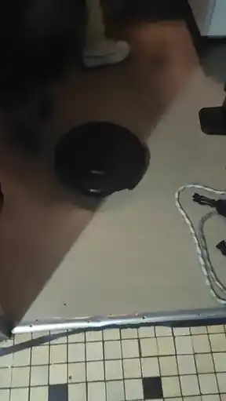
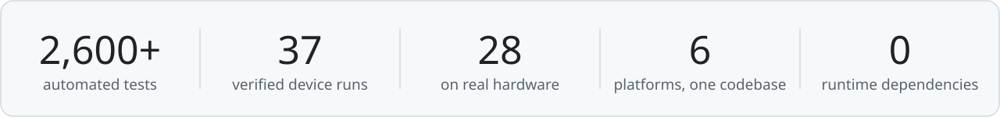
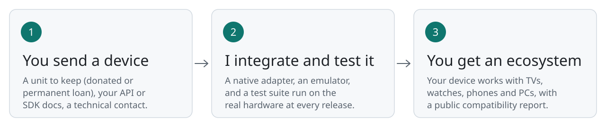

<p align="center">
  
</p>

<h3 align="center">Tell your watch “turn the TV down”, and it does,<br>even though your watch and your TV were never made to talk to each other.</h3>

<p align="center">
OpenBridge connects the devices you already own, whatever the brand.<br>
You ask in plain words, it creates the control you need, and it checks on the device that it really worked.
</p>

<p align="center">
  <a href="https://toskaman.github.io/openbridge/try.html"><b>Try it in your browser</b></a> ·
  <a href="https://youtu.be/TZaxCcRmrLQ"><b>Watch the 3-minute demo</b></a> ·
  <a href="#for-hardware-makers"><b>For hardware makers</b></a> ·
  <a href="#fr">Français</a>
</p>

<p align="center">
  <a href="https://github.com/toskaman/openbridge/actions/workflows/verify.yml"></a>
  <a href="https://github.com/toskaman/openbridge/actions/workflows/codeql.yml"></a>
</p>

<!-- partners:start (promised to partners, checked in CI: see docs/partners/COMMITMENTS.md) -->
<p align="center"><sub>HARDWARE PARTNERS</sub></p>
<p align="center">
  <a href="https://www.engoeyewear.com"><picture><source media="(prefers-color-scheme: dark)" srcset="docs/assets/partners/engo-white.png"></picture></a>
  &nbsp;&nbsp;&nbsp;&nbsp;
  <a href="https://www.activelook.net"><picture><source media="(prefers-color-scheme: dark)" srcset="docs/assets/partners/activelook-white.svg"></picture></a>
  &nbsp;&nbsp;&nbsp;&nbsp;
  <a href="https://www.elecrow.com"><b>Elecrow</b></a>
</p>
<p align="center"><sub>
  <a href="https://www.engoeyewear.com">ENGO</a> heads-up display glasses, powered by <a href="https://www.activelook.net">ActiveLook</a> ·
  <a href="https://www.elecrow.com">Elecrow</a> <a href="https://www.elecrow.com/crowpanel-advance-4-3-hmi-esp32-800x480-ai-display-ips-touch-artificial-intelligent-screen.html">CrowPanel Advance 4.3-inch (ESP32-S3)</a>
</sub></p>
<!-- partners:end -->

## See it work

Filmed with a phone, in a real living room, on real devices (early November 2026).

<table>
  <tr>
    <td align="center" width="33%">
      <br>
      <b>The watch becomes a TV remote</b><br>
      <sub>Ask the watch out loud. Volume buttons appear on it and drive the TV.</sub>
    </td>
    <td align="center" width="33%">
      <br>
      <b>“Start the vacuum”, said to the TV</b><br>
      <sub>The TV gets vacuum buttons it never had. Press one, the robot starts.</sub>
    </td>
    <td align="center" width="33%">
      <br>
      <b>It knows when to say no</b><br>
      <sub>Device state not confirmed fresh? It refuses, and says why.</sub>
    </td>
  </tr>
</table>

<details>
<summary>Three more clips</summary>
<br>
<table>
  <tr>
    <td align="center" width="33%"><br><b>“Go home”, from the couch</b></td>
    <td align="center" width="33%"><br><b>Remove the buttons, everywhere</b></td>
    <td align="center" width="33%"><br><b>Same app on phone, TV and watch</b></td>
  </tr>
</table>
</details>

## How it works

<picture>
  <source media="(prefers-color-scheme: dark)" srcset="docs/assets/readme/how-it-works-dark.svg">
  
</picture>

Three things make OpenBridge different from a smart-home app:

- **It creates controls, it doesn't pick from a list.** Vacuum buttons on a TV did not exist anywhere. OpenBridge built them from what both devices can actually do.
- **“Done” means checked.** After every action it reads the device back. If it can't confirm, it says *unverified*, never a fake success.
- **You stay in charge, and it stays home.** Nothing runs without your approval, everything can be revoked, and the AI runs on your own computer, for free. Bring your own model if you prefer ([AI providers](docs/AI_PROVIDERS.md)).

## Where this is going

<p align="center">
  
</p>
<p align="center"><sub><i>The vision. Some scenes are concepts (VR control room, fridge, coffee machine, file drop to a Linux PC). What runs today is in the table below.</i></sub></p>

## Tested on real hardware

<picture>
  <source media="(prefers-color-scheme: dark)" srcset="docs/assets/readme/numbers-dark.svg">
  
</picture>

| Device | What OpenBridge does with it | Proof |
|---|---|---|
| **Android TV** | Companion app, AI-made control panels, voice requests, volume | Real hardware |
| **Samsung Galaxy Watch7** | Voice requests, controls created and removed on the fly, drives the TV | Real hardware |
| **Android phones** (Xiaomi, Blackview) | Companion, pairing, Bluetooth relay, device actions | Real hardware |
| **Robot vacuum** (Tuya) | Start, pause, dock from the TV or the PC, with state read back | Real hardware |
| **Freebox Delta** (ISP router) | Network inventory and device discovery, read-only by policy | Real hardware |
| **Windows PCs** | Remote agent between PCs, jobs only with consent | Real hardware |
| **Home Assistant** | Lights, plugs, thermostats, blinds (Matter, Zigbee, Thread included), with read-back and Undo | Real instance, demo devices |
| **ENGO smart glasses** (ActiveLook) | 38 heads-up display features, emulator, official app bridge | Emulator, glasses on their way |
| **Elecrow CrowPanel Advance 4.3** (ESP32-S3 + ESP32-H2) | Control panel and Matter / Thread testing | Integration in progress |
| **Windows XP, Windows 7, Linux** | Lightweight agent on genuine guest systems | Virtual machines |
| **ESP32, Pixel 6** | Native microcontroller agent, Android | Official emulators |

Every run is in the public [evidence registry](docs/DEVICE_EVIDENCE.json) and the [hardware compatibility report](docs/HARDWARE_TEST_MATRIX.md). Emulated results are labelled and never counted as physical proof. What doesn't work yet: [known limitations](docs/KNOWN_LIMITATIONS.md).

## For hardware makers

**Send a device. Get back an ecosystem.** OpenBridge makes your product work with the TVs, watches, phones, routers and PCs your customers already own, and tests it on the real hardware at every release.

<picture>
  <source media="(prefers-color-scheme: dark)" srcset="docs/assets/readme/partner-process-dark.svg">
  
</picture>

**What you get:** new features without new firmware (controls, alerts, voice, cross-device flows), interoperability with other brands, a test suite and benchmarks run on your real device, an emulator of your product for your own teams, detailed feedback on your API or SDK, a public verified compatibility report, and your brand listed here.

**What I ask:** hardware to keep (donated or on permanent loan, so tests keep running on every release), your API or SDK documentation, and a technical contact. Your code and data stay yours, and I gladly work under NDA ([licensing](docs/LICENSING.md#commercial--partner-licensing)).

**What I'm looking for next**

| Device family | Why |
|---|---|
| Matter, Thread and Zigbee devices | Native Matter controller is next on the [roadmap](ROADMAP.md) |
| TVs on Tizen or webOS, set-top boxes, soundbars | One web companion covers both TV platforms |
| Robot vacuums and mops, lawn and pool robots | Start, dock and status already proven on a Tuya robot |
| Smart glasses, watches, rings | Glanceable controls and alerts, like the ENGO work |
| Routers and ISP boxes (OpenWrt, FRITZ!Box) | Adapters written and emulator-tested, waiting for hardware |
| ESP32 and maker boards, EV chargers, industrial gateways | Native agent runs on ESP32; mobility and industry are next |

**Proof it works: ENGO.** Before their glasses even arrived, ENGO got 38 heads-up display features, 82 dedicated tests, a professional emulator ([HUD Studio](docs/HUD_STUDIO.md)) and 19 technical documents ([case study](docs/partners/ENGO.md)).

**Elecrow** is the newest partner: a [CrowPanel Advance 4.3-inch](https://www.elecrow.com/crowpanel-advance-4-3-hmi-esp32-800x480-ai-display-ips-touch-artificial-intelligent-screen.html) touch display (ESP32-S3) with an ESP32-H2 module for Matter and Thread ([partner page](docs/partners/ELECROW.md)).

Your engineers can start today: the free [90-day evaluation licence](LICENSES/OpenBridge-Evaluation-1.0.md) needs no signature, and `python -m src.cli partner new "Your Device"` scaffolds an adapter, an emulator and passing tests ([guide](docs/INTEGRATE_YOUR_DEVICE.md)).

<p align="center">
  <a href="mailto:info@lepcpro.fr?subject=OpenBridge%3A%20Hardware%20partnership"><b>Write to info@lepcpro.fr</b></a> (English or French)<br>
  <sub><a href="docs/partners/README.md">Partner program</a> · <a href="docs/partners/PLANS.md">Plans</a> · <a href="site/OpenBridge-Partner-Brief.pdf">One-page brief (PDF)</a></sub>
</p>

## Try it

- **In your browser, nothing to install:** [interactive simulation](https://toskaman.github.io/openbridge/try.html) (clearly labelled as a simulation).
- **On Windows:** [download OpenBridge](https://github.com/toskaman/openbridge/releases/latest) (about 15 MB, Python included), unzip, double-click *Start OpenBridge*.
- **From source, on Windows, Linux or macOS** (Python 3.14, no third-party packages):

```sh
git clone https://github.com/toskaman/openbridge.git
cd openbridge
python -m unittest discover -s tests   # 2,600+ tests, no hardware needed
python -m src.cli demo                 # offline demo, no devices required
python -m src.server                   # then open http://127.0.0.1:18765
```

Local AI models, the Android / TV / watch companion, headless use: see the **[installation guide](docs/QUICKSTART.md)**.

<details>
<summary><b>Recently added, and already built</b></summary>
<br>

- **[Home Assistant bridge](docs/HOME_ASSISTANT.md):** everything Home Assistant knows joins OpenBridge, with consent, read-back and exact Undo. OpenBridge never unlocks a door, moves a garage door or touches an alarm. Verified on a real instance with its demo devices (13/13); physical devices through Home Assistant not tested yet.
- **[Devices that learn](docs/DEVICE_LEARNING.md):** OpenBridge learns what really works on each device and suggests cross-device features built only from proven actions. Soak test: 1,480 real actions, 92.8% verified by read-back ([evidence](docs/evidence/device-learning-soak-22nov.md)).
- **Talk to your home:** `openbridge ha say "dim the kitchen lights to 30%"`, in French or English, understood by OpenBridge's own local model: 47/47 requests on a real Home Assistant ([training and limits](docs/AI_TRAINING.md)).
- **[Messages, TV and vacuum on ENGO glasses](docs/GLASSES.md),** after a one-time grant on the PC.

Built and covered by tests, waiting for more real devices: moving a control from the watch to the TV, chaining up to 8 steps across devices, switching to another route when one dies (never running an action twice), diagnosing *why* a device isn't responding, exporting a set of controls to another home. Concept only: [OpenBridge without a PC](docs/concepts/PC_LESS_OPENBRIDGE.md).
</details>

## Documentation

[Start here](docs/START_HERE.md) · [Installation guide](docs/QUICKSTART.md) · [Integrate your device](docs/INTEGRATE_YOUR_DEVICE.md) · [Architecture](docs/UNIVERSAL_DEVICE_ARCHITECTURE.md) · [Hardware compatibility](docs/HARDWARE_TEST_MATRIX.md) · [Known limitations](docs/KNOWN_LIMITATIONS.md) · [Security](SECURITY.md) · [Privacy](docs/PRIVACY.md) · [Roadmap](ROADMAP.md) · [What's new](CHANGELOG.md) · [All docs](docs/README.md)

## About


I'm an autistic independent developer, passionate about hardware, AI and interoperability since childhood. I love finding out how systems work, and making them work together. OpenBridge is that curiosity turned into a product, built solo. If your devices should talk to each other, <a href="mailto:info@lepcpro.fr?subject=OpenBridge">let's talk</a>.
<br clear="left">

<a id="fr"></a>

<details>
<summary><b>En français</b></summary>
<br>

**Dites à votre montre « baisse le son de la TV », et c'est fait, même si votre montre et votre TV n'ont jamais été conçues pour se parler.**

OpenBridge relie les appareils que vous avez déjà, quelle que soit la marque. Vous demandez avec vos mots, il crée la commande dont vous avez besoin, et il vérifie sur l'appareil que l'action a vraiment eu lieu. Rien ne s'exécute sans votre accord, et l'IA tourne en local, sur votre propre ordinateur.

**Partenaires matériels :** [ENGO](https://www.engoeyewear.com) (lunettes à affichage tête haute, plateforme [ActiveLook](https://www.activelook.net) de Microoled) et [Elecrow](https://www.elecrow.com) ([CrowPanel Advance 4,3 pouces](https://www.elecrow.com/crowpanel-advance-4-3-hmi-esp32-800x480-ai-display-ips-touch-artificial-intelligent-screen.html), ESP32-S3, avec module ESP32-H2 pour Matter et Thread).

**Vous fabriquez des appareils connectés ?** Envoyez un appareil à conserver (don ou prêt permanent), la documentation de votre API ou SDK et un contact technique. En échange : une intégration native, de nouvelles fonctionnalités sans nouveau firmware, des tests et benchmarks sur le matériel réel à chaque version, un émulateur de votre produit et un rapport de compatibilité public et vérifié. Votre code et vos données restent à vous, et je travaille volontiers sous NDA ([conditions](docs/partners/PARTNER_LICENSE.md#version-française)).

📩 **info@lepcpro.fr** · [Site du projet](https://toskaman.github.io/openbridge/) · [Plaquette partenaire (PDF, en anglais)](site/OpenBridge-Partner-Brief.pdf)
</details>

---

<sub>**License:** the OpenBridge core is source-available under [PolyForm Strict 1.0.0](LICENSE): free to read, run and test for noncommercial purposes; redistribution and derivative works are not licensed. The **integration kit** (`openbridge partner new` and the code it generates) is [Apache 2.0](LICENSES/Apache-2.0.txt), and a partner's own code stays under the partner's own licence. **Companies:** partners get a written [partner licence](docs/partners/PARTNER_LICENSE.md) to use the core commercially, and their code and data stay theirs ([commercial & partner licensing](docs/LICENSING.md#commercial--partner-licensing)). For any commercial use, [get in touch](mailto:info@lepcpro.fr?subject=OpenBridge%3A%20Commercial%20licensing). Third-party components and AI model weights keep their own licenses: [credits & notices](THIRD_PARTY.md) · [licensing details](docs/LICENSING.md) · [how this project was built](CONTRIBUTIONS.md) · [previous README versions](docs/README_HISTORY.md).</sub>
