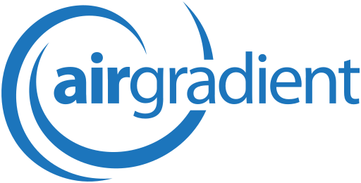
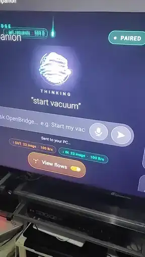
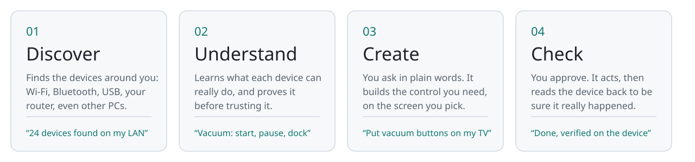

<p align="center">
  
</p>

<h1 align="center">Give your hardware powers it never shipped with.</h1>

<h3 align="center">Say what you want. Your devices work it out together, and every result is checked on the real device.</h3>

<p align="center">
  <a href="#for-device-makers"></a>
  <a href="https://toskaman.github.io/openbridge/try.html"></a>
</p>

<p align="center"><sub><a href="README.fr.md">Lire en français</a> · <a href="https://toskaman.github.io/openbridge/">Website</a></sub></p>

<p align="center">
  
  <br><sub><i>Some scenes are concept previews. What is verified on real hardware is listed under <a href="#proven-on-real-hardware">Proven on real hardware</a>.</i></sub>
</p>

<table align="center">
  <tr>
    <td align="center" width="20%"><b>40</b><br><sub>verified device runs</sub></td>
    <td align="center" width="20%"><b>30</b><br><sub>on real hardware</sub></td>
    <td align="center" width="20%"><b>7</b><br><sub>device families: TV, watch, phone, glasses, router, robot, PC</sub></td>
    <td align="center" width="20%"><b>Local AI</b><br><sub>runs on your own machine</sub></td>
    <td align="center" width="20%"><b>Read back</b><br><sub>every action checked on the device</sub></td>
  </tr>
</table>

<!-- partners:start (promised to partners, checked in CI: see docs/partners/COMMITMENTS.md) -->
<p align="center">
  <sub><b>TRUSTED BY HARDWARE MAKERS</b></sub>
  <br><br>
  <a href="https://www.engoeyewear.com"><picture><source media="(prefers-color-scheme: dark)" srcset="docs/assets/partners/engo-white.png"></picture></a>
  &nbsp;&nbsp;&nbsp;&nbsp;&nbsp;&nbsp;
  <a href="https://www.activelook.net"><picture><source media="(prefers-color-scheme: dark)" srcset="docs/assets/partners/activelook-white.svg"></picture></a>
  &nbsp;&nbsp;&nbsp;&nbsp;&nbsp;&nbsp;
  <a href="https://heltec.cn/"><picture><source media="(prefers-color-scheme: dark)" srcset="docs/assets/partners/heltec-white.svg"></picture></a>
  &nbsp;&nbsp;&nbsp;&nbsp;&nbsp;&nbsp;
  <a href="https://www.elecrow.com"></a>
  &nbsp;&nbsp;&nbsp;&nbsp;&nbsp;&nbsp;
  <a href="https://www.airgradient.com"><picture><source media="(prefers-color-scheme: dark)" srcset="docs/assets/partners/airgradient-white.svg"></picture></a>
  <br><sub><a href="https://www.engoeyewear.com">ENGO</a> × <a href="https://www.activelook.net">ActiveLook</a> · <a href="https://heltec.cn/">Heltec</a> <a href="https://heltec.org/project/wifi-lora-32-v4/">WiFi LoRa 32 V4</a> · <a href="https://www.elecrow.com">Elecrow</a> <a href="https://www.elecrow.com/crowpanel-advance-4-3-hmi-esp32-800x480-ai-display-ips-touch-artificial-intelligent-screen.html">CrowPanel Advance 4.3-inch</a> + ESP32-H2 · <a href="https://www.airgradient.com">AirGradient</a> <a href="https://www.airgradient.com/shop/#!/AirGradient-ONE-Indoor-Monitor-I-9PSL-Kit/p/594725501">ONE Indoor Monitor I-9PSL</a></sub>
</p>
<!-- partners:end -->

---

## What's new

<!-- whatsnew:start (newest first, "YYYY-MM-DD HH:MM" Paris time; update on EVERY change, see AGENTS.md) -->

- `2026-11-27 15:55` **Manual brightness finally wins:** on the real ENGO 3 ([ENGO](https://www.engoeyewear.com) / [ActiveLook by Microoled](https://www.activelook.net)), the auto light sensor visibly overrode any manual level, so setting a brightness now switches auto off first (re-enable it with the ALS button).
- `2026-11-27 15:30` **Oracle answers reach the glasses again:** pushing an answer card to the ENGO 3 ([ENGO](https://www.engoeyewear.com) / [ActiveLook by Microoled](https://www.activelook.net)) crashed calling a send helper that never existed; it now uses the normal send path, proven live on real hardware with a card shown and confirmed in the glasses.
- `2026-11-27 14:15` **Reliability fixes and cleanup:** a refused MQTT subscription now raises instead of hanging, discovery ignores stale devices, the microphone loop no longer stalls audio and reports errors, and the first-responder EXPECTANT screen ([ENGO](https://www.engoeyewear.com) / [ActiveLook by Microoled](https://www.activelook.net)) renders instead of crashing; plus case-insensitive local names and a full unused-import cleanup.
<details>
<summary>Older updates</summary>

- `2026-11-27 13:45` **AI model pinned to every device class:** a 73-test matrix now locks the official command model, voice intents, discovery grounding and the Oracle to each device class, and fixes the model being told phone/PC/glasses skills work on any device ([ENGO](https://www.engoeyewear.com) / [ActiveLook by Microoled](https://www.activelook.net) controls included); spoken English math like "12 divided by 4" now answers instantly. [Matrix](tests/unit/test_ai_device_matrix.py)

- `2026-11-27 12:30` **Full ENGO 3 controls on Wear OS watches ([ENGO](https://www.engoeyewear.com) × [ActiveLook by Microoled](https://www.activelook.net)):** summon all ENGO 3 controls (navigation, 9 HUD screens, display power, brightness, ALS, tap/gesture toggle, 180° rotation, optical alignment shift, privacy and inbox) onto a Wear OS watch by text, voice or options, with watch menus hidden whenever no watch is detected. [Glasses](docs/GLASSES.md) · [Partner page](docs/partners/ENGO.md)

- `2026-11-27 01:00` **OpenBridge Companion 0.15: glasses page, phone sensors, standalone mode and AI on the phone:** a live copy of what the glasses show, the volume keys as a remote, quick tiles and a widget; device cards; six modules the glasses follow; profiles (home, bike, work); the phone's GPS and sport sensors for the sport screens; a visual Oracle; the phone drives the glasses alone when the PC is away; and a small model, speech-to-text and a command model trained on the PC, running on the phone with no network. [Companion](docs/ANDROID_COMPANION.md#0150-27-november-2026)

- `2026-11-26 20:30` **ENGO 3 tap latency traced to the firmware:** the ~2 s before a double tap registers, and the way extra taps are ignored, are the glasses' own tap detection, not OpenBridge (our path is under 100 ms). Documented, with a concrete firmware ask, in the [suggestions for ENGO](docs/partners/engo/ENGO_FEATURE_REQUESTS.md).

- `2026-11-26 18:50` **Every glasses screen redrawn for the real ENGO 3:** messages, TV, sport, navigation, settings and the voice screen now fit the panel with its real font sizes; the older ENGO demo screens show upright and in colour too, and the emulator no longer draws them upside down. What we'd like from ENGO next is in a [suggestions file](docs/partners/engo/ENGO_FEATURE_REQUESTS.md). [Glasses](docs/GLASSES.md)

- `2026-11-26 16:10` **The Oracle becomes an optional module per Companion:** switch it on or off from the PC (Controls > Modules, or `openbridge glasses module oracle on|off`) or by saying "active / retire l'Oracle" on the phone. [Glasses](docs/GLASSES.md)
- `2026-11-26 15:45` **ENGO 3 glasses driven through the phone:** a PC without Bluetooth uses the phone's; ask the Oracle out loud on the phone, the answer appears on the glasses, in colour. [Glasses](docs/GLASSES.md)
- `2026-11-25 23:58` **Partner visibility in logs & GitHub CI:** hardware partner names (ENGO, ActiveLook by Microoled, Heltec Automation, Elecrow, AirGradient) are logged explicitly on every CI run and enforced in `AGENTS.md`.
- `2026-11-25 16:15` **VoiceAI Oracle for ENGO 3 & multi-mic devices:** instant local math, cached web search, warm local LLM, long-polling Android/Wear OS relay (`Oracle ENGO`), and universal mic connector (`mic_oracle`) rendered on the ENGO 3 HUD.
- `2026-11-25 13:20` **AirGradient joins as hardware partner:** an AirGradient ONE (I-9PSL) indoor monitor brings air quality to OpenBridge, read over its local API. [Partner page](docs/partners/AIRGRADIENT.md)
- `2026-11-25 12:50` **Custom controls:** build your own buttons for your TV, watch or phone, save them as profiles and switch in one click. [Guide](docs/CUSTOM_CONTROLS.md)

- `2026-11-25 00:55` **What's new** on the front page: every update, with date and time.

- `2026-11-24 20:03` **Elecrow joins as hardware partner:** CrowPanel Advance 4.3" (ESP32-S3) and ESP32-H2 for Matter / Thread. Partner promises are now checked in CI.
- `2026-11-24 16:28` **New README:** shorter, proof figures up top, French in [README.fr.md](README.fr.md).
- `2026-11-24 15:07` **Heltec Automation joins as hardware partner:** a WiFi LoRa 32 V4 board takes the ESP32 agent from QEMU to real hardware.
- `2026-11-24 14:38` **Partner voice adapter measured:** 98.6 % of a brand's requests understood (45.1 % before), no loss elsewhere. [Results](docs/PARTNER_VOICE_MODEL.md)
- `2026-11-24 13:48` **Tested on the PICO OS 6 headset emulator:** pairing, signed round trip, revoked relay refused. [Guide](docs/PICO_EMULATOR.md)
- `2026-11-24 12:44` **OpenBridge's own voice model v4 is official**, now also trained on household chores. [Training](docs/AI_TRAINING.md)
- `2026-11-23 20:27` **ENGO glasses:** sport and navigation views, French / English.
- `2026-11-23 19:10` **ENGO glasses hub:** messages, TV, vacuum and voice in your field of view. [Glasses](docs/GLASSES.md)
- `2026-11-23 14:48` **Asks back when unsure:** the voice model checks with you instead of guessing.
- `2026-11-23 13:55` **Release 0.5.0 and partner offer:** free 90-day evaluation licence, integrate a device from its OpenAPI. [Plans](docs/partners/PLANS.md)

</details>

<!-- whatsnew:end -->

<sub>Times are Paris time (CET). Full history: [CHANGELOG](CHANGELOG.md).</sub>

---
## See it in action

<sub>Filmed with a phone pointed at the real hardware, late October and early November 2026.</sub>

<table>
  <tr>
    <td align="center" width="33%">
      <br>
      <b>“Start the vacuum”, said to the TV</b><br>
      <sub>The TV gets vacuum buttons it never had.</sub>
    </td>
    <td align="center" width="33%">
      <br>
      <b>Your watch becomes a TV remote</b><br>
      <sub>Ask out loud. The buttons appear and drive the TV.</sub>
    </td>
    <td align="center" width="33%">
      <br>
      <b>It knows when to say no</b><br>
      <sub>State not confirmed? It refuses and says why.</sub>
    </td>
  </tr>
</table>

<p align="center">
  <a href="https://youtu.be/TZaxCcRmrLQ"></a>
</p>

---

## How it works

<p align="center">
  <picture><source media="(prefers-color-scheme: dark)" srcset="docs/assets/readme/how-it-works-dark.svg"></picture>
</p>

1. **Discover.** OpenBridge finds the devices around you and learns what each one can actually do.
2. **Ask.** In plain English or French, typed or spoken, from any screen.
3. **Create.** The AI builds the control you need, even one no manufacturer shipped.
4. **Approve and verify.** Nothing runs without your OK, and the result is read back from the device.

[Why it's different, and what is already built →](docs/WHY_OPENBRIDGE.md)

---

## Proven on real hardware

| Device | What OpenBridge does | Proof |
|---|---|---|
| **Android TV** | AI-made control panels, voice requests, volume | Real hardware |
| **Samsung Galaxy Watch7** | Voice requests, controls created and removed live | Real hardware |
| **Android phones** (Xiaomi, Blackview) | Companion, pairing, Bluetooth relay | Real hardware |
| **Robot vacuum** (Tuya) | Start, pause, dock, with state read-back | Real hardware |
| **Freebox Delta** (ISP router) | Network inventory, read-only by policy | Real hardware |
| **Windows PCs** | Remote agent, consent-gated jobs | Real hardware |
| **ENGO 3 smart glasses** | Menus, messages, Oracle answers spoken into the phone, 38 HUD features | Real hardware (through the phone) |
| **Windows XP · 7 · Linux** | Lightweight agent on genuine guest systems | Virtual machines |
| **ESP32 · Pixel 6 · PICO OS 6** | Native agent and companion | Official emulators |
| **Elecrow CrowPanel Advance 4.3** (ESP32-S3 + ESP32-H2) | Touch control panel, Matter / Thread testing | Integration in progress |
| **AirGradient ONE** (I-9PSL) | Air quality (PM2.5, CO₂, TVOC, NOx) for alerts and automations, over its local API | Integration in progress |

Every result is in the public [evidence registry](docs/DEVICE_EVIDENCE.json). Emulated runs are labelled and never counted as physical proof. [Known limitations](docs/KNOWN_LIMITATIONS.md).

---

## Hardware partners

<p align="center">
  <a href="https://www.engoeyewear.com"></a>
</p>

<p align="center">
  <a href="https://heltec.cn/"></a>
</p>

<p align="center">
  <a href="https://www.elecrow.com"></a>
</p>

<p align="center">
  <a href="https://www.airgradient.com"></a>
</p>

<p align="center"><a href="docs/partners/HARDWARE_PARTNERS.md">Learn more about our partners →</a></p>

---

<a id="for-device-makers"></a>

## For device makers

<table>
  <tr>
    <td width="33%" valign="top"><b>Interoperability with every brand</b><br><sub>Your product works with TVs, watches, phones, routers, robots and PCs from other vendors, with one consent and verification model.</sub></td>
    <td width="33%" valign="top"><b>Tests and benchmarks on your real hardware</b><br><sub>A full test suite for your product, run on every release, in CI on three operating systems.</sub></td>
    <td width="33%" valign="top"><b>An emulator of your product</b><br><sub>A faithful software model for your developers, QA and sales demos, with no unit on the desk.</sub></td>
  </tr>
</table>

<p align="center">
  <a href="mailto:info@lepcpro.fr?subject=OpenBridge%3A%20Hardware%20partnership"></a>
  <br><sub><a href="docs/partners/README.md">Learn more about the partner program →</a></sub>
</p>

---

## Try it in 2 minutes

**No install:** [in-browser simulation](https://toskaman.github.io/openbridge/try.html) · [compatibility](https://toskaman.github.io/openbridge/compatibility.html) · [benchmarks](https://toskaman.github.io/openbridge/benchmarks.html)

**Windows:** [download OpenBridge](https://github.com/toskaman/openbridge/releases/latest) (about 15 MB, Python included), unzip, double-click *Start OpenBridge*.

**From source** (Windows, Linux or macOS · Python 3.14 · no third-party packages):

```sh
git clone https://github.com/toskaman/openbridge.git
cd openbridge
python -m src.cli demo      # offline demo, no devices required
python -m src.server        # open http://127.0.0.1:18765
```

[Quickstart](docs/QUICKSTART.md) · [Start here](docs/START_HERE.md) · [Integrate your device](docs/INTEGRATE_YOUR_DEVICE.md) · [Architecture](docs/UNIVERSAL_DEVICE_ARCHITECTURE.md) · [Security](SECURITY.md) · [Privacy](docs/PRIVACY.md) · [All documentation](docs/README.md)

---

## About me

Independent developer and **AMD ROCm™ Certified Associate**, building OpenBridge solo out of a lifelong passion for hardware, AI and interoperability.
More of my work on [my GitHub profile](https://github.com/toskaman) · Contact: [info@lepcpro.fr](mailto:info@lepcpro.fr?subject=OpenBridge)

---

<sub>“OpenBridge” is a working name; the project will be renamed later. **License:** the core is source-available under [PolyForm Strict 1.0.0](LICENSE) (noncommercial use; no redistribution or derivatives). The integration kit is [Apache 2.0](LICENSES/Apache-2.0.txt). Companies can test it free for 90 days under the [evaluation licence](LICENSES/OpenBridge-Evaluation-1.0.md); partners get a written [partner licence](docs/partners/PARTNER_LICENSE.md). [Licensing details](docs/LICENSING.md) · [Third-party notices](THIRD_PARTY.md) · [Changelog](CHANGELOG.md) · [Previous README versions](docs/README_HISTORY.md).</sub>
