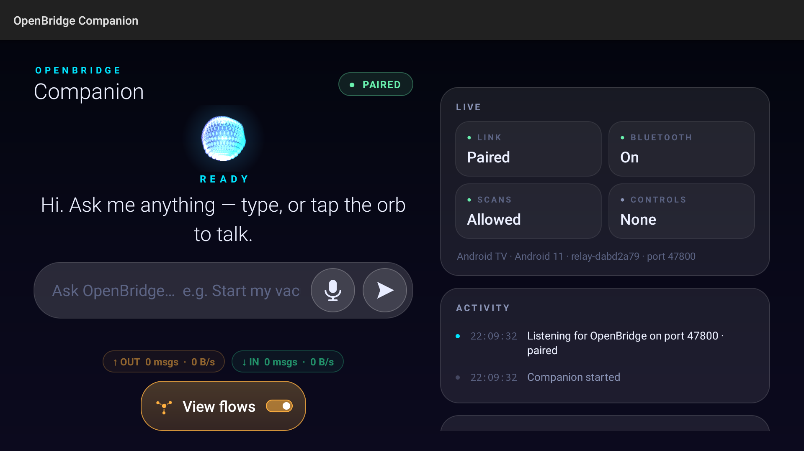
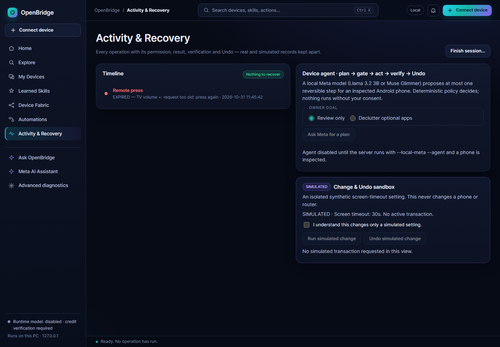

# OpenBridge
### One AI. Many devices. New possibilities.

**Turn disconnected hardware into an intelligent, permission-aware system — powered by Meta AI.**

[](LICENSE) [](https://github.com/toskaman/openbridge/actions/workflows/verify.yml)

Meta Global AI Developer Hackathon 2026 · Indie Developer · *Push the Frontier*

[Demo for judges](docs/jury/JURY_START_HERE.md) · [Showcase](docs/showcase/index.html) · [Quickstart](docs/QUICKSTART.md) · [Evidence](docs/RELEASE_EVIDENCE.md) · [Architecture](docs/UNIVERSAL_DEVICE_ARCHITECTURE.md)


*One live graph of a real home network (28 Oct 2026, names redacted): 24 devices — a Freebox router, mDNS/SSDP discovery, an Android phone over USB and an Android TV over ADB Wi-Fi as paired relays. This PC has no Bluetooth radio; BLE reach comes through the relays.*

## The 30-second explanation

Your devices were never designed to work together. OpenBridge fixes that: it discovers everything on your network, learns what each device can verifiably do, and lets Meta AI compose **new cross-device controls** — a TV panel that operates your robot vacuum, a watch button that quiets the living room.

Meta models do the understanding. Deterministic safety gates do the enforcing: every AI proposal passes strict validation, owner approval, and independent read-back before anything happens. Every run ends with a receipt.

Nothing here is a mock-up: [35 verified evidence rows](docs/DEVICE_EVIDENCE.json) back every claim below, with honest limits stated where runs fell short.

## See OpenBridge in action


*Eleven seconds, six real captures, zero mock-ups. Rebuilt from committed evidence stills (`python dev/rebuild_tour_gif.py`).*

**"Create a control panel on my TV so I can operate my robot vacuum."** Local Muse Glimmer proposes the panel. OpenBridge validates every control against authorized capabilities, installs it on the real Android TV, and dispatches the press to the vacuum over the approved Tuya interface — then revokes it, with denial verified.


*Ask in English or French → fingerprint-bound preview → approve → receipt. Local tiers verified live.*


*Meta-generated T2 panel mid-run on the real TV (31 Oct 2026): hold-press FIND dispatched, receipt tx-4a96f8f6, 15-poll oracle stable, revoke + deny verified after. Press ADB-injected (labeled on the record).*



*The real Android TV Companion, PAIRED (30 Oct 2026): orb, LIVE tiles, activity feed.*

Honest limits, stated upfront: panel installation, button dispatch, receipts, and revocation are verified on real hardware ([S5 proof](docs/evidence/s5-tv-panel-31oct.md), [S5b proof](docs/evidence/s5b-safe-seek-31oct.md)); the vacuum was already docked/cleaning so motion was not observed, and presses were ADB-injected, not manual taps. Owner-gated manual-press + motion runs are scripted in the [physical runbook](docs/jury/DEMO_PHYSICAL_RUNBOOK.md). Early [demo preview](https://github.com/toskaman/openbridge/releases/tag/v0.1.0-alpha.2) (26 Oct state); final video pending owner authorization per the [storyboard](docs/jury/DEMO_STORYBOARD_FINAL.md).

## What can you actually do?

1. **Ask in plain language.** *Scan for bluetooth devices* → preview exactly what will change → approve → read the receipt. French accepted too.
2. **Reach devices your PC can't see.** Bluetooth via phone/TV relays (with a proven [TV-to-phone handover](docs/release/COMPLETE_HANDOVER.md)), Freebox LAN inventory (127 known / 12 active hosts), a second PC, a Tuya vacuum — merged into one graph on strong identifiers only.
3. **Control from any screen.** Phone, Android TV, and Galaxy Watch7 Companions are paired and operational on real hardware; a second Windows PC runs owner jobs. ESP32 runs natively under QEMU (physical deployment pending); more ports are planned, not claimed.
4. **Revoke anything.** One tap revokes standing consent; every refused press lands in the Activity timeline with a server-composed reason. Journaled setting changes get per-change RESTORED / FAILED / MANUAL verdicts; physical acts are labeled non-undoable *before* you approve.

## How it works

```
USER INTENT → META AI REASONING → CAPABILITY DISCOVERY → DETERMINISTIC SAFETY GATE
→ OWNER APPROVAL → CROSS-DEVICE EXECUTION → INDEPENDENT VERIFICATION
→ RECEIPT / REVOCATION / ELIGIBLE UNDO
```

Local-first: Llama 3.2 3B (CPU) triages, Muse Glimmer 30B (GPU/CPU) plans and explains — both digest-pinned, no cloud fallback. Hosted Muse Spark 1.3 answers only synthetic facts, only with explicit consent, inside a hard budget. The runtime is Meta-models-only, enforced by [src/ai/registry.py](src/ai/registry.py). Full design: [architecture](docs/UNIVERSAL_DEVICE_ARCHITECTURE.md).

## Tested hardware

| Surface | Status |
|---|---|
| Android phone, Android TV, Galaxy Watch7 Companions | REAL HARDWARE — installed, paired, controls rendered, commands dispatched |
| Freebox Delta router, Tuya robot vacuum, 2nd Windows PC | REAL HARDWARE — reads + consented commands with read-back |
| 7 Linux/legacy-Windows guests (QEMU) | FULL GUEST OS — agent protocol proven, labeled as VMs |
| Pixel 6 AVD, ESP32 (native IDF agent) | OFFICIAL EMULATOR — proven, never counted as physical |

[Hardware matrix](docs/HARDWARE_TEST_MATRIX.md) · [evidence registry](docs/DEVICE_EVIDENCE.json) (35 VERIFIED rows) · [claim ↔ evidence](docs/jury/CLAIM_EVIDENCE_MATRIX.md) · [known limitations](docs/KNOWN_LIMITATIONS.md)

## Meta AI — why it matters

Without Meta inference, OpenBridge would be static plumbing: discovery would
still list devices, but nothing would understand a plain-language request,
compose a new control panel, propose a multi-step plan, or explain a device
in usable words. The intelligence is Meta's; the proof is deterministic.
Every Meta call below is receipted with model id, digest, tokens, and cost —
favorable and unfavorable results both published:

- **Understanding requests:** tiered Meta-only routing (Llama → Glimmer → Spark only with consent) resolves English/French requests to registered skills. No fixed command grammar.
- **Composing new controls:** Glimmer generated the real TV vacuum panel (4/4 buttons bound, OCR-verified render) and validated Forge capabilities; Llama planned the quiet-mode pair (TV vol 22→21 + vacuum dock).
- **Explanations:** coverage advisor 56/60 usable for Glimmer vs 0/60 for Llama 3B (60 synthetic cases).
- **Planning:** narrow agent benchmark — rules 90.0%, Glimmer 86.7%, Llama 53.3%; all unsafe proposals refused. Registered ablation: no model arm beat the rules (rules/Llama 0.833, Glimmer 0.722).
- **Honest failures kept:** Forge Llama arm 0.0%, Forge Glimmer arm resource-blocked (0/64, nulls not zero-filled), 1,000-turn rules baseline 1.4% with model tiers pending.

Methodology, receipts, and token/latency records: [benchmark status](docs/benchmark/STATUS.md) · [model usage](docs/MODEL_USAGE_AND_EVALUATION.md) · [TV Glimmer journey](docs/forge/TV_GLIMMER_JOURNEY.md).

## Security and trust

Owner consent per privileged act · typed skills, never free-form shell · strict validation before dispatch · idempotency keys + crash-safe journal (honest UNCERTAIN, never blind re-execution) · independent read-back oracles · signed, expiring, replay-protected relay commands · pairing attempt limits · revocation that stops new admissions.

Caveats, not footnotes: BridgeWindows v4 frames are authenticated but plaintext (trusted LAN only; sealed v5 is design-only); pairing codes fall to offline brute force if a transcript is captured (USB enrollment recommended); BLE scans are foreground-only by design; the Android `e2e` CI job is failing while unit/browser/clean-room suites are green.



*Every refused press lands in the Activity timeline with a server-composed reason — shown, not hidden. (Seeded-UI shot from a demo server; payload is a real `process()` refusal.)*

## Try OpenBridge

Windows, Linux, or macOS · Python 3.14 · zero third-party runtime packages.

```sh
git clone https://github.com/toskaman/openbridge.git
cd openbridge
python -m unittest discover -s tests   # 1245 controlled tests, no hardware needed
python -m src.cli judge demo           # offline demo, verdict DEMO_COMPLETE
python -m src.server                   # loopback server → http://127.0.0.1:18765
```

Local Meta models: `python -m dev.start_local_meta --pull-model` (Llama 3.2 3B) and `python -m dev.start_glimmer --pull-model` (Glimmer 30B, ~18 GB). Companions, headless/SSH use, and hardware needs: [QUICKSTART](docs/QUICKSTART.md) · [CLI reference](docs/CLI_REFERENCE.md).

## Proof, tests, reproducibility

1245 tests green (Windows/Ubuntu/macOS + browser incl. WebKit) · clean-room install 8/8 on 7 hosted targets + Debian container · [CI runs](https://github.com/toskaman/openbridge/actions) · [release evidence](docs/RELEASE_EVIDENCE.md) · [release status](docs/RELEASE_STATUS.md) · [full docs](docs/README.md). Anything unverified is labeled as such — simulated results are never counted as physical proof.

## Built for the hackathon

**Push the Frontier:** Meta models inspect unfamiliar physical devices, identify verified interfaces, synthesize missing authorized capabilities, and coordinate heterogeneous hardware — beyond generic chatbots. **Build for Your World:** useful devices that couldn't cooperate now can, through safe operations across existing hardware.

Built from the ground up during the event (start ref 2026-10-26T16:24:00Z; zero files predate it; an earlier private prototype was rewritten from scratch as Bridge Agent v4 — see [CONTRIBUTIONS](CONTRIBUTIONS.md)). Track: Indie Developer, solo. Scoring/bonus details marked T-P ONLY or OPEN in the [compliance checklist](docs/jury/COMPLIANCE_CHECKLIST.md) must be verified in the portal; no award is claimed. Per-award fit, each tied to its evidence: [bonus strategy](docs/jury/BONUS_STRATEGY.md).

## About the developer

I'm an autistic independent developer, passionate about hardware, AI, and interoperability since childhood. I like finding out how systems work — and making them work together. OpenBridge is that curiosity, built into a product.

## License and contributions

MIT ([LICENSE](LICENSE)) · Llama 3.2 Community License for local Llama use · [third-party notices](THIRD_PARTY.md). Build-time assistance (Codex, Claude theme, Spark/Wonder design receipts) is disclosed in [CONTRIBUTIONS](CONTRIBUTIONS.md); runtime inference is Meta-only. Earlier README versions: [history](docs/README_HISTORY.md).
