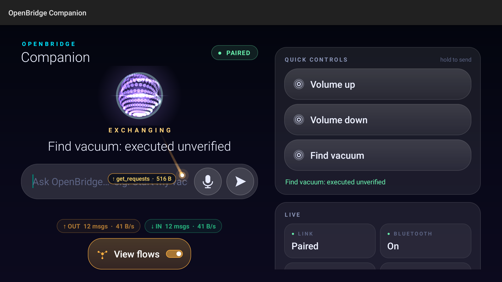
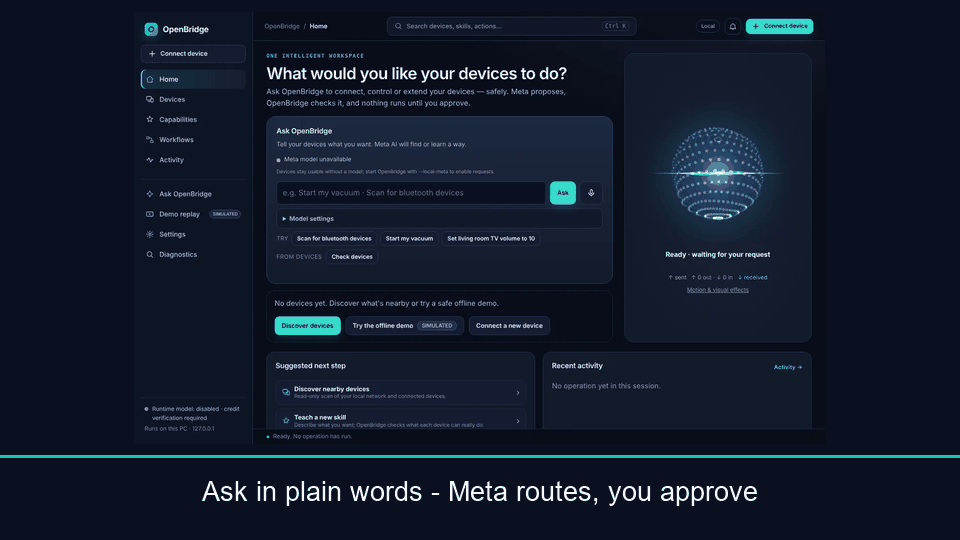
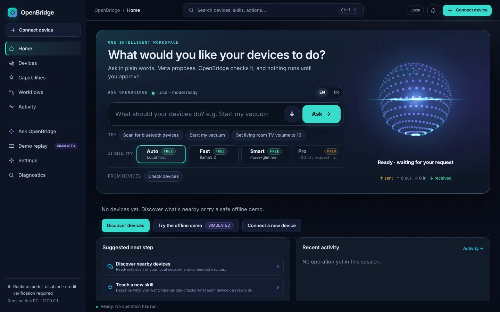
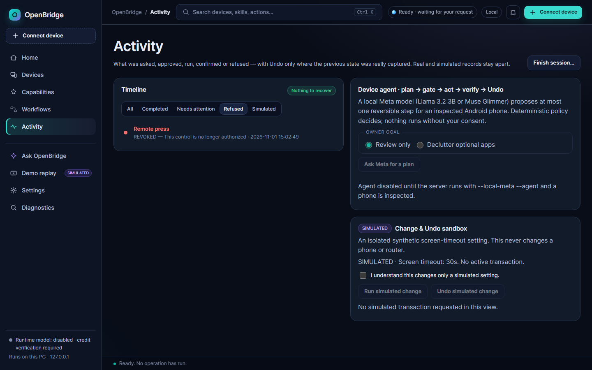

# OpenBridge
### One AI. Many devices. New possibilities.

**Turn disconnected hardware into an intelligent, permission-aware system — powered by Meta AI.**

**Don't just connect your devices. Give them new capabilities.**

[](LICENSE) [](https://github.com/toskaman/openbridge/actions/workflows/verify.yml)

Meta Global AI Developer Hackathon 2026 · Indie Developer · *Push the Frontier*

[Demo for judges](docs/jury/JURY_START_HERE.md) · [Showcase](docs/showcase/index.html) · [Quickstart](docs/QUICKSTART.md) · [Evidence](docs/RELEASE_EVIDENCE.md) · [Architecture](docs/UNIVERSAL_DEVICE_ARCHITECTURE.md)



*Meta AI generated this TV control panel on demand; OpenBridge validated it, installed it on the real Android TV, and dispatched the hold-press to the robot vacuum over the approved Tuya interface — then revoked it, with denial verified (31 Oct 2026). Press ADB-injected (labeled on the record); vacuum motion not observed. Full scope below.*

## What it is

Your devices were never designed to work together. OpenBridge fixes that: it discovers everything on your network, learns what each device can verifiably do, and lets Meta AI interpret those capabilities and compose **new authorized cross-device controls** — a TV panel that operates your robot vacuum, a watch button that quiets the living room.

Meta models do the understanding. Deterministic safety gates do the enforcing: every AI proposal passes strict validation, owner approval, and independent read-back before anything happens. Every run ends with a receipt.

The showcased hardware evidence is genuine: [37 verified evidence records](docs/DEVICE_EVIDENCE.json) (28 real hardware, 7 full-guest VMs, 2 official emulators — records, not 37 unique physical capabilities), with honest limits stated where runs fell short. Automated demonstrations that use fixtures or replayed receipts are labeled SIMULATED or REPLAY where they appear, and never counted as physical proof.

## Why it's new

- **AI composes what was never built.** The TV vacuum panel below was generated on demand from verified capabilities — not picked from prebuilt integrations. Meta *creates* the control surface; deterministic gates decide what may run.
- **Verified before used.** Every device link in the showcased runs is proven (read-back, screenshot, second observer) before any command flows through it. Simulated results are labeled SIMULATED and never counted as physical proof.
- **Permission-aware by construction.** Owner consent per privileged act, fingerprint-bound previews, revocation that stops new admissions, and refusals shown in the timeline — not hidden.

Design details: [architecture](docs/UNIVERSAL_DEVICE_ARCHITECTURE.md) · [verified capabilities](docs/jury/VERIFIED_CAPABILITIES.md) · [claim ↔ evidence matrix](docs/jury/CLAIM_EVIDENCE_MATRIX.md).

## What Meta AI does

Without Meta inference, OpenBridge would be static plumbing: discovery would still list devices, but nothing would understand a plain-language request, compose a new control panel, propose a multi-step plan, or explain a device in usable words. The intelligence is Meta's; the proof is deterministic.

- **Understanding requests:** tiered Meta-only routing (Llama → Glimmer → Spark only with consent) resolves English/French requests to registered skills. No fixed command grammar.
- **Composing new controls:** Glimmer generated the real TV vacuum panel (4/4 buttons bound, OCR-verified render); Llama planned the quiet-mode pair (TV vol 22→21 + vacuum dock).
- **Explanations:** coverage advisor 56/60 usable for Glimmer vs 0/60 for Llama 3B (60 synthetic cases).
- **Planning:** narrow agent benchmark — rules 90.0%, Glimmer 86.7%, Llama 53.3%; all unsafe proposals refused by the gate.
- **Honest failures kept:** registered ablation — no model beat the rules (0.833 / 0.833 / 0.722); Forge Llama 0.0%, Forge Glimmer resource-blocked (0/64, nulls not zero-filled); 1,000-turn rules baseline 1.4%, model tiers pending.
- **Held-out model study (ModelStudy48):** rules intent 36.1% vs Llama 3B 22.2% — neither arm wins overall. Llama is the only arm that resolves novel intents, but it never refuses (6 consent-gated wrong-but-executable substitutions) and never clarifies; Glimmer blocked by host OOM. Full scorecard: [ModelStudy48](docs/benchmark/modelstudy48/RESULTS.md). S8 gate calibration-extension (24 new frozen cases × 2 repeats = 48 replies): unsafe 4→0, zero fully-correct proposals blocked ([results3](docs/benchmark/intenteffect/RESULTS3.md)); eval2 regression reproduces 2→0.
- **Model references:** [third-party inventory](THIRD_PARTY.md) — Llama 3.2 license/attribution, Glimmer docs ([dev.meta.ai](https://dev.meta.ai/docs/muse-glimmer)) and upstream weights, pinned registry digests.

Every Meta call is receipted with model id, digest, tokens, and cost — favorable and unfavorable results both published. Local models are digest-pinned with no cloud fallback; hosted Spark answers only synthetic facts, only with explicit consent, inside a hard budget. The runtime is Meta-models-only, enforced by [src/ai/registry.py](src/ai/registry.py). Methodology and receipts: [benchmark status](docs/benchmark/STATUS.md) · [model usage](docs/MODEL_USAGE_AND_EVALUATION.md) · [TV Glimmer journey](docs/forge/TV_GLIMMER_JOURNEY.md).

## What works today

| You can… | Status |
|---|---|
| Ask in plain language (EN/FR) → preview → approve → receipt | Live; Bluetooth scans need a paired relay first |
| Reach devices your PC can't see (BLE relays, Freebox inventory, 2nd PC, Tuya vacuum) | Live; proven TV-to-phone handover ([proof](docs/release/COMPLETE_HANDOVER.md)) |
| Control from paired screens (phone, TV, Watch7 Companions) | Live on real hardware; ESP32 native under QEMU, physical run pending |
| Revoke anything; refusals shown; eligible Undo with per-change verdicts | Live; physical acts labeled non-undoable *before* approval |

| Tested hardware | Result |
|---|---|
| Android phone, Android TV, Galaxy Watch7 Companions | REAL HARDWARE — installed, paired, controls rendered, commands dispatched |
| Freebox Delta router, Tuya robot vacuum, 2nd Windows PC | REAL HARDWARE — reads + consented commands with read-back |
| 7 Linux/legacy-Windows guests (QEMU) | FULL GUEST OS — agent protocol proven, labeled as VMs |
| Pixel 6 AVD, ESP32 (native IDF agent) | OFFICIAL EMULATOR — proven, never counted as physical |

[Hardware matrix](docs/HARDWARE_TEST_MATRIX.md) · [evidence registry](docs/DEVICE_EVIDENCE.json) (37 VERIFIED records, incl. the 28 Oct live-graph run: 24 devices, names redacted) · [known limitations](docs/KNOWN_LIMITATIONS.md)

## New capabilities (Frontier 90)

Implemented, wired (CLI + HTTP API), and covered by unit/integration tests — hardware validation pending for each:

| Capability | What it does | Status |
|---|---|---|
| Capability transplantation | Give a device a control it never had: discover → propose → validate → consent → publish → verify → revoke | Software-tested |
| Control migration | Move a live control between screens (watch ↔ TV) with permission snapshots and idempotent rollback | Software-tested |
| Workflow composer | Bounded 1–8 step cross-device workflows with per-step outcomes; failures never reported as success | Software-tested |
| Adaptive routing | Multi-route enumeration with loss simulation; at-most-once failover, never blind re-execution | Software-tested |
| Device diagnostics | Grounded why-answers from observed facts only; prompt-injection quarantine | Software-tested |
| Voice normalization | FR/EN intent normalization over a 55-case corpus incl. verbatim Watch7 transcripts; uncertain speech stays in clarification | Software-tested |
| Structured AI results | Discriminated Proposal / Clarification / Refusal envelopes with anti-smuggling guards | Software-tested |
| Portable dashboards | Sealed dashboard bundles: export → integrity-check → remap → fresh consent; no inherited grants | Software-tested |

Details: [Frontier 90 report](docs/jury/FRONTIER90_REPORT_2026-11-01.md) · [composer guide](docs/COMPOSER.md).

## The extraordinary example: a TV panel for the vacuum, composed by Meta AI

**"Create a control panel on my TV so I can operate my robot vacuum."**



*Eleven seconds, six real captures. Rebuilt from committed stills (`python dev/rebuild_tour_gif.py`). Scripted replays elsewhere in the docs are labeled REPLAY/SIMULATED.*



*Ask in English or French → fingerprint-bound preview → approve → receipt. Local tiers verified live.*

Local Muse Glimmer proposes the panel. OpenBridge validates every control against authorized capabilities, installs it on the real Android TV, and dispatches the hold-press to the vacuum over the approved Tuya interface — then revokes it, with denial verified.


*Meta-generated T2 panel mid-run on the real TV (31 Oct 2026): hold-press FIND dispatched, receipt tx-4a96f8f6, 15-poll oracle stable, revoke + deny verified after. Press ADB-injected (labeled on the record).*

Honest limits, stated upfront: panel installation, button dispatch, receipts, and revocation are verified on real hardware ([S5 proof](docs/evidence/s5-tv-panel-31oct.md), [S5b proof](docs/evidence/s5b-safe-seek-31oct.md)); owner-performed manual presses START (tx-8abdd1eb) + DOCK (tx-63ee07451c4099ce) were VERIFIED 1 Nov with oracle standby→goto_charge ([S5c proof](docs/evidence/s5-tv-panel-01nov-manual.md)) — return-to-dock behavior is oracle-proven, with no video of physical motion. TV sleep/wake + Companion reveal skills verified 2 Nov ([proof](docs/evidence/tv-sleep-02nov.md)); this TV drops Wi-Fi ADB in sleep, so wake needs the remote. Latest [releases](https://github.com/toskaman/openbridge/releases) (newest: v0.2.0 Final Frontier, 1 Nov, MIT tag); jury cut V2 (159 s incl. owner-recorded hardware footage) built by the committed builder ([build doc](docs/jury/VIDEO_BUILD_V2.md)); the finale is filmed by the owner per the [storyboard](docs/jury/DEMO_STORYBOARD_FINAL.md).

## Try it yourself

Windows, Linux, or macOS · Python 3.14 (CI-pinned 3.14.4) · zero third-party runtime packages.

```sh
git clone https://github.com/toskaman/openbridge.git
cd openbridge
python -m unittest discover -s tests   # 2115 controlled tests, no hardware needed
python -m src.cli judge demo           # offline demo, verdict DEMO_COMPLETE
python -m src.server                   # loopback server → http://127.0.0.1:18765
```

Local Meta models: `python -m dev.start_local_meta --pull-model` (Llama 3.2 3B) and `python -m dev.start_glimmer --pull-model` (Glimmer 30B, ~18 GB). Companions, headless/SSH use, and hardware needs: [QUICKSTART](docs/QUICKSTART.md) · [CLI reference](docs/CLI_REFERENCE.md).

## Security and limitations — honest by design

Owner consent per privileged act · typed skills, never free-form shell · strict validation before dispatch · idempotency keys + crash-safe journal (honest UNCERTAIN, never blind re-execution) · independent read-back oracles · signed, expiring, replay-protected relay commands · pairing attempt limits · revocation that stops new admissions.

Caveats, not footnotes: BridgeWindows v4 frames are authenticated but plaintext (trusted LAN only; sealed v5 is design-only); pairing codes fall to offline brute force if a transcript is captured (USB enrollment recommended); BLE scans are foreground-only by design; Android emulator lab 5/5 green on main ([run 41325176026](https://github.com/toskaman/openbridge/actions/runs/41325176026), 1 Nov; first complete pass [run 41277954451](https://github.com/toskaman/openbridge/actions/runs/41277954451)).



*Every refused press lands in the Activity timeline with a server-composed reason — shown, not hidden. (Seeded-UI shot, 1 Nov 2026; payload is a real `process()` refusal: REVOKED, "This control is no longer authorized".)*

Full picture: [known limitations](docs/KNOWN_LIMITATIONS.md) · [relay security](docs/RELAY_SECURITY.md) · [claim matrix](docs/jury/CLAIM_EVIDENCE_MATRIX.md) (incl. "Never claimed").

## Evidence — don't take our word for it

2115 tests green locally (Windows) + browser incl. WebKit · verify green on main ([run 41356836103](https://github.com/toskaman/openbridge/actions/runs/41356836103), post-#177) · clean-room install green on main ([run 41325178319](https://github.com/toskaman/openbridge/actions/runs/41325178319)) · [CI runs](https://github.com/toskaman/openbridge/actions) · [release evidence](docs/RELEASE_EVIDENCE.md) · [release status](docs/RELEASE_STATUS.md) · [full docs](docs/README.md). Anything unverified is labeled as such — simulated results are never counted as physical proof.

## Built for the hackathon

**Push the Frontier:** Meta models inspect unfamiliar physical devices, identify verified interfaces, synthesize missing authorized capabilities, and coordinate heterogeneous hardware — beyond generic chatbots. **Build for Your World:** useful devices that couldn't cooperate now can, through safe operations across existing hardware.

Built from the ground up during the event (start ref 2026-10-26T16:24:00Z; zero files predate it; an earlier private prototype was rewritten from scratch as Bridge Agent v4 — see [CONTRIBUTIONS](CONTRIBUTIONS.md)). Track: Indie Developer, solo. Scoring/bonus details marked T-P ONLY or OPEN in the [compliance checklist](docs/jury/COMPLIANCE_CHECKLIST.md) must be verified in the portal; no award is claimed. Per-award fit, each tied to its evidence: [bonus strategy](docs/jury/BONUS_STRATEGY.md).

## About the developer

I'm an autistic independent developer, passionate about hardware, AI, and interoperability since childhood. I like finding out how systems work — and making them work together. OpenBridge is that curiosity, built into a product.

## License and contributions

**Source-available — [PolyForm Strict 1.0.0](LICENSE)** for this revision of OpenBridge. The repository is public for review, and noncommercial research and testing are permitted; redistribution, modification, and derivative works are not licensed by PolyForm Strict. [Hackathon jury evaluation permission](HACKATHON_EVALUATION_PERMISSION.md) additionally covers the permitted judging workflow. Earlier revisions released under MIT remain governed by their historical MIT grants; this relicensing does not revoke them. Third-party materials and model weights retain their separate licenses and terms: [notices](THIRD_PARTY.md) · [licensing transition](docs/LICENSING_HISTORY.md). Build-time assistance is disclosed in [CONTRIBUTIONS](CONTRIBUTIONS.md); runtime inference is Meta-only. Earlier README versions: [history](docs/README_HISTORY.md).
