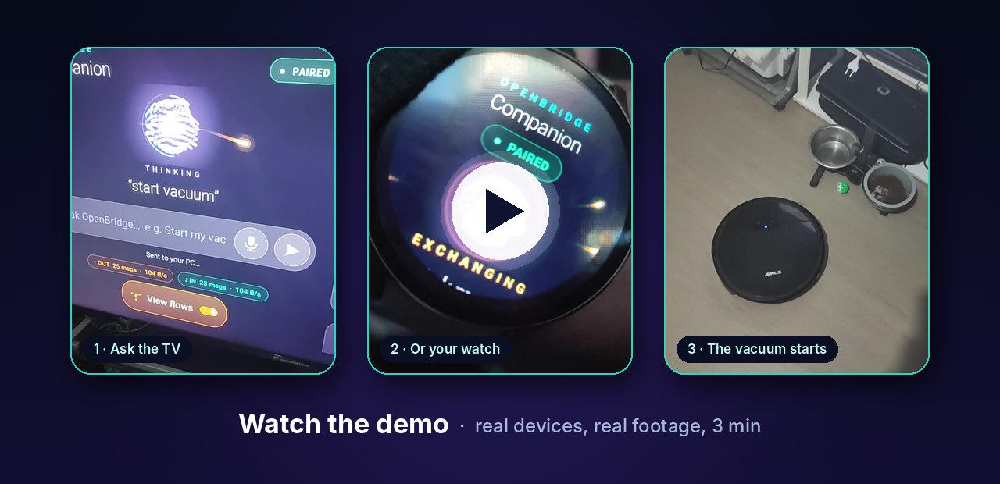
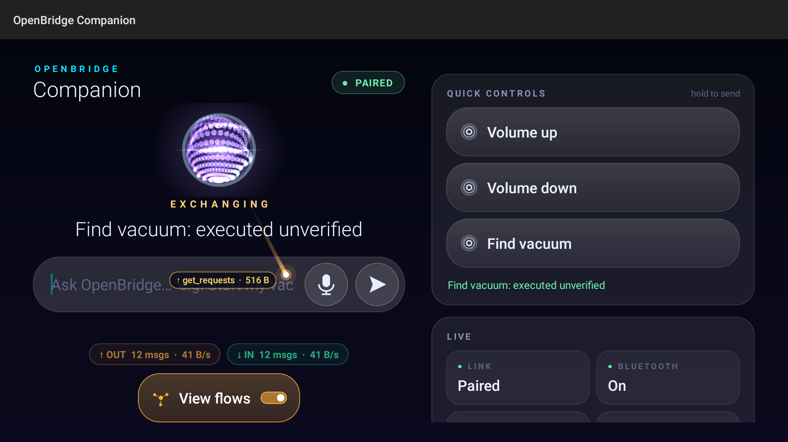
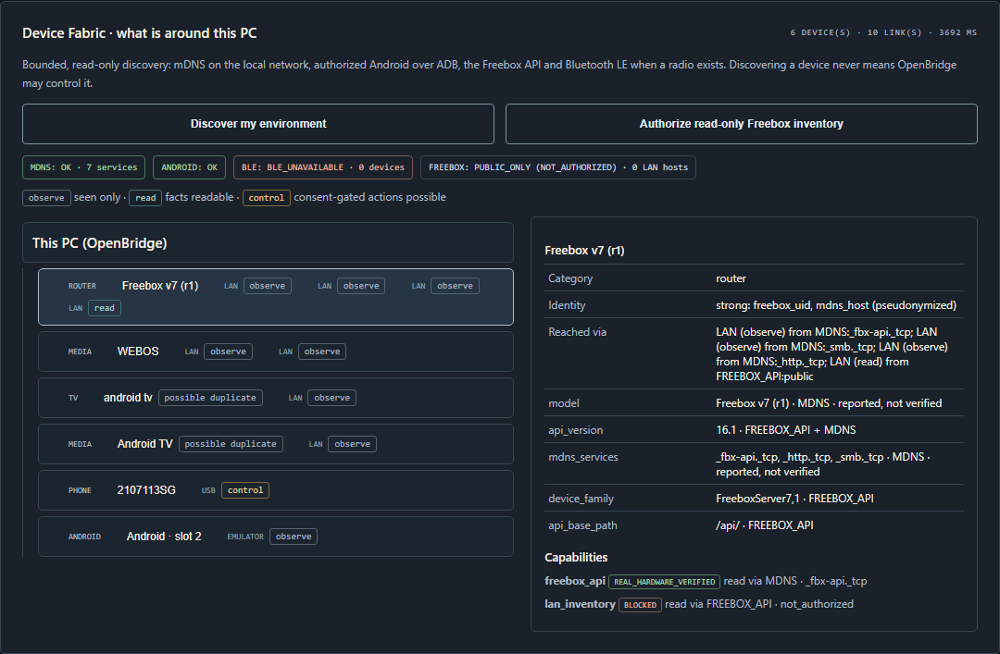

<p align="center">
  
</p>

<p align="center">
  <a href="https://youtu.be/TZaxCcRmrLQ"></a>
  <a href="mailto:toskaman5962@gmail.com?subject=OpenBridge%3A%20Hardware%20partnership"></a>
  <a href="#-try-it-in-2-minutes"></a>
</p>

<p align="center">
  <a href="https://github.com/toskaman/openbridge/actions/workflows/verify.yml"></a>
  
  
  <a href="LICENSE"></a>
</p>

<h3 align="center">Say what you want. Your devices figure out how to do it together.</h3>

<p align="center">
OpenBridge connects the devices you already own (TV, smartwatch, phone, router, robot vacuum, PCs)<br>
and lets an AI <b>create brand-new controls</b> between them, on demand.<br>
Nothing runs without your approval. Every action is <b>checked on the real device</b> afterwards.
</p>

<p align="center">
  <sub><b>HARDWARE PARTNER</b></sub>
  <br><br>
  <a href="https://www.engoeyewear.com"><picture><source media="(prefers-color-scheme: dark)" srcset="docs/assets/partners/engo-white.png"></picture></a>
  &nbsp;&nbsp;&nbsp;&nbsp;&nbsp;&nbsp;
  <a href="https://www.activelook.net"><picture><source media="(prefers-color-scheme: dark)" srcset="docs/assets/partners/activelook-white.svg"></picture></a>
</p>

---

## 🎬 See it in action

> Real devices. Real living room. No mock-ups. Every clip below was filmed with a phone pointed at the actual hardware.

<table>
  <tr>
    <td align="center" width="33%">
      <br>
      <b>“Start the vacuum”, said to the TV</b><br>
      <sub>The TV gets vacuum buttons it never had. Press one, the robot starts.</sub>
    </td>
    <td align="center" width="33%">
      <br>
      <b>Your watch becomes a TV remote</b><br>
      <sub>Ask the watch out loud. Volume buttons appear on it, and they drive the TV.</sub>
    </td>
    <td align="center" width="33%">
      <br>
      <b>“Go home”, from the couch</b><br>
      <sub>One press on the TV remote sends the robot back to its dock.</sub>
    </td>
  </tr>
  <tr>
    <td align="center">
      <br>
      <b>Take it back, just as easily</b><br>
      <sub>“Remove the buttons”, and the control is withdrawn everywhere.</sub>
    </td>
    <td align="center">
      <br>
      <b>It knows when to say no</b><br>
      <sub>Device state not confirmed fresh? OpenBridge refuses and says why.</sub>
    </td>
    <td align="center">
      <br>
      <b>Alive on every screen</b><br>
      <sub>The same companion runs on phone, TV and Galaxy Watch7, paired and live.</sub>
    </td>
  </tr>
</table>

<p align="center">
  <a href="https://youtu.be/TZaxCcRmrLQ"></a>
</p>

---

## 💡 The idea, in 30 seconds

Every home and every company is full of devices that **could** help each other but **never will**, because each brand lives in its own app, its own cloud, its own remote.

**OpenBridge is the missing layer between them.** Think of it as a universal translator plus a careful assistant:

- 🔎 It **finds** what's around you and learns what each device can *actually* do.
- 🧠 You **ask in plain language** (English or French, typed or spoken) from any screen.
- ✨ The AI **invents the control you need**, even one no manufacturer ever shipped, like vacuum buttons on a TV.
- 🛡️ You **approve**, it acts, and then it **checks on the device itself** that it really worked.

<p align="center">
  
</p>

---

## 🚀 Why it's different

<table>
  <tr>
    <td width="50%" valign="top">
      <h4>✨ The AI creates, it doesn't just pick</h4>
      Most smart-home apps only offer integrations someone pre-built. OpenBridge <b>composes new controls</b> from what your devices can verifiably do, and puts them on whichever screen you choose: TV, watch, phone or PC.
    </td>
    <td width="50%" valign="top">
      <h4>✅ “Done” means done</h4>
      Sending a command is not proof. After every action, OpenBridge <b>reads the device back</b> to confirm the change really happened. If it can't confirm, it says <i>unverified</i>. Never a fake success.
    </td>
  </tr>
  <tr>
    <td valign="top">
      <h4>🛡️ You stay in control</h4>
      Nothing privileged runs without your OK. Every control can be <b>revoked instantly</b>, refusals are shown with a reason, and eligible actions can be <b>undone</b>. Commands between devices are signed, expiring and replay-protected.
    </td>
    <td valign="top">
      <h4>🔒 Private by default</h4>
      The AI runs <b>locally on your own machine</b>, for free. No paid model is built in: if you want another AI, <a href="docs/AI_PROVIDERS.md">connect your own AI or API</a> by hand (LM Studio, Ollama, llama.cpp, OpenRouter…), used only with your consent. Your home doesn't have to leave your home.
    </td>
  </tr>
  <tr>
    <td valign="top">
      <h4>🔌 Works with what you already own</h4>
      No new hub to buy. A PC with no Bluetooth can still reach Bluetooth devices <b>through your phone or TV</b>. Even Windows XP and Windows 7 machines can join.
    </td>
    <td valign="top">
      <h4>🧾 A receipt for everything</h4>
      Every run ends with a receipt: what was asked, what was approved, what was done, what was verified. Crash in the middle? It <b>never blindly re-runs</b> an action. It tells you exactly where it stopped.
    </td>
  </tr>
</table>

---

## 🧪 Proven on real hardware, not on slides

<p align="center">
  
</p>

| Device | What OpenBridge does with it | Proof level |
|---|---|---|
| 📺 **Android TV** | Companion installed, AI-made control panels, voice requests, volume control | 🟢 Real hardware |
| ⌚ **Samsung Galaxy Watch7** | Voice requests, controls created & removed on the fly, drives the TV | 🟢 Real hardware |
| 📱 **Android phones** (Xiaomi, Blackview) | Companion, pairing, Bluetooth relay, device actions | 🟢 Real hardware |
| 🤖 **Robot vacuum** (Tuya) | Start · pause · dock from the TV or the PC, with state read-back | 🟢 Real hardware |
| 🌐 **Freebox Delta** (ISP router) | Network inventory and device discovery, read-only by policy | 🟢 Real hardware |
| 🕶️ **ENGO smart glasses** (ActiveLook) | Live status, alerts and confirmations on a heads-up display | 🟡 Integration in progress |
| 💻 **Windows PCs** | Remote agent between PCs, consent-gated jobs | 🟢 Real hardware |
| 🕰️ **Windows XP · Windows 7 · Linux** | Lightweight agent proven on genuine guest operating systems | 🔵 Virtual machines |
| 🔧 **ESP32 · Pixel 6** | Native microcontroller agent · Android emulator | 🟣 Official emulators |

Every result is logged in a public [evidence registry](docs/DEVICE_EVIDENCE.json). Anything emulated or simulated is labelled as such and never counted as physical proof. Limits are written down too: [known limitations](docs/KNOWN_LIMITATIONS.md).

<details>
<summary><b>🖥️ More screenshots</b></summary>
<br>
<p align="center">
  <br>
  <sub>The OpenBridge companion on a real Android TV, with quick controls created on demand.</sub>
</p>
<p align="center">
  <br>
  <sub>Device Fabric: everything discovered around the PC, and exactly what each device is allowed to do (observe, read, or control with consent).</sub>
</p>
</details>

---

## 🔭 Already built, waiting for more hardware

These capabilities are **implemented and covered by automated tests**. What they need now is more real devices to be validated on:

| Capability | In one sentence |
|---|---|
| **Capability transplant** | Give a device a function it never had, then take it back cleanly. |
| **Control migration** | Move a live control from your watch to your TV (and back) without losing permissions. |
| **Workflow composer** | Chain up to 8 steps across devices. Each step is reported honestly, failures are never hidden. |
| **Adaptive routing** | If one path to a device dies, use another, without ever executing twice. |
| **Device diagnostics** | Ask *“why isn't this working?”* and get an answer based only on observed facts. |
| **Portable dashboards** | Export a set of controls, move it to another home and re-approve. No permissions are inherited. |

**Idea in development (concept only, not integrated):** [OpenBridge without a PC](docs/concepts/PC_LESS_OPENBRIDGE.md): devices use each other directly through a made-to-measure, self-updating client and an OpenBridge server over the internet.

**Next integrations on the roadmap:** [ENGO / ActiveLook HUD glasses](docs/partners/ENGO.md) (hardware on its way) · Matter · Thread · Zigbee · Home Assistant · ESPHome · OpenWrt · FRITZ!Box · more TVs, wearables, robots and EV / automotive interfaces.

---

## 🤝 Partners

### 🕶️ Our hardware partner

<p align="center">
  <a href="https://www.engoeyewear.com"></a>
</p>

**[ENGO](https://www.engoeyewear.com)** designs heads-up display smart glasses in Grenoble, France, built on **[ActiveLook](https://www.activelook.net)**, Microoled's ultra-light micro-OLED display platform. ENGO is sending OpenBridge a pair of glasses, and together we're bringing OpenBridge into your field of view:

- 👀 **Glanceable status:** see what your devices are doing without reaching for your phone.
- 🔔 **Alerts that find you:** a refused action, a device going offline, a long job finished.
- ✅ **Confirmations in sight:** “Done, verified” appears right where you're already looking.

<p align="center">
  <a href="https://www.engoeyewear.com"></a>
  <a href="docs/partners/ENGO.md"></a>
</p>

### 🚀 Become the next partner

**ENGO took the first step. Your devices could be next.**

OpenBridge gets better with every new kind of hardware it meets. If you build or sell connected devices (smart-home products, robot vacuums, TVs and set-top boxes, wearables, routers and ISP boxes, IoT / maker boards, automotive or industrial equipment), let's work together.

<table>
  <tr>
    <td width="50%" valign="top">
      <h4>What I'm asking for</h4>
      <ul>
        <li>📦 <b>Test hardware</b> (loan or sample units)</li>
        <li>📚 Access to <b>APIs, SDKs or developer documentation</b></li>
        <li>🧑‍💻 A technical contact for integration questions</li>
      </ul>
    </td>
    <td width="50%" valign="top">
      <h4>What you get</h4>
      <ul>
        <li>🔌 A <b>native OpenBridge integration</b> of your device</li>
        <li>🛠️ <b>Custom scripts</b> written specifically for your product</li>
        <li>✨ <b>New features</b> that make your device work with everything around it</li>
        <li>🧪 <b>Hundreds, even thousands, of tests and benchmarks</b>, run on the real hardware</li>
        <li>🐞 Code improvements and detailed <b>feedback on your API / SDK</b> from a real-world integrator</li>
        <li>🧾 A <b>public, verified compatibility report</b></li>
        <li>⭐ Your brand featured as a <b>hardware partner</b> on this page, like ENGO</li>
      </ul>
    </td>
  </tr>
</table>

<p align="center">
  <a href="mailto:toskaman5962@gmail.com?subject=OpenBridge%3A%20Hardware%20partnership"></a>
</p>
<p align="center"><sub>I reply in English and French. Commercial licensing and integration partnerships are available on request.</sub></p>

<details>
<summary><b>🇫🇷 En bref, en français</b></summary>
<br>

**OpenBridge** relie les appareils que vous possédez déjà (TV, montre, téléphone, box internet, robot aspirateur, PC) et laisse une IA **créer de nouvelles commandes entre eux**, à la demande : des boutons « aspirateur » sur la TV, une télécommande TV sur la montre… Rien ne s'exécute sans votre accord, et chaque action est **vérifiée sur l'appareil réel**. L'IA tourne **en local**, sur votre propre machine.

**ENGO** (Grenoble) a rejoint le projet comme **partenaire matériel** : ses lunettes à affichage tête haute, basées sur la plateforme ActiveLook de Microoled, vont afficher l'état de vos appareils directement dans votre champ de vision.

**Vous fabriquez ou distribuez des appareils connectés ?** Rejoignez ENGO. Je cherche des partenaires pour du **matériel de test** (prêt ou échantillons) et un accès à vos **API / SDK**. En échange : une **intégration native** dans OpenBridge, des **scripts dédiés**, de **nouvelles fonctionnalités**, des **centaines voire milliers de tests et benchmarks sur le matériel réel**, un **rapport de compatibilité public et vérifié**, et un retour technique détaillé sur votre API.

📩 **toskaman5962@gmail.com**
</details>

---

## ⚡ Try it in 2 minutes

Windows, Linux or macOS · Python 3.14 · **no third-party packages to install.**

```sh
git clone https://github.com/toskaman/openbridge.git
cd openbridge
python -m unittest discover -s tests   # 2,300+ tests, no hardware needed
python -m src.cli judge demo           # offline demo, no devices required
python -m src.server                   # open http://127.0.0.1:18765
```

Want the local AI models, the Android / TV / watch companion, or headless use over SSH? → **[Quickstart](docs/QUICKSTART.md)** · [Connect your own AI](docs/AI_PROVIDERS.md) · [CLI reference](docs/CLI_REFERENCE.md) · [Troubleshooting](docs/TROUBLESHOOTING.md)

---

## 📚 Go deeper

- 🏗️ **[Architecture](docs/UNIVERSAL_DEVICE_ARCHITECTURE.md)**<br><sub>How discovery, AI, safety gates and verification fit together</sub>
- 🧪 **[Hardware test matrix](docs/HARDWARE_TEST_MATRIX.md)**<br><sub>Every device tested, and how</sub>
- 🧾 **[Evidence registry](docs/DEVICE_EVIDENCE.json)** · [Release evidence](docs/RELEASE_EVIDENCE.md)<br><sub>The raw proof behind every claim</sub>
- 🔐 **[Relay security](docs/RELAY_SECURITY.md)** · [Transactions & undo](docs/TRANSACTION_AND_UNDO.md)<br><sub>Pairing, signing, consent, rollback</sub>
- ⚠️ **[Known limitations](docs/KNOWN_LIMITATIONS.md)**<br><sub>What doesn't work yet, stated upfront</sub>
- 📖 **[All documentation](docs/README.md)**<br><sub>Everything else</sub>

---

## 👋 About me

I'm an autistic independent developer, passionate about hardware, AI and interoperability since childhood. I love finding out how systems work, and making them work together. **OpenBridge is that curiosity, built into a product**, and built solo.

If your devices should talk to each other, [let's talk](mailto:toskaman5962@gmail.com?subject=OpenBridge).

---

<sub>**License:** source-available under [PolyForm Strict 1.0.0](LICENSE): free to read, run and test for noncommercial purposes; redistribution and derivative works are not licensed. For commercial use or partnerships, [get in touch](mailto:toskaman5962@gmail.com?subject=OpenBridge%3A%20Commercial%20licensing). Third-party components and AI model weights keep their own licenses: [credits & notices](THIRD_PARTY.md) · [licensing details](docs/LICENSING.md) · [contributions](CONTRIBUTIONS.md) · [previous README versions](docs/README_HISTORY.md).</sub>
