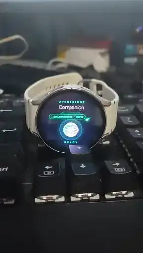
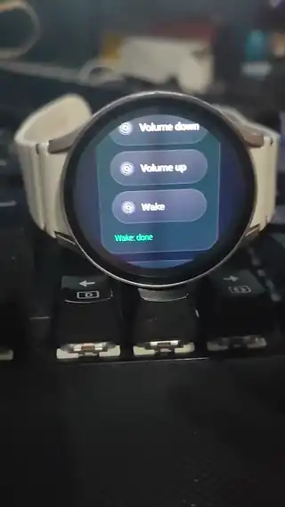
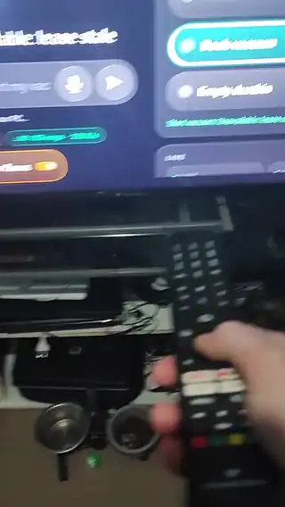
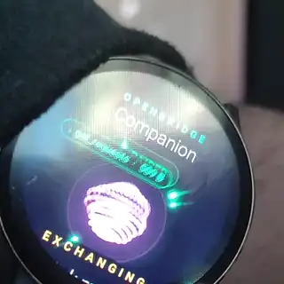
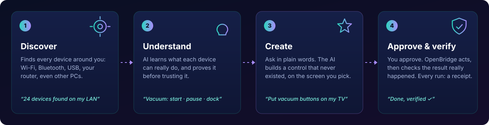
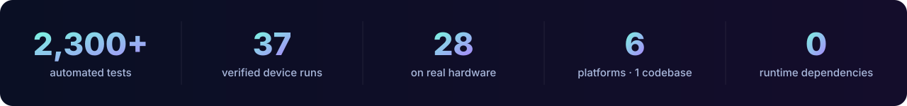

<p align="center">
  
</p>

<p align="center">
  
  <br><sub><i>What OpenBridge is built for. Some scenes are concept previews (VR control room, fridge, coffee machine, file drop to a Linux PC); what is verified today on real hardware is listed in <a href="#-proven-on-real-hardware-not-on-slides">Proven on real hardware</a>.</i></sub>
</p>

<p align="center">
  <a href="docs/partners/README.md"></a>
  <a href="#-try-it-in-2-minutes"></a>
  <a href="https://toskaman.github.io/openbridge/try.html"></a>
  <a href="https://toskaman.github.io/openbridge/"></a>
</p>

<p align="center">
  <a href="https://github.com/toskaman/openbridge/actions/workflows/verify.yml"></a>
  <a href="https://github.com/toskaman/openbridge/actions/workflows/codeql.yml"></a>
</p>

<h1 align="center">Give your hardware powers it never shipped with.</h1>

<h3 align="center">Break the walls between your devices. Say what you want, and they work it out together.</h3>

<p align="center">
Your TV, your watch, your phone, your router, your robot vacuum, your PC: each one is locked inside its own app, its own remote, its own brand.<br>
<b>OpenBridge breaks those walls.</b> Ask out loud, and an AI builds <b>brand-new controls across them</b>, on demand:<br>
vacuum buttons on your TV, a TV remote on your watch, a “go home” button for the robot, right from the couch.
</p>

<table align="center">
  <tr>
    <td align="center" width="33%">🔓<br><b>Break the walls</b><br><sub>Any brand, any screen. TVs, wearables, phones, routers, robots and PCs finally speak one language.</sub></td>
    <td align="center" width="33%">✨<br><b>Unlock new features</b><br><sub>Controls, alerts and voice flows your devices were never sold with, created the moment you ask.</sub></td>
    <td align="center" width="33%">🛡️<br><b>Stay in control</b><br><sub>Nothing runs without your approval. Every action is checked on the real device afterwards. Local-first AI.</sub></td>
  </tr>
</table>

<p align="center">
<b>You build connected devices?</b> Give your customers features you never had to write: interoperability with every other brand,<br>
complete test suites and benchmarks on your real hardware, and an emulator of your product. <a href="#-become-the-next-partner"><b>See what partners gain →</b></a>
</p>

<p align="center"><sub>🇫🇷 <a href="#fr">Lire en français</a></sub></p>

<p align="center"><sub><i>“OpenBridge” is a working name, not the final one: the project will be renamed later.</i></sub></p>

<p align="center">
  <sub><b>HARDWARE PARTNER</b></sub>
  <br><br>
  <a href="https://www.engoeyewear.com"><picture><source media="(prefers-color-scheme: dark)" srcset="docs/assets/partners/engo-white.png"></picture></a>
  &nbsp;&nbsp;&nbsp;&nbsp;&nbsp;&nbsp;
  <a href="https://www.activelook.net"><picture><source media="(prefers-color-scheme: dark)" srcset="docs/assets/partners/activelook-white.svg"></picture></a>
</p>

<p align="center">
  <sub><b>HARDWARE SPONSOR</b></sub>
  <br><br>
  <a href="https://heltec.cn/"></a>&nbsp;<a href="https://heltec.cn/"><b>Heltec Automation</b></a>
</p>

---

## 🎬 See it in action

> **An older demonstration** (filmed late October and early November 2026, before the Home Assistant bridge, OpenBridge's own AI model and
> everything added since). Real devices, real living room, no mock-ups: every clip below was filmed with a phone
> pointed at the actual hardware.

<table>
  <tr>
    <td align="center" width="33%">
      <br>
      <b>“Start the vacuum”, said to the TV</b><br>
      <sub>The TV gets vacuum buttons it never had. Press one, the robot starts.</sub>
    </td>
    <td align="center" width="33%">
      <br>
      <b>Your watch becomes a TV remote</b><br>
      <sub>Ask the watch out loud. Volume buttons appear on it, and they drive the TV.</sub>
    </td>
    <td align="center" width="33%">
      <br>
      <b>“Go home”, from the couch</b><br>
      <sub>One press on the TV remote sends the robot back to its dock.</sub>
    </td>
  </tr>
  <tr>
    <td align="center">
      <br>
      <b>Take it back, just as easily</b><br>
      <sub>“Remove the buttons”, and the control is withdrawn everywhere.</sub>
    </td>
    <td align="center">
      <br>
      <b>It knows when to say no</b><br>
      <sub>Device state not confirmed fresh? OpenBridge refuses and says why.</sub>
    </td>
    <td align="center">
      <br>
      <b>Alive on every screen</b><br>
      <sub>The same companion runs on phone, TV and Galaxy Watch7, paired and live.</sub>
    </td>
  </tr>
</table>

<p align="center">
  <a href="https://youtu.be/TZaxCcRmrLQ"></a>
  <br><sub><i>Older demonstration (November 2026).</i></sub>
</p>

---

## 💡 The idea, in 30 seconds

Every home and every company is full of devices that **could** help each other but **never will**, because each brand lives in its own app, its own cloud, its own remote.

**OpenBridge is the missing layer between them.** Think of it as a universal translator plus a careful assistant:

- 🔎 It **finds** what's around you and learns what each device can *actually* do.
- 🧠 You **ask in plain language** (English or French, typed or spoken) from any screen.
- ✨ The AI **invents the control you need**, even one no manufacturer ever shipped, like vacuum buttons on a TV.
- 🛡️ You **approve**, it acts, and then it **checks on the device itself** that it really worked.

<p align="center">
  
</p>

---

## 🚀 Why it's different

<table>
  <tr>
    <td width="50%" valign="top">
      <h4>✨ The AI creates, it doesn't just pick</h4>
      Most smart-home apps only offer integrations someone pre-built. OpenBridge <b>composes new controls</b> from what your devices can verifiably do, and puts them on whichever screen you choose: TV, watch, phone or PC.
    </td>
    <td width="50%" valign="top">
      <h4>✅ “Done” means done</h4>
      Sending a command is not proof. After every action, OpenBridge <b>reads the device back</b> to confirm the change really happened. If it can't confirm, it says <i>unverified</i>. Never a fake success.
    </td>
  </tr>
  <tr>
    <td valign="top">
      <h4>🛡️ You stay in control</h4>
      Nothing privileged runs without your OK. Every control can be <b>revoked instantly</b>, refusals are shown with a reason, and eligible actions can be <b>undone</b>. Commands between devices are signed, expiring and replay-protected.
    </td>
    <td valign="top">
      <h4>🔒 Private by default</h4>
      The AI runs <b>locally on your own machine</b>, for free. No paid model is built in: if you want another AI, <a href="docs/AI_PROVIDERS.md">connect your own AI or API</a> by hand (LM Studio, Ollama, llama.cpp, OpenRouter…), used only with your consent. Your home doesn't have to leave your home.
    </td>
  </tr>
  <tr>
    <td valign="top">
      <h4>🔌 Works with what you already own</h4>
      No new hub to buy. A PC with no Bluetooth can still reach Bluetooth devices <b>through your phone or TV</b>. Even Windows XP and Windows 7 machines can join.
    </td>
    <td valign="top">
      <h4>🧾 A receipt for everything</h4>
      Every run ends with a receipt: what was asked, what was approved, what was done, what was verified. Crash in the middle? It <b>never blindly re-runs</b> an action. It tells you exactly where it stopped.
    </td>
  </tr>
</table>

---

## 🧪 Proven on real hardware, not on slides

<p align="center">
  
</p>

| Device | What OpenBridge does with it | Proof level |
|---|---|---|
| 📺 **Android TV** | Companion installed, AI-made control panels, voice requests, volume control | 🟢 Real hardware |
| ⌚ **Samsung Galaxy Watch7** | Voice requests, controls created & removed on the fly, drives the TV | 🟢 Real hardware |
| 📱 **Android phones** (Xiaomi, Blackview) | Companion, pairing, Bluetooth relay, device actions | 🟢 Real hardware |
| 🤖 **Robot vacuum** (Tuya) | Start · pause · dock from the TV or the PC, with state read-back | 🟢 Real hardware |
| 🌐 **Freebox Delta** (ISP router) | Network inventory and device discovery, read-only by policy | 🟢 Real hardware |
| 🕶️ **ENGO smart glasses** (ActiveLook) | 38 HUD features, pro emulator, official app bridge; glasses on their way | 🟡 Emulator-validated |
| 💻 **Windows PCs** | Remote agent between PCs, consent-gated jobs | 🟢 Real hardware |
| 🕰️ **Windows XP · Windows 7 · Linux** | Lightweight agent proven on genuine guest operating systems | 🔵 Virtual machines |
| 🔧 **ESP32 · Pixel 6** | Native microcontroller agent · Android emulator | 🟣 Official emulators |

Every result is logged in a public [evidence registry](docs/DEVICE_EVIDENCE.json). Anything emulated or simulated is labelled as such and never counted as physical proof. Limits are written down too: [known limitations](docs/KNOWN_LIMITATIONS.md).

<details>
<summary><b>🖥️ More screenshots</b></summary>
<br>
<p align="center">
  <br>
  <sub>The OpenBridge companion on a real Android TV, with quick controls created on demand.</sub>
</p>
<p align="center">
  <br>
  <sub>Device Fabric: everything discovered around the PC, and exactly what each device is allowed to do (observe, read, or control with consent).</sub>
</p>
</details>

---

## 🔭 Already built, waiting for more hardware

These capabilities are **implemented and covered by automated tests**. What they need now is more real devices to be validated on:

| Capability | In one sentence |
|---|---|
| **Capability transplant** | Give a device a function it never had, then take it back cleanly. |
| **Control migration** | Move a live control from your watch to your TV (and back) without losing permissions. |
| **Workflow composer** | Chain up to 8 steps across devices. Each step is reported honestly, failures are never hidden. |
| **Adaptive routing** | If one path to a device dies, use another, without ever executing twice. |
| **Device diagnostics** | Ask *“why isn't this working?”* and get an answer based only on observed facts. |
| **Portable dashboards** | Export a set of controls, move it to another home and re-approve. No permissions are inherited. |

**Idea in development (concept only, not integrated):** [OpenBridge without a PC](docs/concepts/PC_LESS_OPENBRIDGE.md): devices use each other directly through a made-to-measure, self-updating client and an OpenBridge server over the internet.

**New: [Home Assistant bridge](docs/HOME_ASSISTANT.md).** Everything your Home Assistant knows (lights, plugs, thermostats, blinds, locks, robots, including Matter, Zigbee and Thread devices) joins OpenBridge, with consent, read-back and exact Undo on top. OpenBridge never unlocks a door, never moves a garage door and never touches an alarm. Verified on a real Home Assistant instance with its demo devices (13/13); physical devices through Home Assistant not yet tested.

**New: [devices that learn and talk to each other](docs/DEVICE_LEARNING.md).** OpenBridge learns what really works on each device, suggests cross-device features built only from proven actions (Cinema mode, Leaving home...), and lets one device trigger another once you approve it. Soak-tested with 1 480 real actions: 92.8 % verified by read-back ([evidence](docs/evidence/device-learning-soak-22nov.md)).

**New: talk to your home.** `openbridge ha say "dim the kitchen lights to 30%"`, in French, US or UK English: OpenBridge's own local model understands, the gate checks, Home Assistant acts and the result is read back. 47 / 47 spoken requests understood on a real Home Assistant ([how it was trained, and its limits](docs/AI_TRAINING.md)).

**New: your messages, TV and vacuum on ENGO glasses.** Discord, Telegram and SMS slide into view; a wave moves through a TV remote, the vacuum and voice commands spoken into the phone. Nothing acts before a one-time grant on the PC ([ENGO glasses](docs/GLASSES.md)).

**Next integrations on the roadmap:** [ENGO / ActiveLook HUD glasses](docs/partners/ENGO.md) (hardware on its way) · native Matter · ESPHome · OpenWrt · FRITZ!Box · more TVs, wearables, robots and EV / automotive interfaces.

---

## 🤝 Partners

### 🕶️ Our hardware partner

<p align="center">
  <a href="https://www.engoeyewear.com"></a>
</p>

**[ENGO](https://www.engoeyewear.com)** designs heads-up display smart glasses in Grenoble, France, built on **[ActiveLook](https://www.activelook.net)**, Microoled's ultra-light micro-OLED display platform. ENGO is sending OpenBridge a pair of glasses, and together we're bringing OpenBridge into your field of view:

- 👀 **Glanceable status:** see what your devices are doing without reaching for your phone.
- 🔔 **Alerts that find you:** a refused action, a device going offline, a long job finished.
- ✅ **Confirmations in sight:** “Done, verified” appears right where you're already looking.

<p align="center">
  <a href="https://www.engoeyewear.com"></a>
  <a href="docs/partners/ENGO.md"></a>
</p>

### 📡 Our hardware sponsor

<p align="center">
  <a href="https://heltec.cn/"></a>
</p>

**[Heltec Automation](https://heltec.cn/)** makes IoT and LoRa hardware: ESP32 development boards, LoRa / LoRaWAN modules and nodes. Heltec is sending OpenBridge **one Heltec WiFi LoRa 32 V4 development board** (ESP32-S3 + SX1262 LoRa, Wi-Fi, Bluetooth LE, OLED screen). Thank you, Heltec!

- 🔧 **The first physical ESP32 in the lab:** OpenBridge's ESP32 agent has so far been verified on Espressif's QEMU emulator only; this board takes it onto real hardware.
- 📶 **Wi-Fi, Bluetooth LE and long-range LoRa on one board:** a real test bench for the agent, its screen and its radios.

<p align="center">
  <a href="https://heltec.cn/"></a>
  <a href="https://heltec.org/project/wifi-lora-32-v4/"></a>
</p>

### 🚀 Become the next partner

**ENGO took the first step. Your devices could be next.**

<p align="center">
  <a href="docs/partners/README.md"></a>
</p>

If you build or sell connected devices (smart-home products, robot vacuums, TVs and set-top boxes, wearables, routers and ISP boxes, IoT / maker boards, automotive or industrial equipment), OpenBridge turns your product into a citizen of every home it enters:

- ✨ **New features** your device never shipped: AI-made controls, alerts, voice, cross-device flows.
- 🔌 **Interoperability** with TVs, watches, phones, routers, robots and PCs from other brands.
- 🧪 **Complete test suites and benchmarks** written for your product and run on the real hardware, in CI on three operating systems.
- 📈 **Wider compatibility:** USB, Wi-Fi, BLE or relay, on 6 platforms, even legacy Windows.
- 🖥️ **An emulator of your device**, an expert review of your API / SDK, a **public verified compatibility report**, and your brand featured here like ENGO.

**Your engineers can start today, for free:** the [evaluation licence](LICENSES/OpenBridge-Evaluation-1.0.md) lets your company test OpenBridge with your products for 90 days, internally, with no signature. `python -m src.cli partner new "Your Device"` scaffolds an adapter, an emulator and tests that pass on day one ([guide](docs/INTEGRATE_YOUR_DEVICE.md)). Evaluation, Partner and OEM side by side: **[Plans](docs/partners/PLANS.md)**.

**What I ask in return:** 📦 **hardware to keep** (donated units or a permanent loan, never a time-limited one, so tests and benchmarks keep running on every release), API / SDK documentation, and a technical contact.

🔐 **Your code and data stay yours.** The integration kit is Apache 2.0 and your own code keeps your licence; a written partner licence covers commercial use of the OpenBridge core, and I gladly work under your NDA: confidential material never reaches this repository. [Licensing](docs/LICENSING.md#commercial--partner-licensing) · [Security](SECURITY.md) · [Privacy](docs/PRIVACY.md)

<p align="center">
  <a href="docs/partners/README.md"></a>
  <a href="docs/partners/PLANS.md"></a>
  <a href="mailto:info@lepcpro.fr?subject=OpenBridge%3A%20Hardware%20partnership"></a>
  <a href="site/OpenBridge-Partner-Brief.pdf"></a>
  <a href="https://github.com/toskaman/openbridge/discussions/categories/partner-requests"></a>
</p>
<p align="center"><sub>I reply in English and French. Commercial licensing and integration partnerships are available on request.</sub></p>

<a id="fr"></a>

<details>
<summary><b>🇫🇷 En bref, en français</b></summary>
<br>

*« OpenBridge » est un nom provisoire, non définitif : le projet sera renommé plus tard.*

**Donnez à votre matériel des pouvoirs qu'il n'a jamais eus.**<br>
**Brisez les murs entre vos appareils. Dites ce que vous voulez, ils s'organisent ensemble.**

TV, montre, téléphone, box internet, robot aspirateur, PC : chacun est enfermé dans son appli, sa télécommande, sa marque. **OpenBridge brise ces murs.** Demandez à voix haute, et une IA **crée de nouvelles commandes entre eux**, à la demande : des boutons « aspirateur » sur la TV, une télécommande TV sur la montre, un bouton « retour à la base » pour le robot, depuis le canapé.

- 🔓 **Brisez les murs** : toutes les marques, tous les écrans. TV, objets connectés portés, téléphones, box, robots et PC parlent enfin la même langue.
- ✨ **Débloquez de nouvelles fonctionnalités** : des commandes, des alertes et des parcours vocaux que vos appareils n'avaient pas à l'achat, créés dès que vous les demandez.
- 🛡️ **Gardez le contrôle** : rien ne s'exécute sans votre accord, chaque action est **vérifiée sur l'appareil réel**, et l'IA tourne **en local**, sur votre propre machine.

**ENGO** (Grenoble) a rejoint le projet comme **partenaire matériel** : ses lunettes à affichage tête haute, basées sur la plateforme ActiveLook de Microoled, vont afficher l'état de vos appareils directement dans votre champ de vision.

**[Heltec Automation](https://heltec.cn/)** soutient le projet comme **sponsor matériel** : Heltec nous envoie une **carte de développement Heltec WiFi LoRa 32 V4** (ESP32-S3 + LoRa SX1262, Wi-Fi, Bluetooth LE, écran OLED). Elle sera le premier ESP32 physique du labo : l'agent ESP32 d'OpenBridge n'a été vérifié jusqu'ici que sur l'émulateur QEMU d'Espressif. Merci Heltec !

**Vous fabriquez ou distribuez des appareils connectés ?** Rejoignez ENGO. Je cherche des partenaires pour du **matériel à conserver** (don ou prêt permanent, jamais de prêt limité dans le temps, pour que les tests et benchmarks tournent à chaque version) et un accès à vos **API / SDK**. En échange : une **intégration native** dans OpenBridge, des **scripts dédiés**, de **nouvelles fonctionnalités**, des **centaines voire milliers de tests et benchmarks sur le matériel réel**, un **rapport de compatibilité public et vérifié**, et un retour technique détaillé sur votre API.

🔐 **Votre code et vos données restent à vous** : le kit d'intégration est sous Apache 2.0 et votre code garde votre licence ; une licence partenaire écrite couvre l'usage commercial du cœur d'OpenBridge, et je travaille volontiers sous NDA ([conditions](docs/partners/PARTNER_LICENSE.md#version-française)). [Plaquette partenaire (PDF, en anglais)](site/OpenBridge-Partner-Brief.pdf) · [Site du projet](https://toskaman.github.io/openbridge/)

📩 **info@lepcpro.fr**
</details>

---

## ⚡ Try it in 2 minutes

**No install:** [try the in-browser simulation](https://toskaman.github.io/openbridge/try.html) (labelled as a simulation), or explore the [compatibility](https://toskaman.github.io/openbridge/compatibility.html) and [benchmarks](https://toskaman.github.io/openbridge/benchmarks.html) pages.

**Windows, nothing to install:** [download OpenBridge for Windows](https://github.com/toskaman/openbridge/releases/latest) (about 15 MB, Python included), unzip, then double-click *Start OpenBridge*.

**From source, on any OS:** 
Windows, Linux or macOS · Python 3.14 · **no third-party packages to install.**

```sh
git clone https://github.com/toskaman/openbridge.git
cd openbridge
python -m unittest discover -s tests   # 2,400+ tests, no hardware needed
python -m src.cli demo                 # offline demo, no devices required
python -m src.server                   # open http://127.0.0.1:18765
```

Want the local AI models, the Android / TV / watch companion, or headless use over SSH? → **[Quickstart](docs/QUICKSTART.md)** · [Connect your own AI](docs/AI_PROVIDERS.md) · [CLI reference](docs/CLI_REFERENCE.md) · [Troubleshooting](docs/TROUBLESHOOTING.md)

---

## 📚 Go deeper

- 🧭 **[Start here](docs/START_HERE.md)**<br><sub>A short path for decision-makers, engineers and QA</sub>
- 🏠 **[Home Assistant bridge](docs/HOME_ASSISTANT.md)**<br><sub>Everything your Home Assistant knows, Matter included, with consent and read-back on top</sub>
- 🧰 **[Integrate your device](docs/INTEGRATE_YOUR_DEVICE.md)**<br><sub>`partner new` scaffolds an adapter, an emulator and passing tests</sub>
- 🏗️ **[Architecture](docs/UNIVERSAL_DEVICE_ARCHITECTURE.md)**<br><sub>How discovery, AI, safety gates and verification fit together</sub>
- 🧪 **[Hardware test matrix](docs/HARDWARE_TEST_MATRIX.md)**<br><sub>Every device tested, and how</sub>
- 🧾 **[Evidence registry](docs/DEVICE_EVIDENCE.json)** · [Release evidence](docs/RELEASE_EVIDENCE.md)<br><sub>The raw proof behind every claim</sub>
- 🔐 **[Relay security](docs/RELAY_SECURITY.md)** · [Transactions & undo](docs/TRANSACTION_AND_UNDO.md)<br><sub>Pairing, signing, consent, rollback</sub>
- ⚠️ **[Known limitations](docs/KNOWN_LIMITATIONS.md)**<br><sub>What doesn't work yet, stated upfront</sub>
- 🗺️ **[Roadmap](ROADMAP.md)** · [What's new](CHANGELOG.md)<br><sub>Where OpenBridge is going, and what shipped when</sub>
- 🔐 **[Security policy](SECURITY.md)** · [Privacy note](docs/PRIVACY.md) · [GDPR](docs/GDPR.md) · [Support policy](docs/SUPPORT.md) · [Commercial & partner licensing](docs/LICENSING.md#commercial--partner-licensing)<br><sub>How to report a vulnerability, what data leaves your machine (nothing by default), how companies can use OpenBridge</sub>
- 📖 **[All documentation](docs/README.md)**<br><sub>Everything else</sub>

---

## 👋 About me

I'm an autistic independent developer, passionate about hardware, AI and interoperability since childhood. I love finding out how systems work, and making them work together. **OpenBridge is that curiosity, built into a product**, and built solo.

If your devices should talk to each other, [let's talk](mailto:info@lepcpro.fr?subject=OpenBridge).

---

<sub>**License:** the OpenBridge core is source-available under [PolyForm Strict 1.0.0](LICENSE): free to read, run and test for noncommercial purposes; redistribution and derivative works are not licensed. The **integration kit** (`openbridge partner new` and the code it generates) is [Apache 2.0](LICENSES/Apache-2.0.txt), and a partner's own code stays under the partner's own licence. **Companies:** partners get a written [partner licence](docs/partners/PARTNER_LICENSE.md) to use the core commercially, and their code and data stay theirs ([commercial & partner licensing](docs/LICENSING.md#commercial--partner-licensing)). For any commercial use, [get in touch](mailto:info@lepcpro.fr?subject=OpenBridge%3A%20Commercial%20licensing). Third-party components and AI model weights keep their own licenses: [credits & notices](THIRD_PARTY.md) · [licensing details](docs/LICENSING.md) · [contributions](CONTRIBUTIONS.md) · [previous README versions](docs/README_HISTORY.md).</sub>
