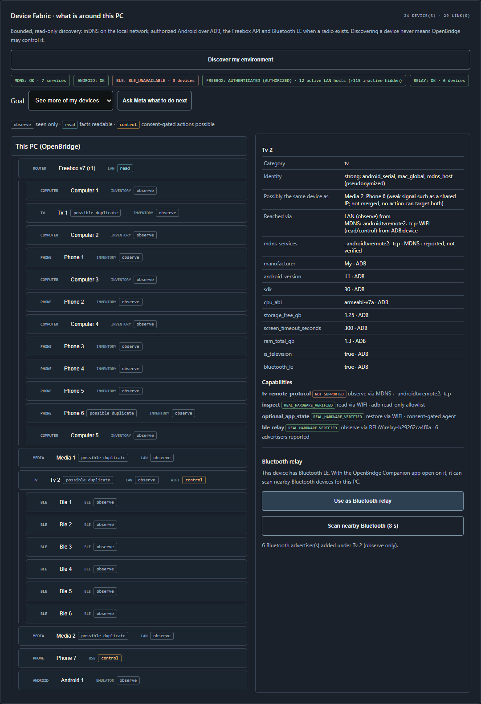
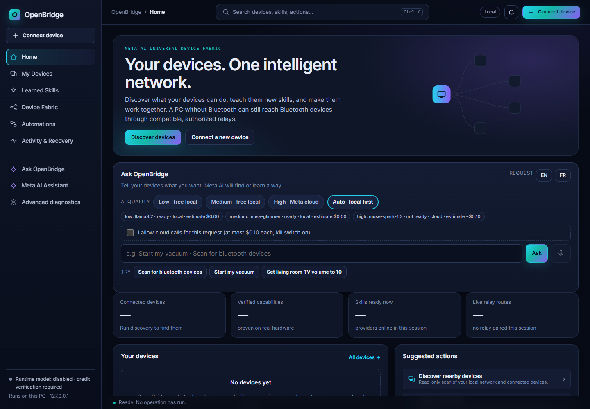

# OpenBridge — Device Fabric

**Local Meta AI that understands the devices around you, reaches the ones your PC can't, and only changes what it can prove it can undo.**

Meta Global AI Developer Hackathon 2026 · Indie Developer · *Push the Frontier* · MIT licence



*Real run on the author's home network (names redacted with `?redact`): a Freebox and the 12 active hosts it reports, an Android phone over USB, an Android TV over ADB Wi-Fi merged with its mDNS identity, and 6 Bluetooth devices that the PC cannot hear itself (it has no Bluetooth radio) found through the TV acting as a relay.*



*Ask OpenBridge: type a request in English or French; tiered Meta-only routing (free local Llama/Glimmer, cloud Spark only with explicit consent) resolves it to a registered skill, shows a fingerprint-bound preview, and executes only after owner approval. Local tiers verified live; cloud path unit-tested, broker unconfigured in this capture.*

## The problem
Homes are full of devices on different transports (USB, Wi-Fi, LAN, Bluetooth) behind different permission screens. Tools either see one transport at a time or ask for broad control. Owners cannot tell what is really connected, what each device can do, and whether a change can be undone.

## What OpenBridge does
1. **Discovers** with bounded, read-only providers: mDNS/DNS-SD, SSDP, ADB (USB and Wi-Fi), the **ISP Router API (e.g., Freebox OS / UPnP-IGD)** — Freebox OS with official app authorization, or a generic read-only UPnP-IGD gateway — Bluetooth LE, and **relays**.
2. **Builds one graph.** Observations merge only on strong identifiers (for example the TV's Bluetooth address seen both over mDNS and ADB); weak signals become "possible duplicate" hints. Every link states what it grants: *observe*, *read* or *control*.
3. **Extends reach through relays.** The OpenBridge Companion app (Android phone or Android TV) performs short signed BLE scans for the PC, after on-screen pairing. Devices it hears appear under it as observe-only.
4. **Uses Meta models where they help.** Muse Glimmer and Llama 3.2 run locally; they explain device state, propose at most one reversible step, and suggest the next discovery step. They never see identifiers and cannot bypass the deterministic gate.
5. **Changes only what it can undo.** Consent → snapshot → execute → independent read-back → exact Undo, with crash recovery. A session journal asks before finishing whether to restore every setting changed during the session.
6. **Routes skills across relays (B2).** Typed skill contracts with READY/ACTIVE/STANDBY states, freshness leases, AUTO/PREFERRED/PINNED policies, consent-bound invocation leases and exact-once dedup. A TV-to-phone BLE failover is demonstrated on hardware ([handover](docs/release/COMPLETE_HANDOVER.md)); a frozen synthetic routing evaluation scores 32/32 with full baselines ([results](docs/evaluation/routing-v1/RESULTS.md)).
7. **Asks in natural language (Ask OpenBridge).** English or French requests resolve to registered skills through tiered Meta-only inference; every step (parse → preview → approval → receipt) is shown with model, cost and evidence, and the model can never authorize its own privileged actions.

## Verified on real hardware
| Capability | Evidence |
|---|---|
| mDNS discovery of the home LAN (Freebox, TVs, Cast, AirPlay, HomeKit, SMB) | [EVIDENCE_LEDGER](EVIDENCE_LEDGER.md) |
| Freebox official app authorization + read-only LAN inventory (127 known / 12 active hosts) | [Freebox doc](docs/FREEBOX_INTEGRATION.md) |
| Android phone (USB) and Android TV (ADB Wi-Fi) inspection, tolerant per-fact reads | [Hardware matrix](docs/HARDWARE_TEST_MATRIX.md) |
| Bluetooth relay through a phone (9–13 advertisers) and through a TV over the LAN (6) | [Relay security](docs/RELAY_SECURITY.md) |
| Consent-gated agent: Meta plan → gate → act → verify → exact Undo | [agent-loop-receipt](docs/agent-loop-receipt.json) |
| Server crash after a change → planning blocked → exact journal recovery | [crash-recovery-receipt](docs/crash-recovery-receipt.json) |
| Muse Glimmer 30B local inference, digest = official registry manifest | [glimmer receipt](docs/glimmer-smoke-receipt.json) |
| Real TV relay → local Muse Glimmer proposal → verified API publication/read → access denial and removal | [TV/Meta journey and limits](docs/forge/TV_GLIMMER_JOURNEY.md) |
| Session restore of pre-session settings (TV system app, Companion, ADB Wi-Fi) | [Transactions & Undo](docs/TRANSACTION_AND_UNDO.md) |
| TV-to-phone BLE failover on hardware (TV scan VERIFIED → link_down → phone scan VERIFIED, dedup + consent-void proofs) | [Complete handover](docs/release/COMPLETE_HANDOVER.md) |
| Watch hold → single TV action with independent read-back and revocation | [Watch acceptance](docs/release/WATCH_CONTROL_ACCEPTANCE.md) (2-tap/16-action root cause unproven; dup/expiry hardware proof pending) |
| Frozen synthetic routing evaluation: router 32/32, full baselines, Spark pre-run design review | [Results](docs/evaluation/routing-v1/RESULTS.md) (no model-advantage claim) |
| Ask OpenBridge NL → skill resolution (local Llama parse, tiered routing, fingerprint-bound approve/execute) | Scratch-verified + fixtures e2e this branch; cloud path unit-tested only |

Status vocabulary and everything not verified: [HARDWARE_TEST_MATRIX](docs/HARDWARE_TEST_MATRIX.md), [KNOWN_LIMITATIONS](docs/KNOWN_LIMITATIONS.md).

## What Meta models add — measured results

**Muse Glimmer adds explanations of the device graph and a proposed next step.** In the recorded coverage-advisor evaluation, **56/60 synthetic cases (93.3%) passed the usable-explanation checks**, versus 0/60 for Llama 3.2 3B. The fixed-priority rules baseline emits a step ID, not an explanation. This measures output validity and grounding checks, not complex-diagnosis correctness or a capability impossible for rules.

| Task and metric | Rules baseline | Llama 3.2 3B | Muse Glimmer 30B |
|---|---|---|---|
| Coverage advisor: usable explanation (60 synthetic cases) | No explanation output; not scored | 0/60 (0%) | **56/60 (93.3%)** |
| Coverage advisor: selected step matches fixed goal priority | 100% by construction | 0% | 53.3% |
| Narrow agent planning: correct decision (30 cases × 3) | 90.0% | 53.3% | 86.7% |
| Unsafe packages proposed in those 90 attempts (all refused) | 9 | 6 | 3 |

**Models explain and propose; deterministic code retains authorization, consent, validation and execution.** Glimmer produced fewer unsafe package proposals than the naive rules baseline in this run, while rules retained higher narrow planning accuracy. All recorded unsafe proposals were refused. These synthetic results do not establish a general model advantage. Full methodology and unfavorable results remain in [benchmark status](docs/benchmark/STATUS.md) and the [raw advisor receipt](docs/benchmark/advisor-benchmark-glimmer.json).

**Meta on real devices:** a real Android TV relay observed four BLE advertisers; local Muse Glimmer generated a validated Forge proposal, followed by owner-authorized consent in the test-driven UI, verified API publication/read and access removal. The recorded proposal used 259 input / 98 output tokens in 82.4 seconds, with $0 provider cost. This is an end-to-end proof, not a new benchmark or a demonstration of fresh human Android permission-dialog acceptance. [Journey, unsuccessful attempts and limits](docs/forge/TV_GLIMMER_JOURNEY.md).

**Meta Model API:** Muse Spark 1.3 has a [recorded successful synthetic advisory call](docs/runtime-meta-receipt.json), separate from its disclosed visual-design contribution. The experimental multi-transport diagnostic is documented in [Capability Forge PR #1](https://github.com/toskaman/openbridge/pull/1). Its first live attempt was blocked; a subsequent supervised synthetic run returned evidence-linked hypotheses and ordered read-only checks ([successful Spark diagnostic](docs/forge/SPARK_DIAGNOSTIC.md), 349/2,999 tokens, ~$0.0132 promotional). No diagnostic-accuracy score is claimed.

Current release status and remaining acceptance gates: [release index](docs/RELEASE_STATUS.md) and [submission worksheet](docs/release/SUBMISSION_EVIDENCE.md).

Runtime models are Meta only, enforced by [src/ai/registry.py](src/ai/registry.py): Llama 3.2 3B (local, CPU), Muse Glimmer 30B (local, GPU/CPU), Muse Spark 1.3 (cloud, synthetic facts only, recorded call). Built with Llama; Llama 3.2 Community License. Development assistants (Codex, Muse Spark design) are never called at runtime — see [CONTRIBUTIONS](CONTRIBUTIONS.md).

## What's new (28 Oct 2026)
- **B2 skill routing**: typed contracts, AUTO/PREFERRED/PINNED, leases, dedup; hardware TV-to-phone handover + frozen 32/32 evaluation with Spark design review.
- **B3 Companion controls**: owner-granted watch/phone controls routed through B2 (one hold → one action, signed outcomes, revocation); hardware edge acceptance still open.
- **Ask OpenBridge**: natural-language panel (EN request UI, FR text accepted), tiered Meta-only routing, cost guard on the shared broker ledger, fingerprint-bound approve/execute.
- **Durable runtime**: routing policies + unresolved-outcome backlog survive restarts (atomic, corrupt-state blocks visibly).

## What's new (27 Oct 2026)
- **Runtime contract v1 and `/api/v2`**: a versioned read model and one execute endpoint over named safe primitives (schema, consent, identity re-check, per-device locking, honest timeouts). See `docs/api/HTTP.md`.
- **More devices, all owner-authorized**: Galaxy Watch7 (wireless-debugging pairing with an in-app tutorial), a second Windows PC through the owner's agent (read-only), Android phone and TV Companion relays feeding Capability Forge.
- **Crash-recoverable writes**: five process-kill points during a real change on the phone, each recovered from the journal with exact read-back (5/5).
- **Live Meta Model API**: `muse-spark-1.3` advisory verified live on synthetic facts within free credits; local Llama 3.2 3B and Muse Glimmer remain the default.
- **Read-only watchers and a redacted multi-device report.**
Evidence for every item: `EVIDENCE_LEDGER.md` and `docs/HARDWARE_TEST_MATRIX.md`. Limits: `docs/KNOWN_LIMITATIONS.md`.

## V4 additions (27 Oct 2026, evening) — status as of this commit
| Feature | What it does | Status |
|---|---|---|
| Cross-transport diagnosis (V4-01) | One timeline of changes from every read path; competing hypotheses that cite timeline entries ("consistent with", never "caused by"); a read-only re-measure probe | SIMULATED_VERIFIED (CI drills with independent labels); real TV+router capture pending |
| Privacy-preserving cloud escalation (V4-05) | Exact outgoing bytes, diff and categories shown before one explicit consent per payload; golden leak corpus; untrusted answer validated locally. Data minimisation, **not** anonymity | SIMULATED_VERIFIED; live call needs the supervised credit permit |
| Registered ablation (V4-04) | 24 frozen held-out cases; rules 20/24 (fails all WAN-outage cases); model arms run on the owner's PC | rules arm MEASURED; model arms pending |
| Generic UPnP-IGD (router) | Allowlisted read-only queries; port-mapping and every write refused before sending; external IP masked | SIMULATED_VERIFIED (fake IGD); real gateway pending |
| BLE zones (V4-11) | Calibrated zones from two relays, "unknown" when unsure; precision/recall per zone; never coordinates | SIMULATED_VERIFIED; owner calibration run pending |
| Visual read-back (V4-07) | Screenshot (status bar cropped) judged by local Muse Glimmer vs structured screen state; disagreement = INCONCLUSIVE | SIMULATED_VERIFIED; real TV run pending |
| Voice (V4-10) | Push-to-talk → `muse-voice-transcribe-1.0` → typed FR/EN intent proposal; owner reviews and presses Run | IMPLEMENTED_UNVERIFIED (no live STT receipt yet) |
| Wear OS manifest (V4-08) | Watch capabilities derived from reported features on every read; control BLOCKED | SIMULATED_VERIFIED; Watch7 run pending |
| PC 2 as a client (V4-12) | Runs owner-typed jobs (consent per command, exit code + output returned) and serves pinned Meta models for the scheduler; raw device data never leaves this PC | jobs REAL_HARDWARE_VERIFIED; inference benchmark pending |
| Tuya robot vacuum | Owner-linked via the owner's Tuya IoT project; status reads; suction/volume with exact Undo; full robot control (start, pause, dock, moves with auto-stop, seek, dust, resets) with consent per command | REAL_HARDWARE_VERIFIED: reads, suction change + exact Undo, start/pause, manual moves and return to dock (EVIDENCE_LEDGER) |

Claim-by-claim evidence: [docs/jury/CLAIM_EVIDENCE_MATRIX.md](docs/jury/CLAIM_EVIDENCE_MATRIX.md).

## Run it
Requirements: Windows or Linux, Python 3.14 (no third-party runtime packages), Android platform-tools for ADB. Optional: Ollama for local Meta models, `bleak` for PC Bluetooth.

```powershell
git clone https://github.com/toskaman/openbridge.git
cd openbridge
python -m unittest discover -s tests          # controlled tests; no hardware needed
python -m dev.start_workspace                 # main :18765 + trusted Forge selector :18767
```
With local Meta models and the agent:
```powershell
python -m dev.start_local_meta --pull-model   # Llama 3.2 3B, private CPU service on :11437
python -m dev.start_glimmer --pull-model      # optional Muse Glimmer 30B on :11438 (~18 GB)
python -m src.server --local-meta --glimmer --agent
```
The default launcher starts no discovery, model call or publication. Open **Capability Forge** from the main navigation, refresh verified routes and explicitly select a source-bound observation. Optional Forge local CPU planning uses `python -m dev.start_workspace --glimmer-cpu-v2` with its existing isolated service on :11439. The standalone simulated demo remains `python -m src.forge.demo_host` on :18766. See [trusted physical workspace proof](docs/forge/WORKSPACE_JOURNEY.md) and [frozen v2 evaluation](docs/forge/evaluation-v2/RESULTS.md).

Companion app: `python -m dev.build_companion` (official Android SDK tools), then **Install the OpenBridge Companion** from a phone or TV sheet in the UI.

**Jury walkthrough:** Ask OpenBridge a request (*Scan for bluetooth devices*) → review the fingerprint-bound preview → approve → read the receipt → Discover my environment → open a device sheet (sources, capabilities, statuses) → TV sheet: *Connect over ADB Wi-Fi* → *Use as Bluetooth relay* → *Scan nearby Bluetooth* → *Ask Meta what to do next* → Device agent (Declutter) for a consent-gated change and exact Undo → *Finish session…*. Without hardware: `python -m tests.e2e.command_center_smoke`, `python -m tests.e2e.fabric_smoke` and `python -m tests.e2e.offline_smoke` (all in CI).

## Safety boundaries
Loopback-only server with Host/Origin/CSRF checks; no port scanning; discovery limited to private networks; one owner-triggered connection per device; router/box configuration read-only by policy; Freebox token protected by Windows DPAPI; raw serials/MACs pseudonymized; signed, expiring, replay-protected relay commands; scans only after on-screen pairing and only while the Companion is open; Android permissions only through Android's own dialogs; writes limited to an allowlist with exact restoration or blocked before writing.

## Documentation
Architecture [UNIVERSAL_DEVICE_ARCHITECTURE](docs/UNIVERSAL_DEVICE_ARCHITECTURE.md) · Discovery [DISCOVERY_PROTOCOLS](docs/DISCOVERY_PROTOCOLS.md) · Identity [DEVICE_IDENTITY_AND_DEDUPLICATION](docs/DEVICE_IDENTITY_AND_DEDUPLICATION.md) · UX [DEVICE_FABRIC_UX](docs/DEVICE_FABRIC_UX.md) · Schema [DEVICE_CAPABILITY_SCHEMA](docs/DEVICE_CAPABILITY_SCHEMA.md) · Android TV [ANDROID_TV_ADAPTER](docs/ANDROID_TV_ADAPTER.md) · Companion [ANDROID_COMPANION](docs/ANDROID_COMPANION.md) · Bluetooth [BLUETOOTH_LOCAL_AND_REMOTE](docs/BLUETOOTH_LOCAL_AND_REMOTE.md) · Routers [ROUTER_ADAPTERS](docs/ROUTER_ADAPTERS.md) · Jury [JURY_ACCEPTANCE_DEVICE_FABRIC](docs/JURY_ACCEPTANCE_DEVICE_FABRIC.md) · Evidence [EVIDENCE_LEDGER](EVIDENCE_LEDGER.md), [RELEASE_EVIDENCE](docs/RELEASE_EVIDENCE.md) · Baseline [DEVICE_FABRIC_BASELINE](docs/DEVICE_FABRIC_BASELINE.md) · Earlier README [README_HISTORY](docs/README_HISTORY.md).

All code was written during the event; see [CONTRIBUTIONS](CONTRIBUTIONS.md) and [THIRD_PARTY](THIRD_PARTY.md).

## Website redesign with Meta Muse Wonder 1.0

The current visual foundation was authored by **Meta Muse Wonder 1.0** through the official Meta API on 27 October 2026: design tokens, workspace shell, and component CSS. Codex adapted the markup, wrote the integration layer, preserved existing controls, and performed verification. The original Meta-authored modules are in `src/ui/theme/`; compile them with `python -m dev.build_web_theme`.

The [generation receipt](docs/forge/meta-web-design-receipt.json) records 798 input and 3,500 output tokens, an estimated $0.073192 promotional-credit cost, and `finish_reason: length`. The final explanatory field was truncated; only the five fully decoded fields were extracted. The three complete CSS fields were retained verbatim. This is a real build-time Meta contribution, not a claim that Meta authored all application code or a new runtime model integration. No second provider request was made.

## Current application theme — owner decision, 28 October 2026

The owner selected Claude's latest application shell and main theme (`src/ui/theme/app.css`), replacing the earlier main-site Meta theme. The Forge theme and retained Spark/Wonder receipts describe their actual, separate contributions; they do not establish authorship of the new main shell. Codex integrated and tested the combined changes. No new Meta design call was made for this integration.
