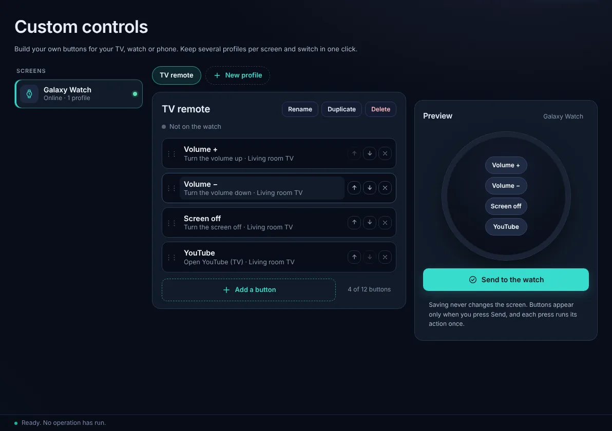
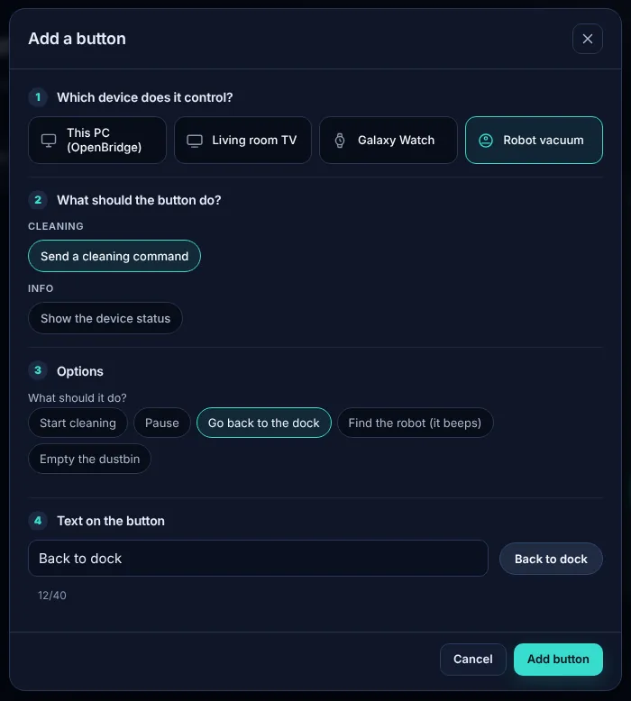

# Custom controls

Build your own buttons for each screen paired with OpenBridge: a TV, a watch or a phone running the
OpenBridge Companion. Save them as profiles ("Movie night", "Cleaning") and switch from one to another in one click.

The Controls page (screenshot taken on test fixtures).

## In four steps

1. Open **Controls** in the left menu and pick the screen you want to customise.
2. Create a profile: start empty, start from a ready-made set (TV remote, robot vacuum), or copy what is on
   the screen now, for example buttons OpenBridge made for you from a request.
3. Add buttons. For each one: choose the device it controls, what it does, a few options if needed, and the
   text shown on the button (a suggestion is filled in for you).
4. Press **Send to the watch** (or TV, or phone), check the list, confirm. The buttons appear on the screen.

## Good to know

- **Saving never changes the screen.** Every edit is saved at once on this PC; the screen only changes when you
  press Send and confirm.
- **Each press runs its action once,** through the same checks as the rest of OpenBridge: the server checks every
  button again when you send a profile (known action, valid options, device found), and a press goes through the
  usual approval rails and receipts.
- **Up to 12 buttons per screen, 16 profiles per screen.** Reorder buttons by dragging them, or with the arrows.
- **Devices are remembered by name.** If a device is not found when you send a profile, OpenBridge tells you which
  one; run Discover on the Devices page and send again.
- **After a restart** of the PC or of the Companion, the last profile you sent comes back on the screen by itself.
- **Remove from screen** clears the buttons from the device; your profiles are kept.
- Buttons from an approved plan or a saved skill can be seen in "On the watch now" but not copied into a profile:
  build one with the same actions instead.
- Running a command on a PC (`pc_run`) is never available as a one-tap button; it keeps its own approval step.

## No screen paired yet?

The page offers **Try the editor with a demo watch**. The demo is SIMULATED: nothing is saved or sent to a device.

## For developers

| Route | What it does |
|---|---|
| `GET /api/v2/control_profiles` | Profiles per screen, what each screen shows now, limits |
| `POST /api/v2/control_profiles/save` | `{relay_id, profile_id?, name, buttons}`: create or update, installs nothing |
| `POST /api/v2/control_profiles/delete` | `{relay_id, profile_id}` |
| `POST /api/v2/control_profiles/apply` | `{relay_id, profile_id, consent: true}`: send to the screen |
| `POST /api/v2/control_profiles/capture` | `{relay_id, name}`: copy the screen's current buttons into a new profile |
| `POST /api/v2/control_profiles/clear` | `{relay_id, consent: true}`: remove every button from the screen |

A button is `{label, skill_id, device, device_key, params}`. Profiles are stored in `runtime-state.json` under
`control_profiles`. Code: [`src/runtime/control_profiles.py`](../src/runtime/control_profiles.py),
[`src/ui/views/controls_view.js`](../src/ui/views/controls_view.js). Tests:
[`tests/runtime/test_control_profiles.py`](../tests/runtime/test_control_profiles.py).
