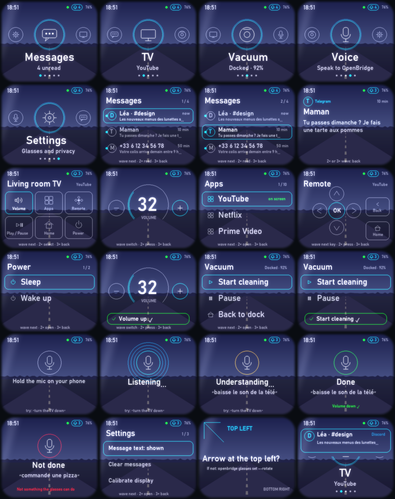

# ENGO glasses: messages, TV, vacuum and voice

OpenBridge puts a small, calm interface on ActiveLook / ENGO glasses (ENGO 1, 2 and 3, including ENGO 3
Photochromic): your messages, a TV remote, the robot vacuum and voice commands from the phone's microphone.



## How it fits together

```
phone (OpenBridge Companion) --messages, voice-->  PC: openbridge glasses run  --frames-->  glasses (Bluetooth) or HUD Studio
                                                    |
                                                    +--typed actions through the gate--> TV (ADB), robot vacuum (Tuya)
```

- **Messages:** the Companion app reads the notifications of the apps you allow (Discord, Telegram, SMS, Google
  Messages, Samsung Messages; WhatsApp and Signal on request) once you grant notification access in Android
  settings ("Messages on my glasses" button). The PC fetches them over the paired, encrypted relay. They stay in
  memory (last 50), are never written to disk and never answered on your behalf. Privacy mode: show the text, only
  the sender, or nothing.
- **TV:** volume, app switching (YouTube, Netflix, Prime Video, Disney+, Spotify, Plex, Twitch, myCANAL, VLC, Kodi),
  a full remote (arrows, OK, back, home, play/pause) and sleep / wake, on an Android TV / Google TV linked over ADB.
  The glasses show the volume and the app on screen, read back from the TV.
- **Vacuum:** start, pause, back to dock, find (beep).
- **Voice:** hold the mic in the Companion app and speak, in French or English. The phone records, the PC transcribes
  locally, OpenBridge's own command model understands ("baisse le son de la télé", "start the vacuum"), and the
  glasses show what was heard and what was done. Anything the glasses may not do is refused and said so.

## Moving around

The ENGO gesture sensor (a hand wave in front of the right lens) drives everything:

| Gesture | Action |
|---|---|
| 1 wave | next item |
| 2 quick waves | open / press |
| 3 quick waves | back |

The same menus answer to `openbridge glasses press next|prev|ok|back|home|up|down|left|right`, to the HUD Studio
`G` key, and to voice. A new message slides in at the top for six seconds; two waves open it.

## Safety

- **Nothing acts until you grant it, once, on the PC**, listing exactly what the glasses may do:
  `openbridge glasses grant --allow tv_remote,tv_apps,tv_power,vacuum --consent ALLOW`
  (`openbridge glasses revoke` takes it back). The grant plus one deliberate gesture or voice command counts as consent
  for one action, like the watch remote controls.
- Every action is a typed OpenBridge primitive (`device_action` key / launch_app, `tv_sleep` / `tv_wake`,
  `tuya_command`) run by the executor, with its receipt. Only the keys, apps and vacuum commands listed above are
  reachable; typing text, unlocking, garage doors and alarms are not.
- Reads (TV volume, app on screen) change nothing.

## Commands

```
openbridge glasses preview --out captures/glasses        # every screen as PNG + a contact sheet, no glasses needed
openbridge glasses grant --allow tv_remote,tv_apps,vacuum --consent ALLOW
openbridge glasses run --link studio                     # HUD Studio (python -m src.adapters.hud_studio --model "ENGO 3")
openbridge glasses run --link ble                        # real glasses over Bluetooth from this PC
openbridge glasses set --privacy sender --apps discord,telegram,sms,messages
openbridge glasses set --rotate on                       # if the calibration arrow is not at the top left
openbridge glasses notify --app telegram --from "Maman" --text "Tu viens ?"
openbridge glasses say "monte le son de la télé"
openbridge glasses status
```

`python dev/glasses_e2e.py --out <dir> [--tv-volume] [--voice]` drives a running hub step by step through its control
port and saves a HUD Studio screenshot after each step.

## Status (23 November 2026)

| Part | Status |
|---|---|
| Menus, messages, TV and vacuum screens, voice screen | Verified in HUD Studio, end to end through `openbridge glasses run` |
| Voice understanding (phone transcript → command model → action) | Verified: "monte / baisse le son de la télé" → volume up / down; "commande une pizza" refused |
| TV actions | Reached the gate; not run on the TV (no ADB link at test time) |
| Vacuum actions | Wired through the gate; not run (no physical test requested) |
| Companion notification access + `get_notifications` | Built (APK compiles); to test on the phone |
| Real ENGO 3 Photochromic over Bluetooth | Waiting for the glasses. First: the **calibration screen** (Settings → Calibrate display) to check orientation, then colours and fonts |

Known gaps: on the move (no PC nearby) the glasses need the phone to hold the Bluetooth link itself; that Companion
part is the next step. Phone buttons for next / OK / back on the Companion screen are also next.
