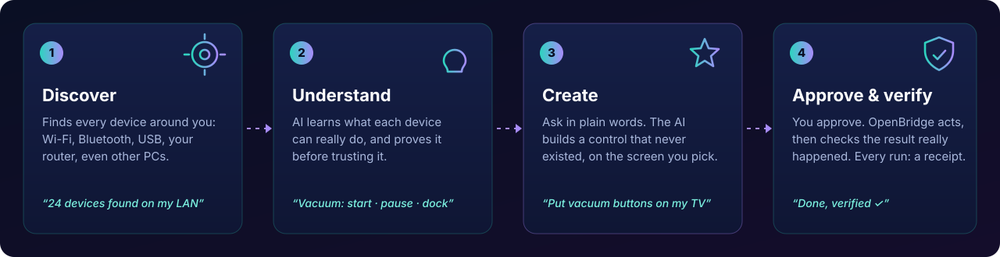
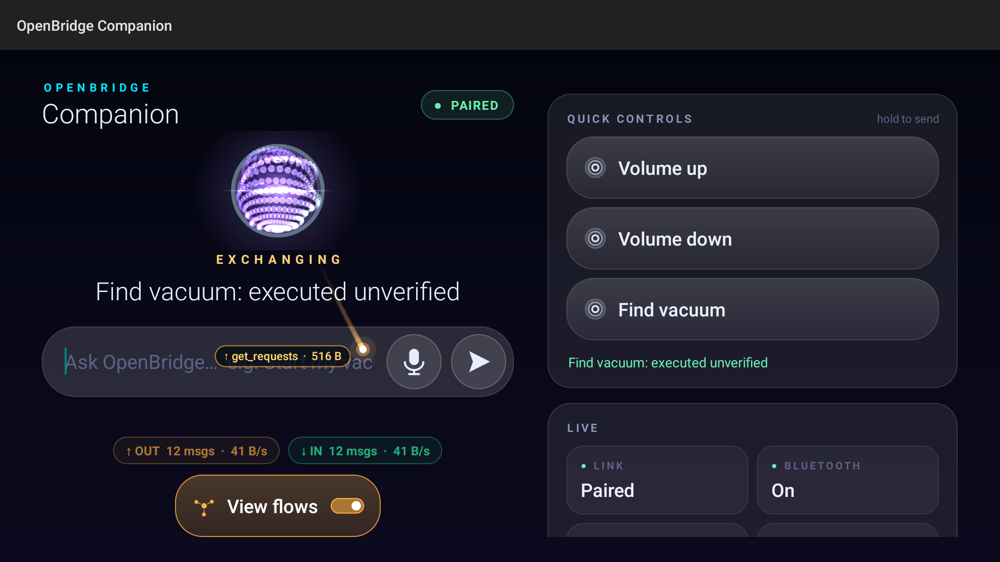
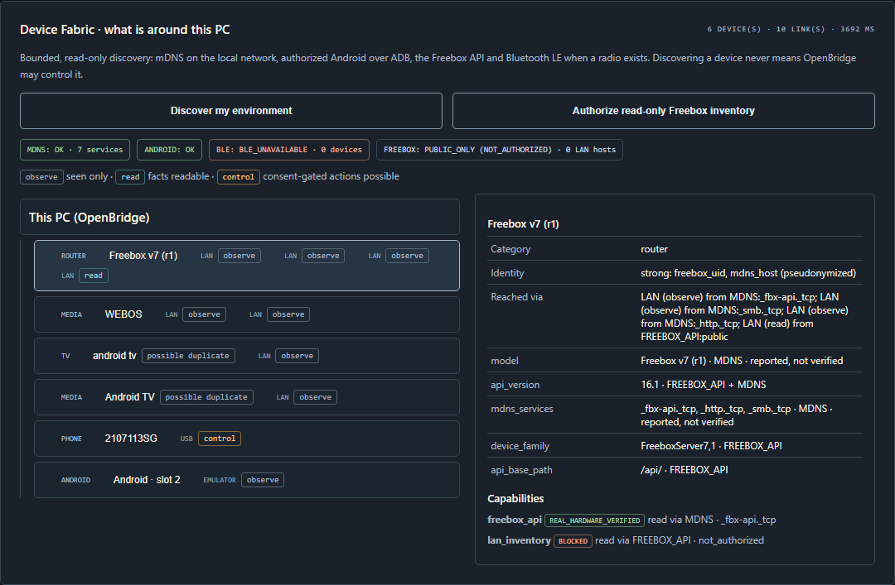

# Why OpenBridge

[← Back to the README](../README.md)

## The idea, in 30 seconds

Every home and every company is full of devices that **could** help each other but **never will**, because each brand lives in its own app, its own cloud, its own remote.

**OpenBridge is the missing layer between them.** Think of it as a universal translator plus a careful assistant:

- 🔎 It **finds** what's around you and learns what each device can *actually* do.
- 🧠 You **ask in plain language** (English or French, typed or spoken) from any screen.
- ✨ The AI **invents the control you need**, even one no manufacturer ever shipped, like vacuum buttons on a TV.
- 🛡️ You **approve**, it acts, and then it **checks on the device itself** that it really worked.

  

## Why it's different

<table>
  <tr>
    <td width="50%" valign="top">
      <h4>✨ The AI creates, it doesn't just pick</h4>
      Most smart-home apps only offer integrations someone pre-built. OpenBridge <b>composes new controls</b> from what your devices can verifiably do, and puts them on whichever screen you choose: TV, watch, phone or PC.
    </td>
    <td width="50%" valign="top">
      <h4>✅ “Done” means done</h4>
      Sending a command is not proof. After every action, OpenBridge <b>reads the device back</b> to confirm the change really happened. If it can't confirm, it says <i>unverified</i>. Never a fake success.
    </td>
  </tr>
  <tr>
    <td valign="top">
      <h4>🛡️ You stay in control</h4>
      Nothing privileged runs without your OK. Every control can be <b>revoked instantly</b>, refusals are shown with a reason, and eligible actions can be <b>undone</b>. Commands between devices are signed, expiring and replay-protected.
    </td>
    <td valign="top">
      <h4>🔒 Private by default</h4>
      The AI runs <b>locally on your own machine</b>, for free. No paid model is built in: if you want another AI, <a href="AI_PROVIDERS.md">connect your own AI or API</a> by hand (LM Studio, Ollama, llama.cpp, OpenRouter…), used only with your consent. Your home doesn't have to leave your home.
    </td>
  </tr>
  <tr>
    <td valign="top">
      <h4>🔌 Works with what you already own</h4>
      No new hub to buy. A PC with no Bluetooth can still reach Bluetooth devices <b>through your phone or TV</b>. Even Windows XP and Windows 7 machines can join.
    </td>
    <td valign="top">
      <h4>🧾 A receipt for everything</h4>
      Every run ends with a receipt: what was asked, what was approved, what was done, what was verified. Crash in the middle? It <b>never blindly re-runs</b> an action. It tells you exactly where it stopped.
    </td>
  </tr>
</table>

## Already built, waiting for more hardware

These capabilities are **implemented and covered by automated tests**. What they need now is more real devices to be validated on:

| Capability | In one sentence |
|---|---|
| **Capability transplant** | Give a device a function it never had, then take it back cleanly. |
| **Control migration** | Move a live control from your watch to your TV (and back) without losing permissions. |
| **Workflow composer** | Chain up to 8 steps across devices. Each step is reported honestly, failures are never hidden. |
| **Adaptive routing** | If one path to a device dies, use another, without ever executing twice. |
| **Device diagnostics** | Ask *“why isn't this working?”* and get an answer based only on observed facts. |
| **Portable dashboards** | Export a set of controls, move it to another home and re-approve. No permissions are inherited. |

**Idea in development (concept only, not integrated):** [OpenBridge without a PC](concepts/PC_LESS_OPENBRIDGE.md): devices use each other directly through a made-to-measure, self-updating client and an OpenBridge server over the internet.

**New: [Home Assistant bridge](HOME_ASSISTANT.md).** Everything your Home Assistant knows (lights, plugs, thermostats, blinds, locks, robots, including Matter, Zigbee and Thread devices) joins OpenBridge, with consent, read-back and exact Undo on top. OpenBridge never unlocks a door, never moves a garage door and never touches an alarm. Verified on a real Home Assistant instance with its demo devices (13/13); physical devices through Home Assistant not yet tested.

**New: [devices that learn and talk to each other](DEVICE_LEARNING.md).** OpenBridge learns what really works on each device, suggests cross-device features built only from proven actions (Cinema mode, Leaving home...), and lets one device trigger another once you approve it. Soak-tested with 1 480 real actions: 92.8 % verified by read-back ([evidence](evidence/device-learning-soak-22nov.md)).

**New: talk to your home.** `openbridge ha say "dim the kitchen lights to 30%"`, in French, US or UK English: OpenBridge's own local model understands, the gate checks, Home Assistant acts and the result is read back. 47 / 47 spoken requests understood on a real Home Assistant ([how it was trained, and its limits](AI_TRAINING.md)).

**New: your messages, TV and vacuum on ENGO glasses.** Discord, Telegram and SMS slide into view; a wave moves through a TV remote, the vacuum and voice commands spoken into the phone. Nothing acts before a one-time grant on the PC ([ENGO glasses](GLASSES.md)).

**Next integrations on the roadmap:** [ENGO / ActiveLook HUD glasses](partners/ENGO.md) (hardware on its way) · native Matter · ESPHome · OpenWrt · FRITZ!Box · more TVs, wearables, robots and EV / automotive interfaces.

<b>More screenshots</b>

 

   
  The OpenBridge companion on a real Android TV, with quick controls created on demand.

   
  Device Fabric: everything discovered around the PC, and exactly what each device is allowed to do (observe, read, or control with consent).

