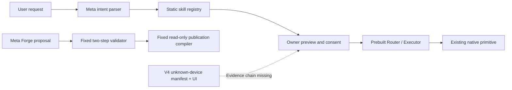

# V4 independent causality and security audit

**Verdict: V4 flagship not established; security release gate BLOCKED.** This is an independent development audit, not product certification or new hardware acceptance. Baseline `dcf852775aab0a4129b1c9e117f9457db77f985d`; auditor source `41e57f7`. [Machine receipt](receipt.json), [spec reconciliation](KIT_SPEC_MAPPING.csv), [test inventory](test_inventory.json) and [next evaluation protocol](HELDOUT_PROTOCOL.md).

## SCOPE_AND_CURRENT_HEAD

V4 owner instructions replace older responsibility assignments. Sol independently tests/audits; Claude owns generic platform/trust/kernel work; Muse Code owns generative Forge/agent source and Meta owns runtime candidate proposals. No platform, generator, protected master document, frozen evaluation or original evidence was edited. No provider, credentials, hardware, deployment, capture, call, shutdown or video was used by this audit. Temporary ledgers and fake effects are clearly marked SIMULATED.

Observed repository public/MIT through connected GitHub CLI. Baseline CI checks122970299734 (Ubuntu),122970299240 (browser),122970298660 (Windows) all reported success on the exact baseline. These are software checks, not V4 acceptance. Owner-provided participant-guide copy is the dated rules source; live portal cutoff and contribution eligibility remain separately unverified.

## INVENTORY_OF_PREBUILT_LOGIC

Registry snapshot:19 primitives,4 B2 skills,8 Command Center skills; canonical SHA256 `74d11e71d675e14bec4edb2944287d38acab5738a915f88f8854c8eb0e6c4ac3`. Full detached data and source blob hashes are in the receipt. This baseline digest does not freeze a new V4 contract or approve every primitive for Meta tools.

| Path | Actual behavior | Honest classification |
|---|---|---|
| src/runtime/skills.py | Statically registers BLE scan, facts, two volume skills, three Tuya commands and fabric.status | NATIVE_PREBUILT at product runtime |
| src/runtime/nl_router.py and command.py | Meta intent/clarification chooses registered IDs, previews/dispatches existing mappings | Meta-assisted intent over prebuilt capabilities; no novel adapter shown |
| src/runtime/fabric_status.py | Contributor-recorded local Llama generated a registry-counting function during development; body has no hardware access | Model-authored development formatter, subsequently prebuilt at runtime; not META_GENERATED_ADAPTER |
| src/forge/planner.py, meta_planner.py, planner_v2.py | Fixed expose_remote_ble_observations goal and read_observations → publish_readonly workflow; selects eligible source | Bounded Meta selection/composition over prebuilt operations |
| src/forge/compiler.py | Strict manifest validation and deterministic OpenAPI/schema/fixed-client output | NATIVE_PREBUILT compiler; generated documents do not prove a new native driver |
| Existing handover and Watch reports | Historical contributor-recorded physical receipts with their stated limits | REAL_VERIFIED only within the original recorded scope; no fresh V4 result |

The fabric.status source header supplies a claimed code hash, token count and local model identity; this inspection did not find a separately linked full generation request/response proving a runtime unknown-device registry delta. Preserve its useful contribution without upgrading it to a novel hardware adapter. No META_GENERATED_UI proof chain from an unknown task through persistent signed deployment and fresh physical read-back was established in the inspected registered paths.

## META_CAUSALITY_VERDICT

The inspected product paths do not establish Meta creating a previously absent device-specific capability at runtime. This is a scoped evidence conclusion, not a claim that Meta had no development or planning contribution. A new formatter, natural-language selection or a fixed API publication path does not meet V4 G2–G8. Existing physical actions remain useful baseline behavior.

Required missing chain: before registry absent → independent facts/oracle → actual Meta candidate/run → strict verifier/sandbox → scoped approval/signed deployment → independent physical read-back → persistent UI/revoke → fair disabled-variant ablation. Do not replace missing links with dialogue examples or configuration model names.

## FAIR_ABLATIONS

Historical Forge v2: Rules/Llama/Glimmer80/80 on a fixed synthetic publication task;25 actual eligible calls per model, with deterministic refusals separately counted. Historical routing: router32/32 and policy-aware heuristic32/32 on eight correlated synthetic families. Neither establishes unfamiliar-protocol creation or an accuracy advantage for Meta.

Explanation PR70 retained eight Spark calls with empty replies; frozen scoring marks8/8 INVALID and zero supported sentences. This is a negative explanation result, not a new routing quality score. Missing finish_reason/raw envelopes mean the exact cause of empty replies is not independently proven; reasoning-budget exhaustion is a plausible reported explanation, not a measured causal conclusion. Do not rerun or alter that frozen study.

New no-Meta V4 ablations are NOT_RUN: no eligible runtime synthesis interface/held-out target/oracle is frozen yet. The draft protocol specifies shared execution, input/budget parity and explicit unavailable states. No fresh hosted or local inference was run.

## SECURITY_FINDINGS

### V4-S1 — P1: concurrent duplicate execution is not atomically claimed

**Where:** src/runtime/command.py229–231 and261–263; threaded HTTP server. **Why:** check cache → approval/dispatch → write cache has no per-intent in-flight ownership. **Evidence:** actual Executor with a fake Tuya runner, two equal intent/fingerprint requests, deliberately serialized effects respecting the per-device lock: two mock effects, two distinct transactions, one cached key. See command_concurrency in receipt.json. The audit CLI returns2 (blocked gate), not a security pass.

**Fix / Claude action:** atomically claim canonical (intent_id, approved binding) before dispatch; concurrent retry waits/returns the same outcome; preserve failure/unknown outcomes and bound lifecycle/shutdown/restart semantics. Do not hold a global lock across unrelated devices. **Test:** two simultaneous retries, delayed response, unknown result and repeated completed retry all cause at most one fake effect and retain one identity; distinct authorized intents remain independently executable.

### V4-S2 — P2: explanation-runner freshness is regenerated from old evidence

**Where:** dev/run_explain_eval.py78–84. **Why:** permit_for sets verified_at=now for each new two-call slot although one CLI balance observation is reused; the CLI has no original observation timestamp. **Evidence:** the real broker rejects the original permit after601 simulated seconds, but accepts the runner-minted next slot using the same observation. No provider was invoked.

**Fix / evaluation-tool author:** preserve immutable operator verification time, reject expired evidence, and require genuinely renewed observation at a new gate. **Test:** clock advance beyond300 seconds blocks subsequent slots without any transport attempt. Do not change frozen prompts or historical receipts to disguise the finding. This does not establish that the historical eight-call run actually exceeded300 seconds.

### V4-S3 — P2: synthetic observation IDs/output ledgers weaken canonical budget enforcement

**Where:** dev/run_explain_eval.py74,82–84. **Why:** one observation becomes four suffixed identities; arbitrary output directories choose separate reservation ledgers. **Evidence:** the actual broker accepts$0.80 across four derived IDs in a temporary ledger, and accepts another reservation in another output ledger. This is an enforcement-property probe, not proof of unauthorized real charges. The frozen run explicitly budgeted$0.80; such larger allowances should be represented as a deliberate audited policy exception, not simulated fresh observations.

**Fix:** one durable canonical observation/ledger, explicit owner-approved evaluation allowance, atomic admission and no counter reset by output path. **Test:** parallel admission and alternate output paths cannot widen the authorized allowance; historical reservations remain intact. Existing runtime budget must not be deleted/reset to enable this experiment.

Existing compiler negative probes reject unsupported operation/command/recipient/origin/control fields, altered transition/self-consent/evidence and stale facts. Passing these narrow existing checks does not certify the absent V4 DSL, UI renderer or all1160 kit specifications.

## PLATFORM_FEASIBILITY

No fresh device inspection occurred. Existing native BLE/ADB/relay capabilities and exact recorded hardware proof remain their own scope. Whole-device Watch/TV capture, encrypted multi-hop files, selective recipient exclusion, continuous TV remote mic and cellular audio, contact identity, shutdown step-up and generated UI persistence are NOT_REVERIFIED or NOT_ESTABLISHED here. BLE discovery does not establish Bluetooth file reception; a voice-search mic does not establish continuous call audio. Owner-only pc_job availability must not become an unrestricted Meta shell tool.

## IMPLEMENTED_VS_SPEC_TESTS

Kit catalogs contain720+120+200+120=1160 unique scenario specifications. Full local unittest execution:605 methods, comprising599 existing methods and6 new audit methods; exit0, no model/hardware calls by the new probes. Method count is not scenario-spec coverage. Mapping CSV marks every full kit scenario as not instantiated/executed by this audit;20 rows have only related partial test references. Coverage percentage is NOT_MEASURED, not zero implementation and not1160 passes. The audit's failing security observations remain failing even though its evidence-collection tests pass.

Commands: `python -B -m unittest tests.audit.test_v4_audit -q` →6 tests, exit0; `python -B -m unittest discover -s tests -q` →605 tests, exit0 (44.671s); `python -B -m dev.audit_v4 --output docs/audits/v4/receipt.json` →exit2, expected blocked gate. Existing ResourceWarnings are retained in the captured test output. Kit validator checks specification structure only; it does not run app tests.

Public [redacted test output](TEST_OUTPUT.txt), [machine-readable baseline CI](BASELINE_CI.json) and [provenance/redaction record](PROVENANCE.json) support these verification claims. Initial helper-development failures are retained in provenance; no core implementation was changed to make these probes pass.

## JURY_GATE_REPORT

| Gate | Verdict | Reason |
|---|---|---|
| G0 | PARTIAL | Exact public source/license/CI captured; contribution-cutoff eligibility not independently settled |
| G1 | PARTIAL | Existing19-primitive registry exists; V4 generic contract and current platform facts not frozen |
| G2 | BLOCKED | No independently observed genuine held-out target/oracle and missing-mapping proof |
| G3 | NOT_ESTABLISHED | No runtime novel adapter/UI provenance chain in inspected paths |
| G4 | FAIL | Concurrent duplicate execution reproduced; existing narrow validator checks pass |
| G5 | NOT_RUN | No exact new candidate/deployment scope approved in this audit |
| G6 | NOT_RUN | No fresh V4 physical read-back |
| G7 | NOT_RUN | No fresh generated-profile restart/revoke/cleanup proof |
| G8 | NOT_ESTABLISHED | Historical parity is retained; no new novel-capability ablation |
| G9 | BLOCKED | Final eligible revision, authorized video and submission receipt not established |

No official or predicted jury score is claimed. Under the supplied30/25/20/25 rubric, impact has baseline demonstrations, Meta novelty remains unproven, technical execution has a confirmed blocker, and the V4 demo is not ready. Do not publish an autonomous-driver headline on this evidence.

## CLAUDE_ACTIONS

1. Fix V4-S1 with the smallest independently tested per-intent ownership patch; preserve existing consent/identity/persistence gates. Sol has not edited the owning core file.
2. Freeze the primitive/evidence/invocation/receipt/UI contract jointly with Muse Code, including narrow model-tool scope. Do not create hardcoded scenario workflows or another competing trust kernel.
3. Identify one genuinely feasible native surface and provide signed facts/read-back oracle support. Keep missing capture/microphone/file APIs explicitly unsupported.

## MUSE_CODE_ACTIONS

1. Build the missing evidence/gap/candidate/UI/workflow pipeline against the agreed contract, keeping prebuilt/status-formatter contributions accurately labeled.
2. Capture before/after registry digests, exact Meta request/model/candidate manifests and validation outcomes; no self-approval or hidden rule fallback.
3. Hand over adverse cases and unsupported-primitive refusals without seeing private held-out gold. Expose the no-Meta/disabled-agent seam for independent evaluation.
4. Evaluation-tool author addresses V4-S2/S3 in a new runner version without changing frozen study bytes or retrospective accounting.

## OWNER_APPROVALS

No question is needed to finish this audit. Later gates require an exact held-out device/task and data scope, protected-file patch if needed, actual model request/budget, signed candidate deployment/hardware action, capture/call/shutdown, and any video/final publication/submission. Existing broad authorization is not used as a fabricated approval receipt for a new candidate. No approvals were granted by the model or auditor.
