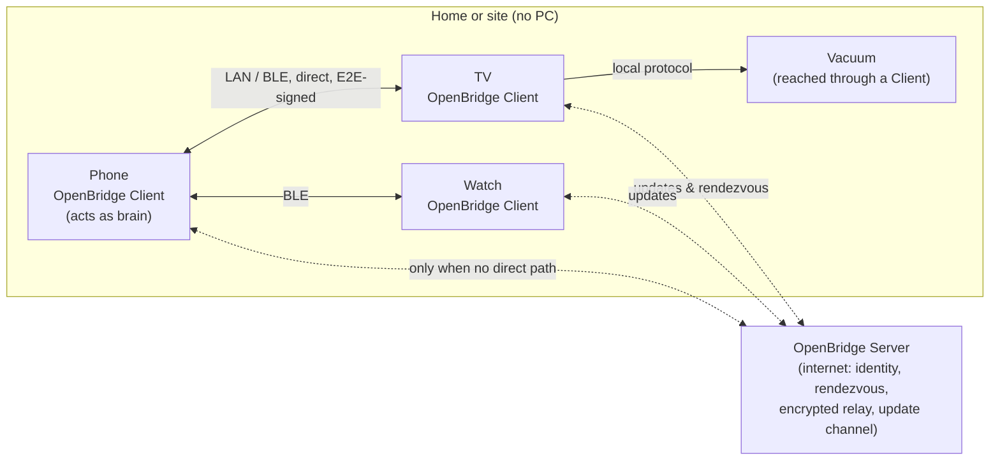

# Concept: OpenBridge without a PC

> **Status: CONCEPT. Not implemented, not integrated, no code ships for it yet.**
> This page describes a direction for discussion with partners and contributors. Nothing below is
> a claim about the current release. Today, OpenBridge needs a PC (or a small headless Linux box)
> running the runtime; the devices talk to it.

## The idea in one paragraph

Today the PC is the brain: it discovers devices, holds the capability graph, runs the local model,
asks for approval, executes and verifies. The idea is to let **devices use each other directly**,
with no PC in the loop: a small **OpenBridge Client**, built for each kind of device, that keeps
itself up to date from an **OpenBridge Server** reachable over the internet. The phone could drive
the TV, the watch could start the vacuum, the HUD glasses could show the doorbell, even when no
computer is switched on, with the same rules as today: owner approval, signed and expiring
commands, read-back verification and a receipt for every action.

## Why

- **Most homes have no always-on PC.** They do have a phone, a TV and often a watch.
- **Companies want fleets, not desktops.** A shop, a hotel or a vehicle fleet should not need a
  computer per site to let its devices cooperate.
- **The pieces already exist.** The Android Companion, the signed relay protocol, the capability
  schema and the verification layer were built device-agnostic. The PC is a deployment choice,
  not a design requirement.

## What it would look like

### 1. OpenBridge Client (one per device family)

A small native client, made to measure for each platform, that does only what that device can do:

| Family | Client form | Role |
|---|---|---|
| Android phone / tablet | app (evolution of today's Companion) | usually the **brain**: approval screen, capability graph, optional on-device model |
| Android TV / Google TV | TV app | display, remote, always-on mains-powered peer (good brain fallback) |
| Wear OS / watches | watch app | quick approvals, glanceable controls |
| HUD glasses (ENGO / ActiveLook) | reached through the phone client | display surface |
| iOS / iPadOS | app | brain or remote, within iOS background limits |
| Linux boards, NAS, routers, ESP32-class | headless daemon / firmware module | always-on peer, optional self-hosted server |

Every client exposes the same three things it already exposes to the PC today: **capabilities it
can verify**, **actions it can execute**, and **read-backs** that prove an action happened.

### 2. Who is the brain without a PC?

- **Brain election.** Among the owner's paired clients, the most capable *present* device takes
  the brain role (mains power > battery, screen for approvals, CPU/RAM for a model). A TV can hold
  it overnight, the phone takes over when it joins.
- **The owner's approval stays on a screen the owner holds** (phone or watch). Brain election
  never moves the consent step to a device without a trusted display.
- **AI is optional and local-first.** A small on-device model (phone NPU) for intent parsing, or the
  AI the owner connected by hand ([connect your own AI](../AI_PROVIDERS.md)). No paid model is
  required; deterministic skills and fixed controls keep working with no model at all.

### 3. OpenBridge Server (over the internet)

The server is deliberately thin. It is **not** the brain and it **never** sees commands in clear.

| Function | What it does | What it never does |
|---|---|---|
| **Identity & pairing** | owner account, per-device keys, pairing ceremony (code shown on device, as today) | hold the owner's private keys |
| **Rendezvous** | helps two clients find each other when they are not on the same LAN | route traffic when a direct path exists |
| **Encrypted relay** | forwards end-to-end encrypted, signed envelopes as a last resort | decrypt, reorder or replay them (the replay protection is end-to-end) |
| **Update channel** | publishes signed client releases and signed capability packs | push unsigned code, or force an update during an action |
| **Fleet console (companies)** | site and device inventory, policies, staged rollouts, audit export | approve actions on the owner's behalf |

It can be run **by OpenBridge** (managed) or **self-hosted** (Raspberry Pi, NAS, company server).
Same protocol, same clients.

### 4. Self-updating clients, done safely

| Rule | Why |
|---|---|
| Every artifact is **signed**; clients verify against pinned keys with **threshold signing and key rotation** (TUF-style metadata: root, targets, snapshot, timestamp) | a compromised server cannot push code |
| **Staged rollouts** (1 % → 10 % → 100 %) with automatic halt on crash or verification-rate regressions | a bad release never reaches every home at once |
| **A/B install with automatic rollback** if the new client fails its self-test | a device is never bricked by an update |
| **Never during an action**: updates wait for an idle window and an empty journal | at-most-once execution is preserved |
| **Capability packs are data, not code**: declarative descriptions of protocols, controls and read-backs, validated against the capability schema | most improvements ship without a binary update |
| **Store rules respected**: builds distributed through Google Play / App Store update **through the store**; only the data packs come from the OpenBridge channel. Sideloaded and enterprise (MDM) builds may use the OpenBridge binary channel | store policies forbid self-updating executable code outside the store |

### 5. Device-to-device use without the software on the PC

- **Direct first.** Clients on the same LAN or in BLE range talk directly (mDNS / SSDP / BLE
  discovery, as today), with the existing **signed, expiring, replay-protected envelopes**.
- **Through a peer next.** A device with no client (a vacuum, a router, a TV without an app) is
  reached **through** a client that can speak its protocol: the same idea as today's "a PC without
  Bluetooth reaches Bluetooth devices through the phone".
- **Through the server last.** Only when no direct or peer path exists, and only as opaque
  encrypted envelopes.
- **Same guarantees everywhere.** Preview → owner consent → execute once → read back → receipt.
  If a client cannot read back, it says *unverified*, exactly like the PC runtime.

## What can be reused from today's code

| Today (PC runtime) | Role in a PC-less setup |
|---|---|
| Android Companion + relay pairing (`src/fabric/relay.py`, 6-digit code, derived keys) | basis of the client and of the pairing ceremony |
| Signed, expiring, replay-protected commands | end-to-end envelope format between clients |
| Capability schema (`docs/DEVICE_CAPABILITY_SCHEMA.md`) | format of capability packs |
| Read-back verification and receipts | unchanged contract on every client |
| Adaptive routing and at-most-once dispatch | path choice: direct → peer → server relay |
| Connected AI ([AI_PROVIDERS.md](../AI_PROVIDERS.md)) | optional intent parsing from the brain device |

## Phased plan (proposal)

| Phase | Scope | Exit criterion |
|---|---|---|
| **0. Spec** | protocol spec (envelopes, pairing, brain election, update metadata), threat model, store-policy review | external security review of the spec |
| **1. Phone as brain, LAN only** | Android client takes the brain role; TV and watch as peers; no server | a phone-only home runs the existing verified scenarios with no PC |
| **2. Signed update channel** | data packs over the channel, store-distributed binaries, A/B + rollback on sideloaded builds | rollback drill passes on every client family |
| **3. Rendezvous + encrypted relay** | server for remote use and multi-site | relay sees only ciphertext (verified by test), replay attacks rejected |
| **4. Fleet console** | companies: sites, policies, staged rollouts, audit export | pilot with a partner fleet |
| **5. Self-hosted server** | same server on a Pi / NAS / company host | parity test managed vs self-hosted |

## Open questions

- Brain election on battery devices: how long can a phone hold the role before it costs the
  owner's battery noticeably?
- iOS background execution limits: is an iPhone viable as a brain, or only as a remote?
- Offline consent: what happens when the brain is a TV and the owner's phone is away? (Proposal:
  only read-only and pre-approved, revocable routines; never new privileged actions.)
- Pricing for the managed server and fleet console versus a free self-hosted server.
- Which capability packs can be shipped as pure data, and which still need native code per device.

## Non-goals

- Replacing the PC runtime: it stays the reference implementation and the developer tool.
- A cloud that controls homes: the server never decides, never approves, never sees commands in clear.
- Weakening any current guarantee to make the PC-less mode easier.

---

*Concept recorded on 2026-11-22. Feedback welcome through the [contact on the main README](../../README.md#-about-me).*
