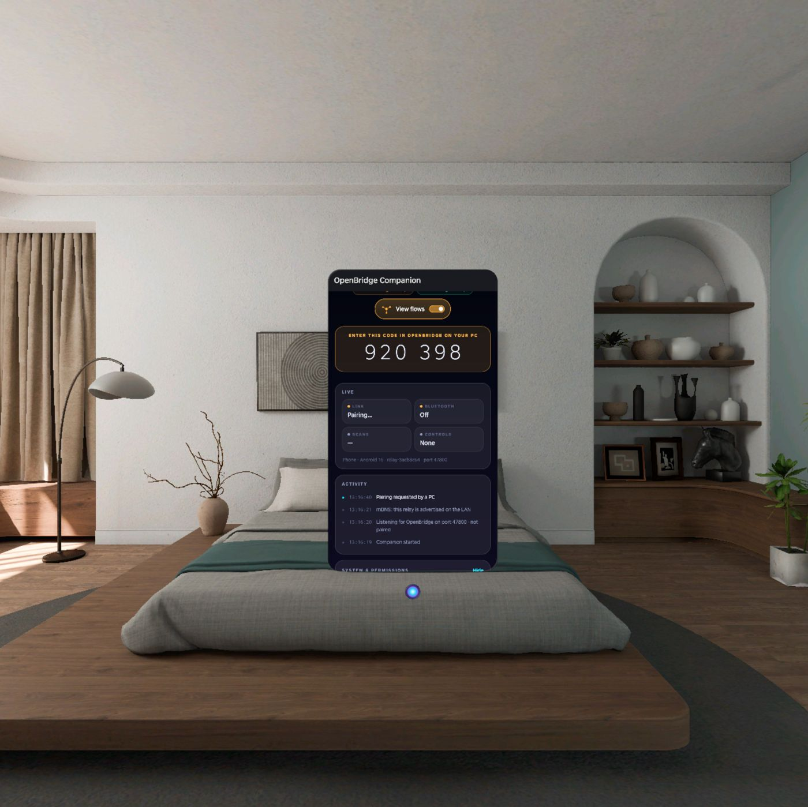

# PICO OS 6 emulator: Companion pairing and signed round trip — 2026-11-24

Official PICO Emulator 6.2.1 (PICO OS 6.2.0, Android 16 / API 36, `swan_oversea_x86_64`, 2160x2158 display),
AVD `OpenBridge_PICO`, started with `pico-cli emulator start`. Driven by `scripts/verify/cloud_e2e.py`
through the real stack: server, discovery, pairing, relay, Companion. How to run it: [PICO_EMULATOR.md](../PICO_EMULATOR.md).

| Step | Result |
|---|---|
| NET-01 server starts | ok |
| NET-02..06 emulator discovered | ok (category `phone`) |
| Companion APK installed | ok (`Success`) |
| NET-04 pair-start | ok, code shown on the headset |
| Code read from the screen | ok (uiautomator) |
| NET-05..08 paired | ok |
| NET-09..11 signed round trip | ok: signed refusal "Bluetooth is off on this device" |
| Oracle: Android service and adb forward agree | ok |
| NET-12/13 revoked relay denied | ok |

Verdict: **PASS** ([verdict.json](pico-emulator-24nov-verdict.json)).

## Limits (honest)

- Emulator, not a headset (level: official platform emulator).
- The Companion was built with `--software-rendering`: the emulator image aborts any hardware-accelerated app
  (arm64 `libspatial_client.so` loaded on x86_64). Real headsets run the normal build.
- Bluetooth is off in the emulator, so the round trip ends in a signed refusal, not a scan result.
- Built from commit 87fa423c8 plus the `cloud_e2e.py` changes in the same pull request (multi-display focus,
  system-dialog tap, skipping offline emulators).
