# AirGradient × OpenBridge

  

**[AirGradient](https://www.airgradient.com)** is an OpenBridge hardware partner. AirGradient makes open-source
air quality monitors: open hardware designs, open firmware, and a documented local API on the monitor itself.

| Hardware | Role in OpenBridge |
|---|---|
| **[AirGradient ONE Indoor Monitor I-9PSL (Kit)](https://www.airgradient.com/shop/#!/AirGradient-ONE-Indoor-Monitor-I-9PSL-Kit/p/594725501)** | Indoor monitor on an ESP32-C3: PM1 / PM2.5 / PM10, CO₂, TVOC and NOx indexes, temperature and humidity, with an OLED screen and an LED bar. Target: air quality as a source OpenBridge can read on the local network and turn into alerts and owner-approved automations. |

## What we are building

1. **Discovery and readings.** Find the monitor on the local network (it announces itself over mDNS) and read
   its current values from its local API (`/measures/current`), with no cloud account.
2. **Air quality on every screen.** Show readings on the TV, the watch, the phone or the ENGO glasses, and as
   buttons or status lines in [custom controls](../CUSTOM_CONTROLS.md).
3. **Alerts and automations, with consent.** For example a reminder on the watch when CO₂ climbs, or the robot
   vacuum and a purifier scheduled around fine dust. Every action still goes through approval and read-back.
4. **Read-only by default.** Changing the monitor's own settings (LED bar, display, calibration) stays out of
   scope until it is tested on the real device and asked for.

## Status

| Step | Status |
|---|---|
| Partnership agreed | Done, 25 Nov 2026 |
| AirGradient ONE (I-9PSL kit) received and assembled | Planned |
| Local API adapter and evidence record on the real monitor | Planned |
| Entry in the [hardware compatibility report](../HARDWARE_TEST_MATRIX.md) | Listed as a partner; test rows are added only once a run on the real monitor passes |

As for every device, nothing is claimed before it is verified on the real hardware. Example values shown in
illustrations are labelled as examples.

## What OpenBridge committed to

These commitments are tracked in [partners.json](partners.json) and checked in CI
([COMMITMENTS.md](COMMITMENTS.md)), so they cannot silently disappear.

1. **Partner credit.** AirGradient is listed as a hardware partner in the README partner section, with links
   to airgradient.com and to the AirGradient ONE I-9PSL kit product page.
2. **Credit in the repository and reports.** AirGradient is credited in the [README](../../README.md), the
   [installation guide](../QUICKSTART.md), the [hardware compatibility report](../HARDWARE_TEST_MATRIX.md) and
   on the project website.

## Contact

info@lepcpro.fr (English or French).
