  

# ENGO × OpenBridge

**Your devices, in your field of view.**

[ENGO](https://www.engoeyewear.com) designs heads-up display (HUD) smart glasses in Grenoble, France. They are built on [ActiveLook](https://www.activelook.net), Microoled's ultra-light, low-power micro-OLED display platform, driven over Bluetooth Low Energy.

ENGO is OpenBridge's first official hardware partner and is sending a pair of glasses for integration and testing.

## Why a heads-up display

OpenBridge already lets you ask any screen (TV, watch, phone, PC) to control the devices around you. Glasses add something no other screen can: **information that reaches you without you looking for it.**

| Situation | Without glasses | With ENGO + OpenBridge |
|---|---|---|
| You send the vacuum back to its dock | Walk over or open an app to check | “Vacuum · docking” appears, then “Docked ✓” |
| An action is refused for safety | You find out later, in the activity log | The reason shows up in your view right away |
| You're wiring a test bench | Look away to a screen for every reading | Sensor values and alerts stay in sight |
| A device drops off the network | Nothing, until something fails | A short alert, the moment it happens |

## What we're building

1. **ActiveLook adapter.** Discover and pair the glasses like any other OpenBridge device, with a verified evidence record.
2. **Status layouts.** A compact, glanceable view of the devices you care about.
3. **Alerts and confirmations.** Refusals, offline devices and “Done, verified” receipts pushed to the display.
4. **Display only, by design.** The glasses show information; they never trigger privileged actions on their own. Every action still goes through approval and read-back.

## Progress

- [x] Partnership confirmed with ENGO
- [ ] Hardware received
- [ ] BLE connection and evidence record (real hardware)
- [ ] Status layout on the glasses
- [ ] Alerts and confirmations
- [ ] Filmed demo with TV, watch and robot vacuum
- [ ] Public, verified compatibility report

Every step will be logged in the [evidence registry](../DEVICE_EVIDENCE.json) once it runs on the real glasses, with the same rules as the rest of the project: nothing simulated is ever counted as physical proof.

## Links

- ENGO glasses: [engoeyewear.com](https://www.engoeyewear.com)
- ActiveLook platform: [activelook.net](https://www.activelook.net)
- OpenBridge: [back to the project](../../README.md)

ENGO, ActiveLook and Microoled names and logos are trademarks of their respective owners and are shown here as part of the hardware partnership.
