# Hardware partners

[← Back to the README](../../README.md) · [Version française](#version-française)

## ENGO × ActiveLook

  

**[ENGO](https://www.engoeyewear.com)** designs heads-up display smart glasses in Grenoble, France, built on **[ActiveLook](https://www.activelook.net)**, Microoled's ultra-light micro-OLED display platform. ENGO is sending OpenBridge a pair of glasses, and together we're bringing OpenBridge into your field of view:

- 👀 **Glanceable status:** see what your devices are doing without reaching for your phone.
- 🔔 **Alerts that find you:** a refused action, a device going offline, a long job finished.
- ✅ **Confirmations in sight:** “Done, verified” appears right where you're already looking.

  
  

## Heltec × ESP32

  

**[Heltec Automation](https://heltec.cn/)** makes IoT and LoRa hardware: ESP32 development boards, LoRa / LoRaWAN modules and nodes. Heltec is sending OpenBridge **one Heltec WiFi LoRa 32 V4 development board** (ESP32-S3 + SX1262 LoRa, Wi-Fi, Bluetooth LE, OLED screen). Thank you, Heltec!

- 🔧 **The first physical ESP32 in the lab:** OpenBridge's ESP32 agent has so far been verified on Espressif's QEMU emulator only; this board takes it onto real hardware.
- 📶 **Wi-Fi, Bluetooth LE and long-range LoRa on one board:** a real test bench for the agent, its screen and its radios.

  
  

## Elecrow

  

**[Elecrow](https://www.elecrow.com)** makes ESP32 displays, boards and modules. Elecrow is sending OpenBridge a **[CrowPanel Advance 4.3-inch](https://www.elecrow.com/crowpanel-advance-4-3-hmi-esp32-800x480-ai-display-ips-touch-artificial-intelligent-screen.html)** touch display (ESP32-S3) and an **ESP32-H2** module (Thread / Zigbee / Matter).

- **A touch control panel:** OpenBridge controls on a dedicated wall or desk screen.
- **Matter and Thread testing** with the ESP32-H2 ([planned notes](elecrow/ESP32-H2_MATTER_THREAD.md), no results claimed yet).

Details, commitments and media authorization: [Elecrow partner page](ELECROW.md).

## Become the next partner

**ENGO and Heltec took the first step. Your devices could be next.**

  

If you build or sell connected devices (smart-home products, robot vacuums, TVs and set-top boxes, wearables, routers and ISP boxes, IoT / maker boards, automotive or industrial equipment), OpenBridge turns your product into a citizen of every home it enters:

- ✨ **New features** your device never shipped: AI-made controls, alerts, voice, cross-device flows.
- 🔌 **Interoperability** with TVs, watches, phones, routers, robots and PCs from other brands.
- 🧪 **Complete test suites and benchmarks** written for your product and run on the real hardware, in CI on three operating systems.
- 📈 **Wider compatibility:** USB, Wi-Fi, BLE or relay, on 6 platforms, even legacy Windows.
- 🖥️ **An emulator of your device**, an expert review of your API / SDK, a **public verified compatibility report**, and your brand featured here like ENGO.

**Your engineers can start today, for free:** the [evaluation licence](../../LICENSES/OpenBridge-Evaluation-1.0.md) lets your company test OpenBridge with your products for 90 days, internally, with no signature. `python -m src.cli partner new "Your Device"` scaffolds an adapter, an emulator and tests that pass on day one ([guide](../INTEGRATE_YOUR_DEVICE.md)). Evaluation, Partner and OEM side by side: **[Plans](PLANS.md)**.

**What I ask in return:** 📦 **hardware to keep** (donated units or a permanent loan, never a time-limited one, so tests and benchmarks keep running on every release), API / SDK documentation, and a technical contact.

🔐 **Your code and data stay yours.** The integration kit is Apache 2.0 and your own code keeps your licence; a written partner licence covers commercial use of the OpenBridge core, and I gladly work under your NDA: confidential material never reaches this repository. [Licensing](../LICENSING.md#commercial--partner-licensing) · [Security](../../SECURITY.md) · [Privacy](../PRIVACY.md)

  
  
  
  
  

I reply in English and French. Commercial licensing and integration partnerships are available on request.

## Version française

**[Elecrow](https://www.elecrow.com)** a rejoint le projet comme **partenaire matériel** : Elecrow nous envoie un écran tactile **[CrowPanel Advance 4,3 pouces](https://www.elecrow.com/crowpanel-advance-4-3-hmi-esp32-800x480-ai-display-ips-touch-artificial-intelligent-screen.html)** (ESP32-S3) et un module **ESP32-H2** (Thread / Zigbee / Matter), pour un écran de commande OpenBridge et des tests Matter / Thread ([page partenaire](ELECROW.md)).

**ENGO** (Grenoble) a rejoint le projet comme **partenaire matériel** : ses lunettes à affichage tête haute, basées sur la plateforme ActiveLook de Microoled, vont afficher l'état de vos appareils directement dans votre champ de vision.

**[Heltec Automation](https://heltec.cn/)** a aussi rejoint le projet comme **partenaire matériel** : Heltec nous envoie une **carte de développement Heltec WiFi LoRa 32 V4** (ESP32-S3 + LoRa SX1262, Wi-Fi, Bluetooth LE, écran OLED). Elle sera le premier ESP32 physique du labo : l'agent ESP32 d'OpenBridge n'a été vérifié jusqu'ici que sur l'émulateur QEMU d'Espressif. Merci Heltec !

**Vous fabriquez ou distribuez des appareils connectés ?** Rejoignez ENGO. Je cherche des partenaires pour du **matériel à conserver** (don ou prêt permanent, jamais de prêt limité dans le temps, pour que les tests et benchmarks tournent à chaque version) et un accès à vos **API / SDK**. En échange : une **intégration native** dans OpenBridge, des **scripts dédiés**, de **nouvelles fonctionnalités**, des **centaines voire milliers de tests et benchmarks sur le matériel réel**, un **rapport de compatibilité public et vérifié**, et un retour technique détaillé sur votre API.

🔐 **Votre code et vos données restent à vous** : le kit d'intégration est sous Apache 2.0 et votre code garde votre licence ; une licence partenaire écrite couvre l'usage commercial du cœur d'OpenBridge, et je travaille volontiers sous NDA ([conditions](PARTNER_LICENSE.md#version-française)). [Plaquette partenaire (PDF, en anglais)](../../site/OpenBridge-Partner-Brief.pdf) · [Site du projet](https://toskaman.github.io/openbridge/)

📩 **info@lepcpro.fr**
