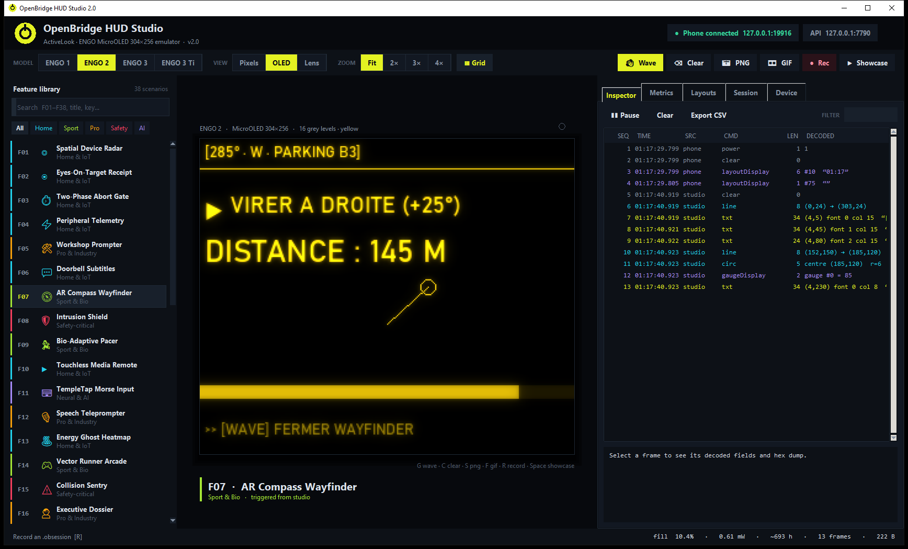
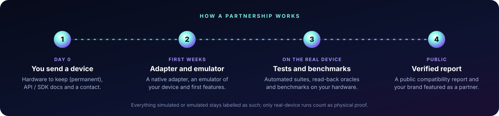

  

# Partner with OpenBridge

**You build connected devices. OpenBridge makes them work with everything around them.**

OpenBridge is a local-first layer that discovers the devices in a home or a company, learns what each one can
*really* do, and lets an AI compose new controls between them: vacuum buttons on a TV, a TV remote on a
watch, alerts in smart glasses. Every action needs the owner's approval and is **checked on the real device**
afterwards. It runs on Windows, Linux, macOS, Android, Android TV and Wear OS, with no runtime dependencies.

For a hardware maker, that means your product stops being an island.

---

## What your company gains

| | What you get | Why it matters |
|---|---|---|
| ✨ | **New features, without new firmware** | OpenBridge composes controls, alerts, voice and cross-device flows on top of what your device already exposes. Your customers get abilities you never shipped. |
| 🔌 | **Interoperability with other brands** | Your device works with TVs, watches, phones, routers, robots and PCs from other vendors, through one consent and verification model, not a pile of one-off integrations. |
| 🧪 | **Complete test suites and benchmarks** | Hundreds of automated tests written for your product (protocol, edge cases, failure paths), plus benchmarks on the real hardware. They keep running on every change, on three operating systems in CI. |
| 📈 | **Wider compatibility** | Your device becomes reachable over USB, Wi-Fi, BLE or through a relay device (a PC without Bluetooth can reach BLE devices through a phone), across 6 platforms and even legacy Windows machines. |
| 🖥️ | **An emulator of your device** | A faithful software model of your product, so your own developers, QA and sales can demo and test without a unit on the desk. |
| 🐞 | **Expert feedback on your API / SDK** | Detailed, reproducible reports from a real-world integrator: quirks, firmware workarounds, documentation gaps. |
| 🧾 | **A public, verified compatibility report** | Every claim is backed by an evidence record. Emulated results are labelled as emulated; only real-device runs count as physical proof. |
| ⭐ | **Visibility** | Your brand featured as a hardware partner on the project page, in the demo videos and in the documentation. |

---

## Current partners

- **[ENGO](ENGO.md)** ([engoeyewear.com](https://www.engoeyewear.com)): heads-up display smart glasses, powered by ActiveLook by Microoled.
- **[Elecrow](ELECROW.md)** ([elecrow.com](https://www.elecrow.com)): [CrowPanel Advance 4.3-inch](https://www.elecrow.com/crowpanel-advance-4-3-hmi-esp32-800x480-ai-display-ips-touch-artificial-intelligent-screen.html) (ESP32-S3) with an ESP32-H2 module for Matter and Thread.

What each partner was promised is tracked in [partners.json](partners.json) and checked in CI ([commitments](COMMITMENTS.md)).

---

## Proof, not promises: the ENGO case study

[ENGO](ENGO.md) (heads-up display smart glasses, built on Microoled's ActiveLook platform) agreed to send a
pair. **Before the glasses even arrived**, OpenBridge delivered:

| Delivered | Details |
|---|---|
| **A pro HUD emulator** | [HUD Studio](engo/19_HUD_STUDIO_EMULATOR.md): pixel-accurate 304×256 MicroOLED with Pixels / OLED / Lens views, frame inspector, metrics, session recording, PNG/GIF export and a JSON control API. |
| **The official app, driving the emulator** | The official ActiveLook Android app (development build) talks to HUD Studio over the same binary protocol, so the real phone-side code path is exercised today. |
| **38 HUD features** | From action receipts and a vacuum radar to a two-phase abort gate and live subtitles, each rendered and measured ([catalogue](engo/18_OPENBRIDGE_NEURAL_SENSORY_EXPANSION.md)). |
| **82 dedicated automated tests** | Protocol encoder, flow control, layouts, gestures, AI bridge and emulator, all green. |
| **19 technical documents** | Hardware specs, BLE protocol manual, full opcode reference, Wireshark dissector, firmware pitfalls, ergonomics benchmark ([hub](engo/README.md)). |

  
   HUD Studio emulating ENGO glasses. Validated in the emulator; hardware tests start when the pair arrives.

---

## How it works

  

**What we ask:** 📦 **hardware to keep**: donated units or a permanent loan, not a time-limited loan. Integration,
regression tests and benchmarks run on every release for the life of the integration, so the device has to stay on
the bench. Plus access to APIs, SDKs or developer documentation, and
a technical contact for integration questions.

**Try it first, for free:** the [evaluation licence](../../LICENSES/OpenBridge-Evaluation-1.0.md) lets your engineers
install and test OpenBridge with your products for 90 days, internally, with no signature. What each plan includes
(Evaluation, Partner, OEM, and services such as audits, voice models and skill packs) is on [Plans](PLANS.md).

---

## Who we are looking for

| Category | Examples |
|---|---|
| 🏠 Smart home | plugs, lights, thermostats, locks, sensors, Matter / Thread / Zigbee bridges |
| 🤖 Robots | robot vacuums and mops, lawn mowers, pool robots |
| 📺 Screens | TVs, set-top boxes, projectors, soundbars |
| ⌚ Wearables | watches, smart glasses and HUDs, rings, fitness sensors |
| 🌐 Networking | routers and ISP boxes, mesh Wi-Fi, NAS |
| 🔧 Makers and industry | ESP32 / IoT boards, industrial gateways, test benches |
| 🚗 Mobility | EV chargers, automotive and e-bike interfaces |

---

## Frequently asked questions

**Does OpenBridge change my device's behaviour or settings on its own?**
No. Nothing privileged runs without the owner's explicit approval, every action is verified by reading the
device back, and some categories are blocked by policy (for example, OpenBridge never changes router
settings).

**Does user data go to a cloud?**
No by default. The AI runs locally on the user's machine; OpenBridge ships no paid model. A hosted AI is used
only if the owner connects one by hand ([details](../AI_PROVIDERS.md)).

**Who owns the integration code?**
You do. The integration kit and everything `openbridge partner new` generates (adapter, emulator, tests, checklist)
are **Apache 2.0**, and the code you write is yours, under the licence you choose: you can keep it in your own
repository and ship it. The OpenBridge core it runs on stays under [PolyForm Strict 1.0.0](../../LICENSE) (read, run
and test, noncommercial); using the core commercially (your QA and CI, customer demos, shipping it in your products)
is covered by a written [partner licence](PARTNER_LICENSE.md). Details: [licensing](../LICENSING.md).

**Can our documentation stay confidential?**
Working under an NDA can be arranged: what you share confidentially stays out of the public repository, and
only what you approve is published.

---

  
  
  
  
  

Replies in English and French. [Security](../../SECURITY.md) · [Privacy](../PRIVACY.md) · <a href="../../README.md">Back to the project</a>.

