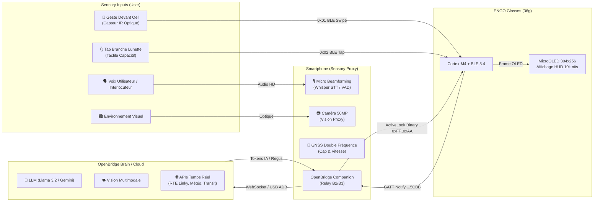

# ENGO × OpenBridge: Phone-as-Sensory-Proxy & AI Integration Architecture

> **Architecture Technique Officielle**  
> Comment connecter une IA multimodale, la reconnaissance vocale et des APIs temps réel sur des lunettes sans microphone ni caméra (ENGO 1, ENGO 2, ENGO 3, ENGO 3 Titanium).

---

## 1. La Réalité Matérielle : Zéro Capteur Audio/Optique Embarqué

Les lunettes intelligentes **ENGO Eyewear** (technologie ActiveLook® par MicroOLED) possèdent des spécifications optiques et biomécaniques inégalées :
- **Poids plume :** 28,9 g (Titanium) à 36 g (Standard).
- **Autonomie record :** 20 à 24 heures d'utilisation active continue.
- **Affichage collimaté :** MicroOLED 304×256 pixels, luminance crête 10 000 nits, focalisé à l'infini (3 mètres).
- **Capteurs embarqués :** Capteur optique infrarouge de proximité (swipe sans contact) et surface capacitive sur la branche.

> [!IMPORTANT]
> **ENGO n'intègre NI microphone, NI haut-parleur, NI caméra.**  
> C'est précisément l'absence de ces composants énergivores qui leur permet de peser moins de 36 grammes et de tenir plus de 20 heures sans recharge. Pour les transformer en lunettes de réalité augmentée IA de science-fiction, OpenBridge applique le paradigme du **Phone-as-Sensory-Proxy**.

---

## 2. Le Paradigme "Phone-as-Sensory-Proxy"

L'utilisateur porte ses lunettes ENGO sur le visage et garde son smartphone dans sa poche, sur un support de guidon de vélo ou un harnais torse.



### Rôles du Smartphone :
1. **Microphone Beamforming :** Écoute directionnelle avec annulation de bruit active pour le modèle Speech-to-Text Whisper.
2. **Caméra Multimodale :** Capture haute résolution (50MP) déclenchée à la demande pour l'analyse visuelle multimodale.
3. **Passerelle Réseau Haute Vitesse :** Connexion 5G / Wi-Fi 6 vers le cerveau OpenBridge (local sur PC ou cloud).

---

## 3. Les 4 Fonctionnalités IA & APIs Impossibles sur Montre

### 🎙️ Fonctionnalité A : Mind's Eye — Co-Pilote Vocal IA Touchless
*Problème résolu : Consulter une IA tout en ayant les mains prises (vélo, bricolage, cuisine, chirurgie).*
- **Cycle d'interaction 3 phases :**
  1. **Phase 1 (Wake) :** Un simple geste de la main devant le front (`wave` IR) active instantanément le micro du smartphone. L'écran HUD affiche un bandeau discret : `🎙 PHONE MIC LISTENING... Parlez naturellement...`.
  2. **Phase 2 (Exécution) :** Dès la fin de la parole (ou par un second `wave`), l'audio est transcrit par Whisper et envoyé au LLM (Llama 3.2 local ou Gemini). La réponse synthétique est projetée dans le HUD sous forme de carte à fort contraste.
  3. **Phase 3 (Dismiss) :** Un troisième `wave` efface l'écran et restaure la vision ambiante transparente.

### 👁️ Fonctionnalité B : Sight-Through-Phone — Scanner de Vision Multimodale
*Problème résolu : Diagnostiquer un tableau électrique, une panne mécanique ou traduire un texte sans quitter des yeux son travail.*
- **Déclenchement :** Double tap sur la branche de la lunette.
- Le smartphone capture instantanément un instantané optique haute définition.
- Le modèle de vision multimodale OpenBridge localise le composant cible et injecte son diagnostic dans le champ visuel :
  - `👁️ [DISJONCTEUR #4] DIAGNOSTIC VISION : Position BASSE (Chauffe-eau déclenché).`

### 🌐 Fonctionnalité C : The Silent Interpreter — Sous-Titres de Traduction en Temps Réel
*Problème résolu : Comprendre un interlocuteur étranger sans regarder un écran de smartphone ni porter d'écouteurs traducteurs isolants.*
- Le smartphone capte la parole étrangère ambiante (ex: Anglais, Espagnol).
- Le moteur de streaming Whisper + Traduction génère le texte français avec une latence < 300 ms.
- La lunette affiche les sous-titres dans la zone inférieure collimatée (`stream_live_translation`), préservant le contact visuel direct avec l'interlocuteur.

### ⚡ Fonctionnalité D : Injecteur d'APIs Périphériques Temps Réel
1. **RTE Tempo & Linky :**
   - Alerte visuelle de couleur : Jour de pointe Blanc ou Rouge pour demain (`⚡ RTE TEMPO : DEMAIN ROUGE`).
   - Puissance instantanée appelée en Watts avec jauge visuelle dynamique.
2. **Radar de Précipitations Météo :**
   - Alerte pluie imminente : `🌧️ PLUIE DANS : 10 MINUTES | Temp: 13°C | Vent: 28 km/h`.
   - Jauge d'imminence visuelle (0 à 100%).
3. **Transit Urbain en Direct :**
   - Prochain métro / bus en temps réel : `🚇 M14 Direction Orly : PROCHAIN 3 MIN ⬆`.

---

## 4. Métriques Optiques et Consommation Énergétique

Contrairement aux écrans AMOLED de montres connectées qui allument des millions de sous-pixels (consommation 50 à 120 mW), l'architecture OpenBridge pour MicroOLED ActiveLook maintient une sobriété extrême :

| Scénario HUD | Octets Transférés | Taux de Remplissage Pixels | Puissance MicroOLED | Autonomie Théorique Affichage |
| :--- | :---: | :---: | :---: | :---: |
| **Radar Spatial Périphérique** | 340 o | **1,47 %** | **0,34 mW** | **1 235 heures** |
| **Co-Pilote Vocal IA (Réponse)** | 218 o | **3,29 %** | **0,45 mW** | **944 heures** |
| **Télémétrie Périphérique Linky** | 67 o | **18,50 %** | **0,86 mW** | **497 heures** |
| **Reçu Eyes-On-Target** | 274 o | **12,47 %** | **0,67 mW** | **630 heures** |
| **Prompteur d'Atelier (Étape)** | 236 o | **5,25 %** | **0,46 mW** | **928 heures** |
| **Sous-Titres Traduction Directe** | 184 o | **7,82 %** | **0,53 mW** | **801 heures** |

---

## 5. Guide d'Utilisation dans l'Émulateur

L'émulateur interactif intègre désormais une barre d'outils dédiée **AI/Sensory** :
```bash
# Lancer l'émulateur avec la barre IA et les démos interactives :
python -m src.adapters.activelook_emulator
```

Boutons disponibles dans l'interface :
- `🎙️ Voice AI` : Simule l'activation vocale touchless via geste wave.
- `👁️ Phone Vision` : Déclenche le scan multimodale via tap sur la branche.
- `🌐 Subtitles` : Affiche le flux de traduction sous-titrée en direct.
- `🌧️ Weather` : Injecte l'alerte radar de précipitations.
- `⚡ RTE Tempo` : Affiche la couleur du jour RTE et la consommation live.
- `🚇 Transit` : Simule l'affichage du prochain train/métro.
