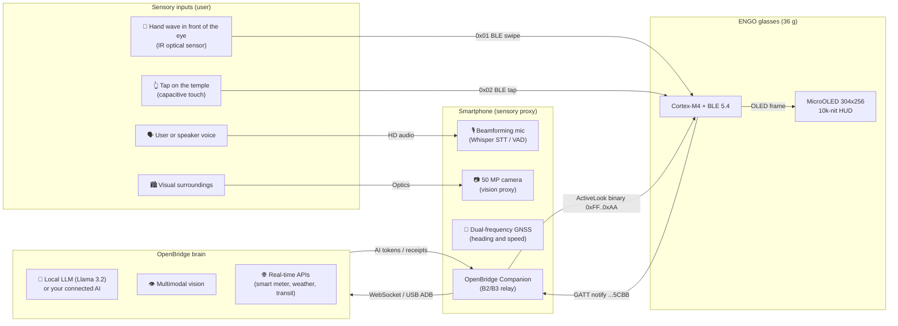

# ENGO × OpenBridge: Phone-as-Sensory-Proxy and AI Integration Architecture

> **Technical architecture.**
> How to bring multimodal AI, speech recognition and real-time APIs to glasses that have no microphone and
> no camera (ENGO 1, ENGO 2, ENGO 3, ENGO 3 Titanium).
>
> **Status: design, validated in the emulator only.** No physical pair has been tested yet.

---

## 1. The hardware reality: no audio or optical sensors on board

**ENGO Eyewear** smart glasses (ActiveLook® technology by Microoled) have outstanding optical and
biomechanical specifications:
- **Featherweight:** 28.9 g (Titanium) to 36 g (Standard).
- **Long battery life:** 20 to 24 hours of continuous active use.
- **Collimated display:** 304×256-pixel MicroOLED, 10,000-nit peak luminance, focused at infinity (3 m).
- **On-board sensors:** infrared proximity sensor (touchless swipe) and a capacitive surface on the temple.

> [!IMPORTANT]
> **ENGO has NO microphone, NO speaker and NO camera.**
> Leaving out these power-hungry parts is exactly what keeps the glasses under 36 grams and above 20 hours
> per charge. To turn them into AI-assisted glasses, OpenBridge applies the **phone-as-sensory-proxy** pattern.

---

## 2. The "phone-as-sensory-proxy" pattern

The user wears the ENGO glasses and keeps the smartphone in a pocket, on a bike mount or on a chest harness.



### What the smartphone does
1. **Beamforming microphone:** directional listening with active noise reduction for Whisper speech-to-text.
2. **Multimodal camera:** on-demand high-resolution capture (50 MP) for visual analysis.
3. **High-speed network gateway:** 5G / Wi-Fi 6 link to the OpenBridge brain (local on the PC, or the AI the
   owner connected; OpenBridge ships no paid model, see [AI_PROVIDERS.md](../../AI_PROVIDERS.md)).

---

## 3. Four AI and API features a watch cannot offer

### 🎙️ Feature A: Mind's Eye, a touchless AI voice co-pilot
*Problem solved: ask an AI while your hands are busy (cycling, DIY, cooking, surgery).*
- **Three-phase interaction:**
  1. **Phase 1 (wake):** a simple hand wave in front of the forehead (IR `wave`) turns on the phone's
     microphone. The HUD shows a discreet banner: `🎙 PHONE MIC LISTENING... Speak naturally...`.
  2. **Phase 2 (run):** when speech ends (or on a second `wave`), the audio is transcribed by Whisper and sent
     to the model (local Llama 3.2 or the owner's connected AI). The short answer is shown on the HUD as a
     high-contrast card.
  3. **Phase 3 (dismiss):** a third `wave` clears the screen and restores clear ambient vision.

### 👁️ Feature B: Sight-Through-Phone, a multimodal vision scanner
*Problem solved: diagnose a breaker panel, a mechanical fault or translate a sign without taking your eyes off the job.*
- **Trigger:** double tap on the temple.
- The smartphone captures a high-definition snapshot.
- The multimodal vision model locates the target component and puts its diagnosis in the field of view:
  - `👁️ [BREAKER #4] VISION DIAGNOSIS: position DOWN (water heater tripped).`

### 🌐 Feature C: The Silent Interpreter, live translated subtitles
*Problem solved: understand someone speaking another language without looking at a phone or wearing isolating translation earbuds.*
- The smartphone picks up the foreign speech nearby (e.g. English, Spanish).
- The streaming Whisper + translation engine produces text in the user's language with < 300 ms latency.
- The glasses show the subtitles in the lower collimated area (`stream_live_translation`), so the user keeps
  direct eye contact with the speaker.

### ⚡ Feature D: Real-time peripheral API injector
1. **Electricity tariff and smart meter (e.g. RTE Tempo / Linky in France):**
   - Colour alert for tomorrow's peak-price day (`⚡ RTE TEMPO: TOMORROW RED`).
   - Live power draw in watts with a dynamic gauge.
2. **Rain radar:**
   - Imminent rain alert: `🌧️ RAIN IN: 10 MINUTES | Temp: 13°C | Wind: 28 km/h`.
   - Visual imminence gauge (0 to 100 %).
3. **Live public transit:**
   - Next metro / bus in real time: `🚇 M14 to Orly: NEXT IN 3 MIN ⬆`.

---

## 4. Optical and power metrics (modelled)

Smartwatch AMOLED screens light millions of sub-pixels (50 to 120 mW). OpenBridge's layouts for the
ActiveLook MicroOLED stay extremely frugal. Figures below are **computed from pixel fill rates in the
emulator**, not measured on hardware:

| HUD scenario | Bytes sent | Pixel fill rate | MicroOLED power | Theoretical display time |
| :--- | :---: | :---: | :---: | :---: |
| **Peripheral spatial radar** | 340 B | **1.47 %** | **0.34 mW** | **1,235 h** |
| **AI voice co-pilot (answer)** | 218 B | **3.29 %** | **0.45 mW** | **944 h** |
| **Smart-meter telemetry** | 67 B | **18.50 %** | **0.86 mW** | **497 h** |
| **Eyes-on-target receipt** | 274 B | **12.47 %** | **0.67 mW** | **630 h** |
| **Workshop prompter (step)** | 236 B | **5.25 %** | **0.46 mW** | **928 h** |
| **Live translated subtitles** | 184 B | **7.82 %** | **0.53 mW** | **801 h** |

---

## 5. Using it in the emulator

The interactive emulator has a dedicated **AI/Sensory** toolbar:
```bash
# Launch the emulator with the AI toolbar and interactive demos:
python -m src.adapters.activelook_emulator
```

Buttons available:
- `🎙️ Voice AI`: simulates touchless voice activation with a wave gesture.
- `👁️ Phone Vision`: triggers the multimodal scan with a temple tap.
- `🌐 Subtitles`: shows the live translated subtitle stream.
- `🌧️ Weather`: injects the rain-radar alert.
- `⚡ RTE Tempo`: shows the tariff colour of the day and live consumption.
- `🚇 Transit`: simulates the next train / metro display.
