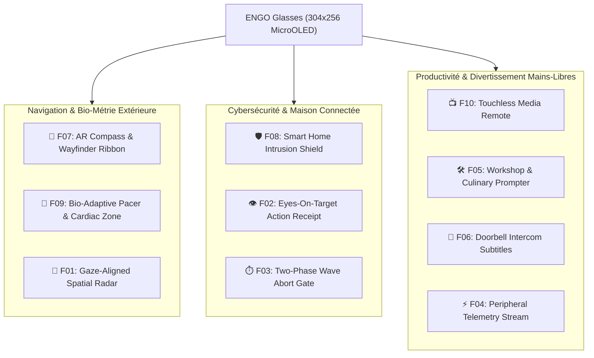

# Catalogue des Fonctionnalités HUD Avancées & Synergies Écosystème

> **Dossier R&D — Fonctionnalités "Watch-Impossible" v2.0**  
> 10 cas d'usage immersifs impossibles sur smartphone ou montre connectée, conçus spécifiquement pour l'affichage collimaté 304×256 MicroOLED des lunettes ENGO.

---

## 1. Vue d'Ensemble des 10 Fonctionnalités Matérielles



---

## 2. Spécification Détaillée des 4 Nouvelles Fonctionnalités

### 🧭 Fonctionnalité F07 : AR Compass Ribbon & Outdoor Wayfinder (`push_compass_wayfinder`)
* **Problème résolu :** Retrouver sa voiture sur un parking géant, garder le cap en randonnée ou en trail sans sortir son téléphone ni dévier son regard vers son poignet.
* **Architecture Visuelle :**
  - **Ruban de cap 360° (y: 0 à 24) :** Affiche le cap courant et le point cardinal (`[ 285° · W · PARKING B3 ]`).
  - **Chevron d'angle relatif :** Calcule en continu le delta angulaire entre la direction du regard et la cible :
    - Si $|\Delta| \le 15^\circ$ : `▲ TOUT DROIT (SUR CIBLE)` (Vert).
    - Si $\Delta > +15^\circ$ : `▶ VIRER A DROITE (+XX°)` (Ambre).
    - Si $\Delta < -15^\circ$ : `◀ VIRER A GAUCHE (-XX°)` (Ambre).
  - **Vecteur de direction & jauge de distance :** Jauge dynamique de 0 à 100% représentant la progression d'arrivée.
* **Métriques :** 212 octets BLE, 6,91% de remplissage d'écran, **0,51 mW** de puissance (autonomie continue : **838 heures**).

---

### 🛡️ Fonctionnalité F08 : Intrusion Shield & Alerte Réseau en Temps Réel (`push_smart_home_security_alert`)
* **Problème résolu :** Être alerté instantanément d'une anomalie critique de cybersécurité (scan de port rogue sur le Wi-Fi domestique, nouvel appareil non identifié) et pouvoir l'isoler sans toucher à un ordinateur.
* **Comportement :**
  1. Le moniteur réseau OpenBridge (branché sur l'API Freebox Pop) détecte un scan SYN suspect depuis l'adresse IP `192.168.1.189`.
  2. Les lunettes affichent un encadré rouge vif d'alerte :
     - `🛡️ INTRUSION SHIELD ALERT`
     - `MENACE : SYN Port Scan (Port 22 SSH)`
     - `IP Source : 192.168.1.189 | Constructeur : Rogue Pi`
  3. **Action Touchless 1-Geste :** L'encadré bas invite à un balayage de la main :
     - `>> [WAVE] ISOLER SUR FREEBOX`
  4. Dès le balayage IR capté (`0x01`), OpenBridge envoie l'instruction à la Freebox pour bannir l'adresse MAC du réseau local.
* **Métriques :** 310 octets BLE, 2,99% de remplissage, **0,39 mW** de puissance (autonomie continue : **1 090 heures**).

---

### 🏃 Fonctionnalité F09 : Bio-Adaptive Pacer & Gardien de Zone Cardiaque (`push_bio_adaptive_pacer`)
* **Problème résolu :** En course à pied ou fractionné, regarder sa montre toutes les 10 secondes casse la foulée et oblige à une accommodation oculaire fatigante (1,85 seconde).
* **Affichage Tête Haute Collimaté :**
  - **Bandeau Fréquence Cardiaque Dynamique :** Couleur indexée sur la zone physiologique de l'utilisateur :
    - Zone 1–2 (Récupération / Endurance fondamentale) : Cyan.
    - Zone 3 (Aérobie) : Vert.
    - Zone 4 (Seuil Lactique) : Ambre (`ZONE 4: SEUIL LACTIQUE`).
    - Zone 5 (Effort Maximal) : Rouge clignotant.
  - **Métronome Visuel de Cadence :** Affiche la cadence réelle (ex: 174 SPM) face à la cible (180 SPM), avec curseur centré à 50% sur la jauge `0x70`.
  - **Conseil Biomécanique Direct :** `▲ ACCELERER (+6 SPM) | AUGMENTER FREQUENCE`.
* **Métriques :** 258 octets BLE, 7,68% de remplissage, **0,53 mW** de puissance (autonomie continue : **801 heures**).

---

### 📺 Fonctionnalité F10 : Télécommande Média Touchless Glance-to-Control (`push_media_remote_hud`)
* **Problème résolu :** Contrôler le son ou la lecture de son téléviseur de salon (Kodi, Android TV, barre de son) tout en cuisinant ou en bricolant, sans télécommande physique ni smartphone.
* **Interface Projetée :**
  - **État de Lecture :** `▶ CONTROLE MEDIA : EN LECTURE` (Vert) ou `⏸ PAUSE` (Ambre).
  - **Métadonnées Piste :** Titre de la vidéo / musique et périphérique source (`Kodi Salon (4K HDR)`).
  - **Double Jauge :**
    - Jauge 0 : Progression de lecture dans le média (`00:57:00 / 02:46:00`).
    - Jauge 1 : Volume sonore de la pièce (ex: 45%).
  - **Interactions Gestuelles :**
    - Swipe main devant l'œil (`wave`) : Play / Pause.
    - Tap sur la branche (`tap`) : Volume +5%.
* **Métriques :** 286 octets BLE, 9,70% de remplissage, **0,59 mW** de puissance (autonomie continue : **719 heures**).

---

## 3. Matrice Comparative des 10 Fonctionnalités Implémentées

| Réf | Fonctionnalité HUD | Déclencheur | Octets BLE | Remplissage Pixels | Puissance MicroOLED | Autonomie Continue |
| :-: | :--- | :--- | :---: | :---: | :---: | :---: |
| **F01** | **Radar Spatial Périphérique** | Événement IoT | 340 o | **1,46 %** | **0,34 mW** | **1 235 h** |
| **F02** | **Reçu d'Action In-Situ (Oracle)** | Commande domotique | 274 o | **12,58 %** | **0,68 mW** | **627 h** |
| **F03** | **Two-Phase Commit Abort Gate** | Routine critique | 195 o | **19,06 %** | **0,87 mW** | **487 h** |
| **F04** | **Télémétrie Périphérique Linky** | Débordement seuil | 67 o | **19,06 %** | **0,87 mW** | **487 h** |
| **F05** | **Prompteur Atelier / Recette** | Balayage IR main | 236 o | **5,33 %** | **0,46 mW** | **923 h** |
| **F06** | **Sous-Titres Directs Interphone** | Sonnette connectée | 160 o | **35,98 %** | **1,38 mW** | **308 h** |
| **F07** | **AR Compass & Wayfinder Ribbon** | Orientation GPS | 212 o | **6,91 %** | **0,51 mW** | **838 h** |
| **F08** | **Intrusion Shield & Alerte Réseau** | Détection Freebox | 310 o | **2,99 %** | **0,39 mW** | **1 090 h** |
| **F09** | **Bio-Adaptive Cadence Pacer** | Capteur cardio BLE | 258 o | **7,68 %** | **0,53 mW** | **801 h** |
| **F10** | **Télécommande Média Touchless** | Regard vers l'écran | 286 o | **9,70 %** | **0,59 mW** | **719 h** |
| **TOTAL** | **10 Scénarios Combinés** | — | **2 338 o** | **Moy. 12,0 %** | **Moy. 0,66 mW** | **~780 h** |

---

## 4. Tests et Démarrage dans l'Émulateur

Toutes les fonctionnalités sont immédiatement testables dans l'émulateur interactif via la nouvelle barre d'outils **Watch-Impossible** :
```bash
# Lancement de l'émulateur complet :
python -m src.adapters.activelook_emulator
```

Boutons disponibles :
- `🧭 AR Compass` : Rendu du ruban 360° et calcul de l'angle de braquage relatif.
- `🛡️ Shield Alert` : Simulation de l'intrusion réseau avec invite d'isolation Freebox.
- `🏃 Bio Pacer` : Démonstration du métronome visuel et des zones cardiaques.
- `📺 Media Remote` : Interface de télécommande téléviseur avec progression et volume.
