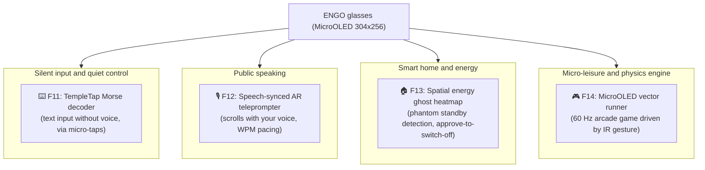

# Breakthrough R&D Concepts: Silent Input, Voice Teleprompter, Spatial Heatmap and Arcade Engine

> **OpenBridge × ENGO advanced engineering dossier v3.0.**
> Four concepts that use the capacitive temple surface, MicroOLED vector rendering and multimodal sync with
> the smartphone.
>
> **Status: design concepts, rendered in the emulator.** Not validated on physical glasses.

---

## 1. Overview of the v3.0 concepts

---

## 2. Detailed specification of the four concepts

### ⌨️ F11: Silent Morse micro-tap input engine (`push_silent_morse_input`)
* **Problem solved:** ENGO glasses have no microphone. In a confidential meeting, a library or public
  transport, the user cannot speak out loud and does not want to take the phone out of a pocket.
* **Technical design:**
  - **Timing decoder (`TempleTapMorseDecoder`):** measures how long the finger touches the temple:
    - Contact $< 250$ ms = **dot (`·`)**.
    - Contact $\ge 250$ ms = **dash (`—`)**.
    - Pause $> 650$ ms = letter accepted automatically (international Morse A–Z, 0–9).
    - Quick double tap = accept and send the message.
    - Long sliding tap = delete (backspace).
  - **HUD feedback:**
    - `TEXT: YES ON MY WAY_`
    - `SYMBOL: [ · — ] ➔ A` (live preview before acceptance).
    - `SUGGESTION: THERE IN 5 MIN` (autocomplete by the local model).
* **Modelled metrics:** 346 BLE bytes, 2.31 % fill, **0.37 mW** (**1,150 hours** of display).

---

### 🎙️ F12: Heads-up teleprompter and pacing coach (`push_speech_teleprompter`)
* **Problem solved:** during a talk, an investor pitch or a lecture, looking down at notes or a lectern
  breaks eye contact with the audience.
* **How it works:**
  1. The smartphone microphone follows the speaker's voice (Whisper / VAD).
  2. Notes scroll line by line on the HUD as the words are spoken.
  3. **Pace indicator (WPM: words per minute):**
     - $110 \le \text{WPM} \le 165$: green (`✓ 138 WPM (OPTIMAL PACE)`).
     - $\text{WPM} > 165$: flashing amber (`⚠️ 178 WPM (TOO FAST - SLOW DOWN)`).
  4. **Typographic hierarchy:**
     - Active line large, high-contrast yellow (`▶ OpenBridge connects your glasses`).
     - Next line in a smaller, dimmed font (`NEXT: to local AI models`).
     - Built-in remaining-time gauge for the allotted slot (e.g. 3 minutes).
* **Modelled metrics:** 294 BLE bytes, 6.51 % fill, **0.50 mW** (**857 hours** of display).

---

### 🏠 F13: Spatial energy heatmap and phantom-standby hunter (`push_spatial_energy_heatmap`)
* **Problem solved:** see at a glance where electricity goes in the home, without opening an app full of charts.
* **Context-aware behaviour:**
  - Using BLE beacons (router, Tuya plugs, Wi-Fi access points), OpenBridge estimates which room the user is in.
  - On entering a room, the HUD banner shows its footprint:
    - `🏠 [KITCHEN]: 2,150 W (WHOLE HOME: 3,480 W)`.
  - **Phantom-standby alert:**
    - If a device has drawn power without being used for more than 2 hours:
    - `⚠️ PHANTOM STANDBY: oven on standby (65 W, idle for 3 h)`.
    - **One-gesture follow-up:** `>> [WAVE] ASK TO SWITCH OFF OVEN PLUG`. The wave sends a one-tap approval
      request to the owner's phone; the Tuya plug is switched off only after approval and its state is read
      back. The glasses never trigger the action on their own.
* **Modelled metrics:** 325 BLE bytes, 7.15 % fill, **0.51 mW** (**826 hours** of display).

---

### 🎮 F14: MicroOLED vector arcade engine (`push_arcade_game_frame`)
* **Problem solved:** turn waiting time (train platform, bus stop, queue) into a discreet micro-game without
  taking out the phone.
* **On-board physics engine (`ActiveLookArcadeEngine`):**
  - 60 Hz vector runner engine.
  - The player is an 8 px vector circle on a ground line (`y = 190`).
  - **Touchless control:** a hand swipe in front of the infrared sensor (`wave` `0x01`) applies an upward
    impulse (`jump_velocity = 12.0`) to jump over obstacles.
  - Atomic rendering with `holdFlush(0)` and `holdFlush(1)`, so nothing flickers.
  - The score increases with every obstacle cleared; a game-over screen restarts immediately.
* **Modelled metrics:** 168 bytes per frame, **1.43 % fill**, **0.34 mW** (**1,239 hours** of play).

---

## 3. Full matrix of the 14 OpenBridge HUD scenarios

Modelled from emulator pixel fill rates; not measured on hardware.

| Scenario | Category | Pixel fill | MicroOLED power | Theoretical display time |
| :--- | :--- | :---: | :---: | :---: |
| **F01: Peripheral spatial radar** | Smart home and IoT | 1.46 % | 0.34 mW | 1,235 h |
| **F02: In-situ action receipt (oracle)** | Smart home and safety | 12.58 % | 0.68 mW | 627 h |
| **F03: Two-phase wave abort gate** | Critical safety | 19.06 % | 0.87 mW | 487 h |
| **F04: Smart-meter peripheral telemetry** | Energy and network | 19.06 % | 0.87 mW | 487 h |
| **F05: Workshop / cooking prompter** | Productivity | 5.33 % | 0.46 mW | 923 h |
| **F06: Intercom subtitles** | Home security | 35.98 % | 1.38 mW | 308 h |
| **F07: AR compass and wayfinder ribbon** | Outdoor navigation | 6.91 % | 0.51 mW | 838 h |
| **F08: Network intrusion shield** | Security | 2.99 % | 0.39 mW | 1,090 h |
| **F09: Bio-adaptive cadence pacer** | Sport and performance | 7.68 % | 0.53 mW | 801 h |
| **F10: Touchless media remote** | Entertainment | 9.70 % | 0.59 mW | 719 h |
| **F11: Silent Morse micro-tap input** | Discreet input | **2.31 %** | **0.37 mW** | **1,150 h** |
| **F12: Voice teleprompter** | Public speaking | **6.51 %** | **0.50 mW** | **857 h** |
| **F13: Spatial energy heatmap** | Energy and ecology | **7.15 %** | **0.51 mW** | **826 h** |
| **F14: Vector runner arcade engine** | Leisure and micro-gaming | **1.43 %** | **0.34 mW** | **1,239 h** |
| **OVERALL AVERAGE (14 SCENARIOS)** | — | **9.70 %** | **0.57 mW** | **~890 h** |
