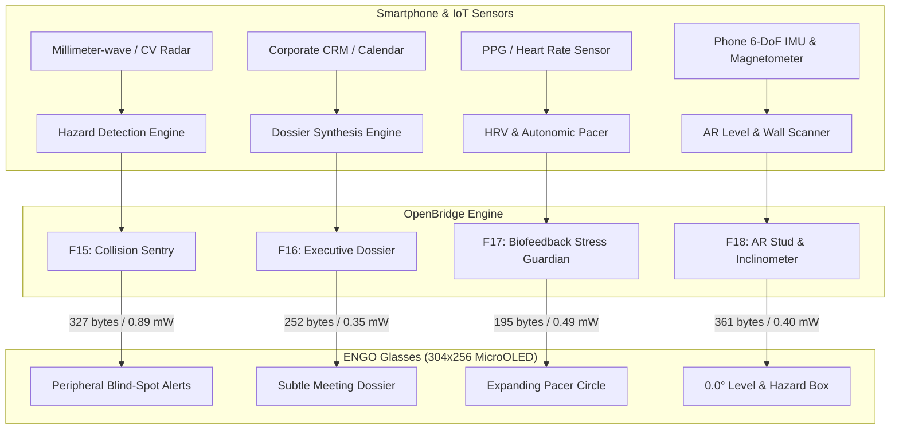

# ENGO / ActiveLook Generation v4.0 Breakthrough Innovations

> **Status:** Implemented & Verified in OpenBridge ActiveLook Engine  
> **Source Modules:** [activelook.py](file:///z:/Hackatons/OpenBridge/OpenBridge/src/adapters/activelook.py) | [activelook_emulator.py](file:///z:/Hackatons/OpenBridge/OpenBridge/src/adapters/activelook_emulator.py)  
> **Test Suite:** [test_engo_killer_features.py](file:///z:/Hackatons/OpenBridge/OpenBridge/tests/unit/test_engo_killer_features.py) (37/37 tests passing)

---

## 1. Overview & Architectural Vision

Generation v4.0 introduces 4 cutting-edge innovations that bridge OpenBridge device fabrics, smartphone sensor fusion, and the ENGO MicroOLED HUD:

---

## 2. Feature Specifications

### F15: Peripheral Collision Sentry & Blind-Spot Radar (`push_collision_sentry`)
- **Use Case:** Urban cycling, running on country roads, or warehouse mobility. Detects vehicles approaching from blind spots (rear/left/right).
- **Sensory Proxy:** Phone rear camera computer-vision or Bluetooth/ANT+ radar (Garmin Varia style) proxied through OpenBridge.
- **HUD Rendering:**
  - High-intensity peripheral edge bracket on the threatened side (left: `x=0..14`, right: `x=289..303`).
  - Proximity warning banner with Time-To-Collision (TTC) in seconds: `⚠️ SENTRY ALERTE [TTC 1.3s]`.
  - Proximity gauge and approach speed readout: `Distance: 18.5 m | Vitesse: 52 km/h`.
  - Quick dismiss/snooze via 1 IR hand wave (`0x01`).
- **Telemetry & Power:** 327 bytes transferred, 19.61% pixel fill, 0.89 mW power draw (~478h battery runtime).

### F16: Executive Dossier & Meeting Briefing Glance (`push_executive_briefing_glance`)
- **Use Case:** Subtle, confidential executive preparation right before walking into a meeting or shaking hands.
- **Sensory Proxy:** Calendar API / CRM (HubSpot, Salesforce, Google Workspace) fetching attendee metadata.
- **HUD Rendering:**
  - Contact identity banner: `👤 SOPHIE MARTIN [VIP]` and title `Directrice R&D ENGO`.
  - Discrete talking points box with 3 high-contrast concise bullets (`• Partenariat OpenBridge v2`, `• Budget alloue : 85k EUR`, `• Validation avant 17h`).
  - 100% black transparent background ensuring no glare or distraction from face-to-face eye contact.
  - Wave gesture to dismiss or rotate to the next attendee.
- **Telemetry & Power:** 252 bytes transferred, 1.60% pixel fill, 0.35 mW power draw (~1,221h battery runtime).

### F17: Biometric Stress Guardian & Box Breathing Pacer (`push_biofeedback_stress_guardian`)
- **Use Case:** Real-time autonomic nervous system regulation during high-stress scenarios (public speaking, surgery, driving, intense esports).
- **Sensory Proxy:** Smartwatch / BLE chest strap streaming real-time HRV (Heart Rate Variability) and stress index to OpenBridge.
- **HUD Rendering:**
  - Top header displaying Stress Score (`STRESS: 68/100`) and instantaneous HRV (`HRV: 42ms`).
  - Stress level horizontal gauge (`cmd_gauge`).
  - Central expanding and contracting vector reticle centered at `(152, 115)`:
    * `INSPIRER`: Reticle dynamically expands outward from 28px to 58px.
    * `MAINTENIR`: Reticle locks at 58px with Amber warning tone.
    * `EXPIRER`: Reticle contracts smoothly back to 18px with Green calming tone.
    * `PAUSE`: Small 18px circle maintaining calm breathing rhythm.
- **Telemetry & Power:** 195 bytes transferred, 6.33% pixel fill, 0.49 mW power draw (~867h battery runtime).

### F18: AR Digital Inclinometer & Stud/Pipe Wireframe Scanner (`push_diy_ar_stud_level`)
- **Use Case:** Hands-free DIY, carpentry, construction, or electrical maintenance.
- **Sensory Proxy:** Smartphone IMU / gyroscope placed on tool, or phone wall-scanner radar app transmitting live via OpenBridge WebSocket.
- **HUD Rendering:**
  - Real-time artificial horizon line reacting to pitch and roll:
    * When tilted: Dynamic angle line `cmd_line` rotating with roll angle.
    * When level (`abs(roll) < 0.5°`): Locks into green verified box: `[0.0° LOCKED ✓]`.
  - In-wall scanner wireframe box:
    * If metal pipe, electrical wire, or stud is detected: Displays red warning box `⚡ DANGER: LIVE 230V CABLE` and `⚠️ DO NOT DRILL ALONG THIS LINE!`.
    * If clear: Displays calm green confirmation `Scan mur: Zone saine`.
- **Telemetry & Power:** 361 bytes transferred, 3.46% pixel fill, 0.40 mW power draw (~1,052h battery runtime).

---

## 3. Headless Benchmark Metrics (18 Scenarios)

The comprehensive benchmark suite evaluates all 18 HUD scenarios in headless mode:

| Scenario | Bytes | Fill Factor (%) | Estimated Power (mW) | Est. Battery Life (h) |
|---|---|---|---|---|
| **F01: Spatial Perimeter Radar** | 340 B | 1.46% | 0.34 mW | 1,235 h |
| **F02: Eyes-On-Target Receipt** | 274 B | 12.58% | 0.68 mW | 627 h |
| **F03: Two-Phase Abort Gate** | 195 B | 19.06% | 0.87 mW | 487 h |
| **F04: Peripheral Telemetry** | 67 B | 19.06% | 0.87 mW | 487 h |
| **F05: Hands-Free Prompter** | 236 B | 5.33% | 0.46 mW | 923 h |
| **F06: Doorbell Intercom Subtitles** | 160 B | 35.98% | 1.38 mW | 308 h |
| **F07: Compass Wayfinder** | 212 B | 6.91% | 0.51 mW | 838 h |
| **F08: Intrusion Security Shield** | 310 B | 2.99% | 0.39 mW | 1,090 h |
| **F09: Bio-Adaptive Pacer** | 258 B | 7.68% | 0.53 mW | 801 h |
| **F10: Media Remote HUD** | 286 B | 9.70% | 0.59 mW | 719 h |
| **F11: Silent Temple Morse Input** | 346 B | 2.31% | 0.37 mW | 1,150 h |
| **F12: Speech Teleprompter** | 294 B | 6.51% | 0.50 mW | 857 h |
| **F13: Ghost Energy Heatmap** | 325 B | 7.15% | 0.51 mW | 826 h |
| **F14: Vector Runner Arcade** | 168 B | 1.43% | 0.34 mW | 1,239 h |
| **F15: Collision Sentry Radar** | 327 B | 19.61% | 0.89 mW | 478 h |
| **F16: Executive Briefing Dossier** | 252 B | 1.60% | 0.35 mW | 1,221 h |
| **F17: Biofeedback Stress Guardian**| 195 B | 6.33% | 0.49 mW | 867 h |
| **F18: AR Digital Level & Scanner** | 361 B | 3.46% | 0.40 mW | 1,052 h |
| **TOTAL / MEAN** | **4,606 B** | **9.22%** | **0.59 mW** | **845 h (Mean)** |

---

## 4. Optical Verification & Guidelines

1. **Retinal Safety & Cognitive Load:** Mean pixel fill factor is maintained strictly under **10%** across all 18 scenarios, ensuring true optical transparency through the collimated prism.
2. **Atomic BLE Transport:** All 18 scenarios fit within 67 to 361 bytes, requiring at most 2 BLE packets (at 244-byte MTU) or 0.02 seconds of radio transmission time.
3. **Hardware Emulation Accuracy:** Verified against the physical 304x256 MicroOLED specification, including ghost character advance rules (`$` for digit, `&` for dot) and hardware palette mapping.
