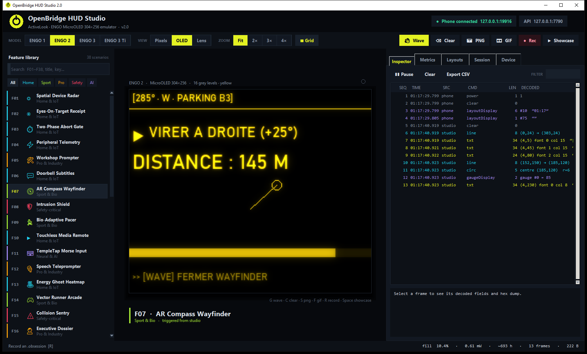
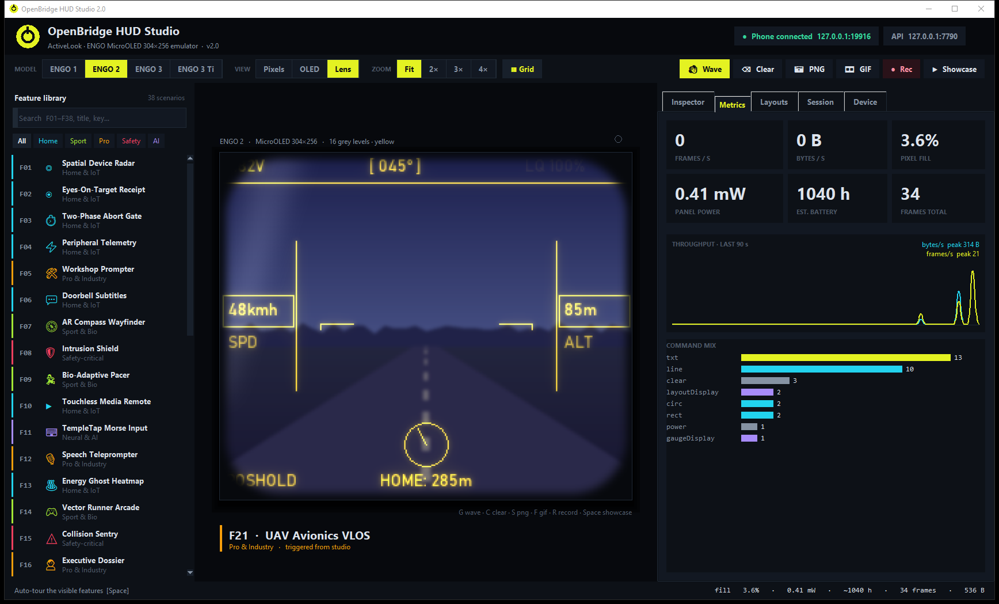
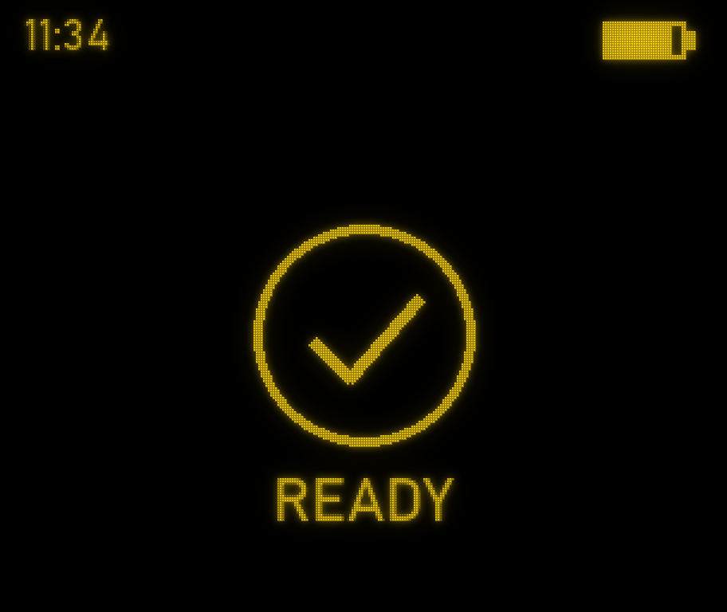
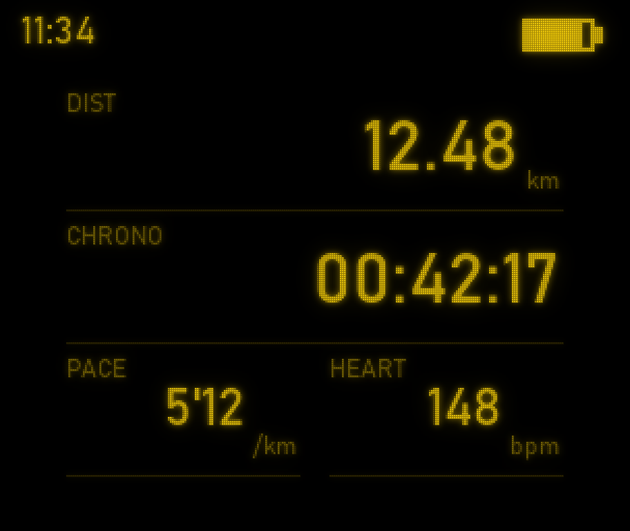
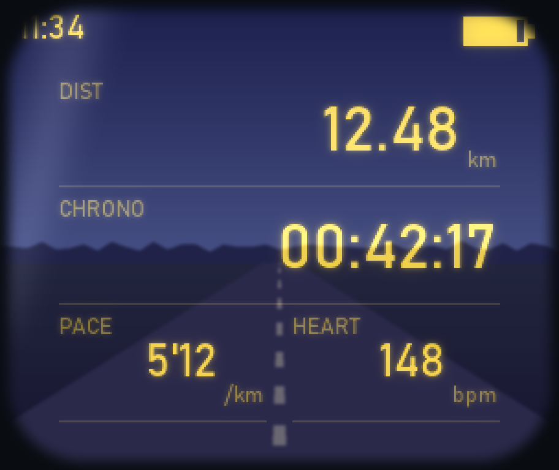
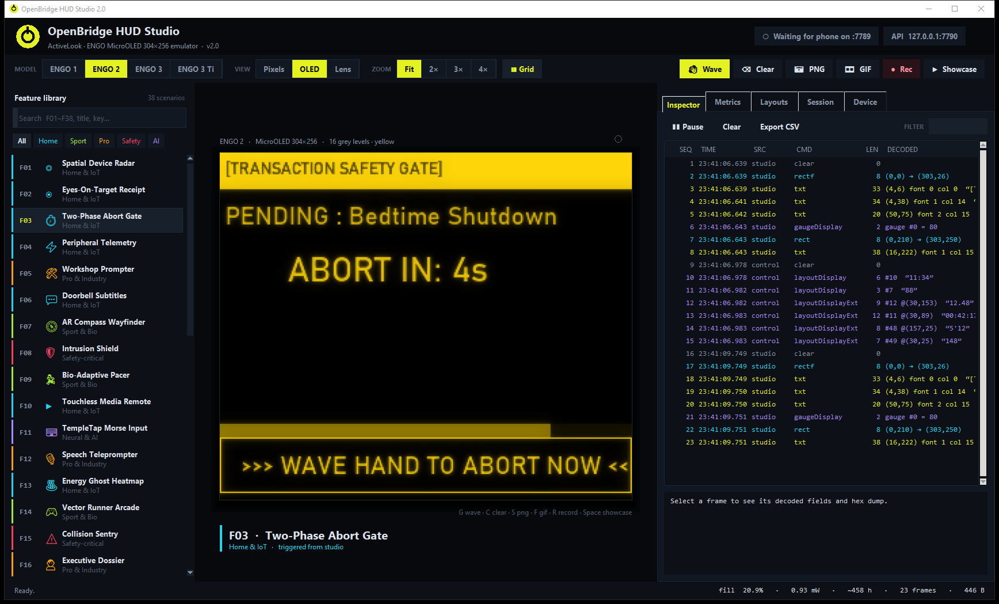
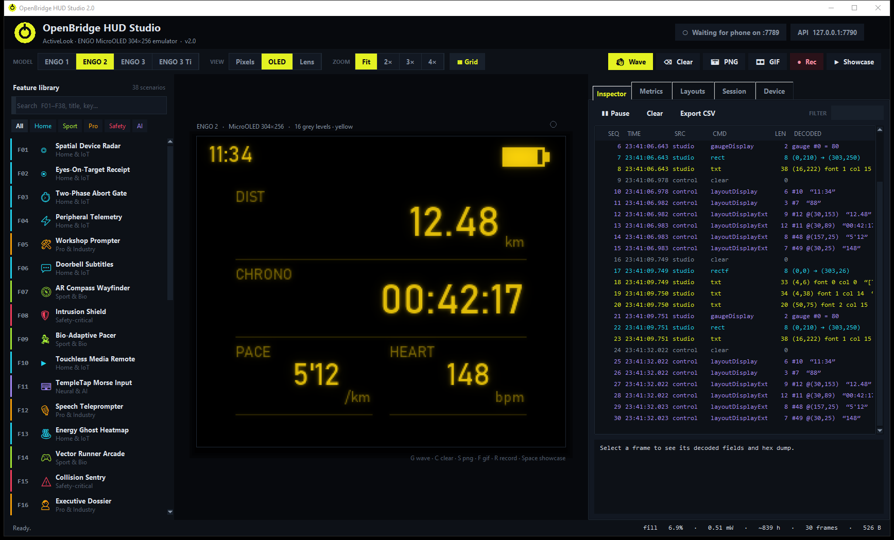

# OpenBridge HUD Studio: ENGO / ActiveLook Emulator

> **Validation status: emulator only.** Everything below was built and validated with HUD Studio and the
> official ActiveLook Android app (patched developer build) on a Xiaomi 11T Pro (Android 14 / HyperOS),
> **without physical glasses**. Real-hardware tests on an ENGO pair (BLE timing and flow control, the
> firmware "ALooK" layouts, optics and brightness, gesture sensor, battery) are **pending until the pair is
> received**. Results will be added to this document and to the hardware test matrix.
>
> Document code: `ENGO-DOC-19`. Complements [04_EMULATOR_AND_TOOLS.md](04_EMULATOR_AND_TOOLS.md).

Pixel-exact emulator for ActiveLook® / ENGO MicroOLED glasses (304 × 256), built for two audiences:

* **Developers**: decode every frame, replay bug sessions, script the HUD from tests, iterate without glasses.
* **Demo & business teams**: drive the 38 OpenBridge features (F01–F38) from the PC *or from the official
  ActiveLook phone app*, show them through a realistic lens, export PNG / GIF in one key press.



## Quick start

HUD Studio needs **Pillow**, an optional dependency; the OpenBridge runtime itself stays dependency-free:
`python -m pip install -r requirements-optional.txt` (or just `pillow`). Without it, the renderer tests
are skipped and `--send` still works.

```powershell
cd Z:\Hackatons\OpenBridge\OpenBridge
powershell -NoProfile -ExecutionPolicy Bypass -File dev\launch_hud_studio.ps1      # detached, adb reverse included
# or, attached to the console:
python -m src.adapters.hud_studio --model "ENGO 2"
python -m src.adapters.activelook_emulator          # same Studio (use --classic for the legacy window)
```

| Key | Action | Key | Action |
|---|---|---|---|
| `G` | optical wave → phone | `S` | PNG (current view + raw 304×256) |
| `C` | clear panel | `F` | start / stop animated GIF |
| `R` | start / stop session recording | `Space` | Showcase (auto-tour of the visible features) |

## What is on screen

* **Feature library**: F01–F38 with search and category filters (Home & IoT, Sport & Bio, Pro & Industry,
  Safety-critical, Neural & AI). Click to render, Space to tour.
* **Viewport**: three optical models.
  * *Pixels*: raw frame buffer, optional sub-pixel grid.
  * *OLED*: emission bloom plus the panel's pixel gaps.
  * *Lens*: additive see-through rendering on a tinted sports lens, the closest view to what a wearer sees.

  ENGO 1/2 render in the panel's monochrome yellow, ENGO 3 in the colour palette. Hover any pixel for
  `x, y, #RRGGBB, grey level`.
* **Inspector**: every frame with source (`phone`, `studio`, `control`, `replay`), command name, decoded
  parameters and full hex dump. You can filter it, pause it and export it as CSV.
* **Metrics**: frames/s, bytes/s (90 s history), pixel fill, panel power (mW) and estimated battery hours,
  plus the command mix.
* **Layouts**: the layout bank uploaded with `layoutSave` (0x60).
* **Session**: record/replay `.obsession` files at 0.5×–4×, and the captures gallery (`captures/`).
* **Device**: luma, connected phones, copy-paste setup commands, protocol cheat sheet.



## Official ActiveLook app as a client (no glasses, no Bluetooth)

The patched app (`ActiveLook-OpenBridge-NoSplit-v6.apk`, built by `dev/repatch_nosplit_bridge.py`)
sees a virtual **ENGO 2 000001** during its scan. It speaks raw ActiveLook frames over
`127.0.0.1:7789`, which `adb reverse` forwards to the Studio.

* The app's own screens render faithfully. Clock, battery, READY, pause, session-ended, countdown and every
  sport metric (ids 10–78) come from the built-in **ALooK layout bank** (`src/adapters/alook_layouts.py`),
  including the app's native coordinates (origin at the bottom-right, from `computeLayoutXY`).
* A floating **OB** button (draggable) opens a native panel. From there you can trigger F01–F38 on the HUD
  (frame `0xF0 <n>`), send a wave to the app, clear the panel, or run a Tour.
* **Sticky link**: if the Studio restarts, the app stays "connected" and the bridge reconnects within
  1.5 s. It then replays the connection so the app redraws.
* The dev build is offline from Sentry. The notification icon lost by the de-split is restored with a fallback.

Build & install (Windows, phone in USB debugging):

```powershell
python dev\repatch_nosplit_bridge.py                       # -> ..\ActiveLook-OpenBridge-NoSplit-v6.apk
adb push ..\ActiveLook-OpenBridge-NoSplit-v6.apk /sdcard/Download/
adb push dev\ob_install.sh /data/local/tmp/ && adb shell sh /data/local/tmp/ob_install.sh ActiveLook-OpenBridge-NoSplit-v6.apk
```

On MIUI / HyperOS, `adb install` is blocked ("Install via USB"). `ob_install.sh` opens the system
installer from the media store instead.

## Emulator screenshots

| | |
|---|---|
|  |  |
| Official ActiveLook app driving the Studio: idle screen (clock, battery, READY) | Running session layout (3 rows, split last row) through the ALooK bank |
|  |  |
| Same session in the *Lens* view | F03 Two-Phase Abort Gate on a monochrome ENGO 2 (banner text drawn unlit) |



### What is emulated and what is not (yet)

* **ALooK layout bank**: reconstructed from the official app (layout ids from `getActualLayoutId`, positions
  from `computeLayoutXY`). It is **not** a dump of the firmware configuration. Fonts, icons and exact
  geometry on real glasses may differ and will be calibrated on the pair.
* **Fonts**: approximated with Bahnschrift (Windows), sized to the 304 × 256 panel.
* **Transport**: frames travel over TCP (`adb reverse`), not BLE. MTU fragmentation, flow-control
  notifications and BLE latency are not modelled.
* **Not distributed**: the patched app itself (APK). Only the build scripts are in the repository; they
  patch a copy of the official app that the developer provides.

## Control API (automation, CI, demos)

Line-delimited JSON on `127.0.0.1:7790`. No window focus is needed.

```powershell
python -m src.adapters.hud_studio --send '{"cmd":"feature","id":"F07"}'
python -m src.adapters.hud_studio --send '{"cmd":"gesture"}'
python -m src.adapters.hud_studio --send '{"cmd":"screenshot","mode":"lens"}'
```

| cmd | parameters | effect |
|---|---|---|
| `ping`, `status`, `features` | | health, live counters, F01–F38 catalogue |
| `feature` | `id` (`F07`, `7`, `compass_wayfinder`) | render a feature |
| `gesture` | `code` (default 1) | optical wave to every connected phone |
| `clear`, `luma` | `value` 0–15 | panel control |
| `model` | `model` | ENGO 1 / 2 / 3 / 3 Titanium |
| `inject` | `hex` | push raw ActiveLook bytes |
| `screenshot` | `mode` raw/pixels/oled/lens, `path`, `scale` | save PNG |
| `record` | `action` start/stop, `path` | `.obsession` capture |
| `replay` | `path`, `speed` | timed replay |
| `view`, `zoom`, `tab`, `showcase` | UI automation | drive the window for demos |

`--headless` runs the phone link and the API without a window (CI / servers).

## Protocol

| Direction | Frame | Meaning |
|---|---|---|
| phone → PC | `FF CMD FMT LEN [QID] DATA AA` | ActiveLook command (LEN = whole frame; FMT bit 5 = 2-byte LEN) |
| PC → phone | `FF 0A 01 <code> AA` | optical wave gesture |
| phone → PC | `FF F0 00 06 <n> AA` | run OpenBridge feature F*n* |

## Files

| Path | Role |
|---|---|
| `src/adapters/hud_studio.py` | Studio UI, engine (single-thread pump), phone link, control API, renderer |
| `src/adapters/hud_features.py` | F01–F38 catalogue (shared with the headless benchmark) |
| `src/adapters/alook_layouts.py` | built-in ALooK layout bank used by the official app |
| `src/adapters/activelook_emulator.py` | `HUDCanvas` frame engine (parsing, drawing, layouts) |
| `dev/build_activelook_openbridge.py` | JS bridge (`PATCH_JS`) + bundle hooks |
| `dev/repatch_nosplit_bridge.py` | rebuild + sign the de-split APK |
| `dev/launch_hud_studio.ps1` | detached launcher (restarts any running instance) |
| `tests/unit/test_hud_studio.py` | codec, catalogue, ALooK, engine, control API, record/replay |
