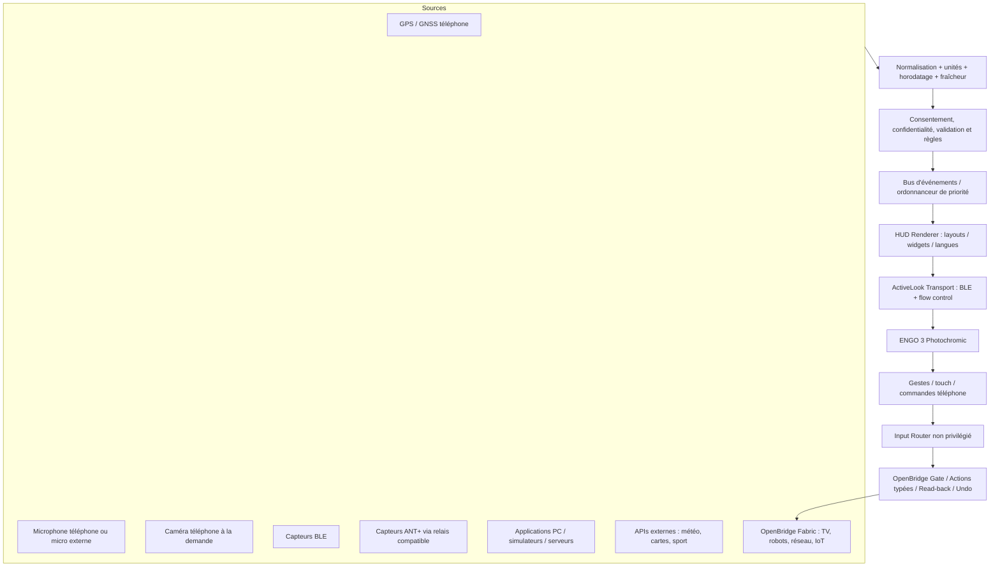

# OpenBridge × ENGO 3 Photochromic — Spécification produit et plan d'intégration

> **Document interne de référence — destiné au développement OpenBridge**  
> Version : 1.0  
> Date de cadrage : 23 novembre 2026  
> Cible initiale : ENGO 3 Photochromic / plateforme ActiveLook  
> Dépôt : [`toskaman/openbridge`](https://github.com/toskaman/openbridge)  
> Statut : spécification et plan d'intégration ; ne constitue pas une preuve de validation sur lunettes physiques.  
> État réel de chaque fonctionnalité : [matrice de traçabilité](21_FEATURE_TRACEABILITY_MATRIX.md) (générée depuis `feature_registry.json`).

---

## 0. Objectif et décision produit

Construire dans OpenBridge une plateforme logicielle extensible qui transforme les lunettes ENGO 3 Photochromic en **interface tête haute universelle**, reliée au téléphone, aux capteurs Bluetooth, aux services en ligne et à un ordinateur. Les lunettes restent légères et jouent principalement le rôle d'écran HUD et de périphérique d'entrée limité ; les calculs, la navigation, la reconnaissance vocale, l'IA et l'orchestration restent sur le téléphone ou le PC.

Le système doit réunir trois expériences cohérentes :

1. **Sport et mobilité** : course, vélo, trail, randonnée, navigation, entraînement, sécurité et compétition virtuelle.
2. **Assistant connecté OpenBridge** : notifications, données d'appareils, commandes vocales via téléphone, confirmations d'actions et informations contextuelles.
3. **Écosystème ouvert** : capteurs BLE, éventuel relais ANT+, intégration PC, API, plugins et extensions tierces.

### Principes non négociables

- Le HUD affiche des informations courtes, lisibles et utiles ; ce n'est pas un écran vidéo ou un smartphone miniature.
- L'ENGO 3 n'est pas supposée avoir de GPS, de microphone, de haut-parleur, de caméra, de connexion Internet autonome ou de calcul IA embarqué.
- Toute donnée doit conserver sa source, son horodatage, son unité, son niveau de confiance et son état de fraîcheur.
- Une donnée absente, périmée ou non vérifiée ne doit jamais être présentée comme certaine.
- Les gestes des lunettes peuvent parcourir, acquitter ou annuler une interface. Ils ne doivent pas contourner les autorisations d'OpenBridge.
- Toute action sur un appareil tiers doit passer par les primitives, la politique, le consentement, la vérification indépendante et l'Undo disponibles dans OpenBridge.
- Aucun résultat simulé ou émulateur ne doit être présenté comme une validation matérielle.
- Les fonctionnalités à risque médical, de conduite, de sécurité vitale ou d'usage réglementé restent expérimentales ou hors périmètre jusqu'à validation spécialisée.
- La langue de l'interface doit être sélectionnable explicitement en **Français** ou **English**.

---

## 1. État existant OpenBridge : réutiliser avant de reconstruire

Cette spécification est une extension de l'intégration ENGO déjà présente dans le dépôt. Avant d'ajouter du code, les agents et développeurs doivent relire les fichiers actuels et vérifier leur état réel sur la branche utilisée.

### 1.1 Composants déjà documentés dans le dépôt

| Élément existant | Emplacement connu | Réutilisation attendue |
|---|---|---|
| Adaptateur ActiveLook | `src/adapters/activelook.py` | Transport BLE, commandes et affichage ActiveLook |
| Pont IA / voix / capteurs | `src/adapters/engo_ai_bridge.py` | Extension du pipeline voix, télémétrie et événements |
| Émulateur ActiveLook | `src/adapters/activelook_emulator.py` | Tests et scénarios BLE virtuels |
| HUD Studio | `src/adapters/hud_studio.py` | Rendu, inspection de trames, captures, relecture et API locale |
| Catalogue HUD | `src/adapters/hud_features.py` | Catalogue d'écrans et de démonstrations F01–F38 existant |
| Layouts ALooK | `src/adapters/alook_layouts.py` | Compatibilité avec les mises en page de l'application officielle, sous réserve de vérification |
| Tests ActiveLook | `tests/unit/test_activelook.py` | Socle de tests protocole et adaptateur |
| Tests HUD Studio | `tests/unit/test_hud_studio.py` | Tests de l'émulateur et du renderer |
| Tests IA ENGO | `tests/unit/test_engo_ai_bridge.py` | Tests du pont IA |
| Tests extension sensorielle | `tests/unit/test_engo_openbridge_neural_integration.py` | Tests des événements multimodaux |
| Tests fonctionnalités HUD | `tests/unit/test_engo_killer_features.py` | Tests de fonctionnalités déjà décrites |
| Documentation principale ENGO | `docs/partners/ENGO.md` | Présentation du partenariat et de l'intégration |
| Hub R&D ENGO | `docs/partners/engo/README.md` | Index des dossiers techniques 01–19 |
| Intégration HUD existante | `docs/GLASSES.md` | Expérience actuelle : messages, TV, robot, voix via téléphone |
| Plan d'intégration | `docs/partners/engo/05_OPENBRIDGE_INTEGRATION_PLAN.md` | Architecture, Fabric et contrat de preuve |
| Hub lunettes (menus, messages, TV, aspirateur, voix) | `src/glasses/hub.py`, `ui.py`, `panel.py`, `icons.py` | Expérience produit actuelle et rendu HUD |
| Transport ActiveLook (MTU, flow control, file, contrôleur unique) | `src/glasses/transport.py` | Couche §3.4, testée sans matériel |
| Événements HUD et ordonnanceur de priorité | `src/glasses/events.py` | Contrat §6.2 / §6.3 |
| Observations normalisées et fraîcheur | `src/glasses/metrics.py` | Contrat §6.1 / §6.4 |
| Décodeurs capteurs BLE (FC, RSC, CSC, puissance, FTMS, batterie) | `src/glasses/sensors.py` | §5.8 |
| Moteurs sport, séances, Ghost | `src/glasses/sport.py`, `live.py` | §5.4, §5.6, §5.7 |
| Navigation GPX | `src/glasses/nav.py` | §5.3 |
| Français / English | `src/glasses/i18n.py`, `src/glasses/locales/*.json`, Companion `L.java` | §4 |
| Registre et matrice de traçabilité | `docs/partners/engo/feature_registry.json`, `21_FEATURE_TRACEABILITY_MATRIX.md` | §12 |
| Architecture phone tether | `docs/partners/engo/07_PHONE_TETHER_AI_AND_API_ARCHITECTURE.md` | Téléphone comme proxy sensoriel et de calcul |
| HUD Studio | `docs/partners/engo/19_HUD_STUDIO_EMULATOR.md` | Environnement de validation simulée |

### 1.2 Fonctionnalités et démonstrations déjà décrites

Le dépôt documente déjà un catalogue de 38 scénarios HUD F01–F38, notamment : confirmations d'actions, carrousel gestuel, statut domotique, télémetrie, synergie voix/écrans, alertes, mode développeur, navigation/compas conceptuel, assistant vocal, vision via caméra du téléphone, matrice IoT, traduction et plusieurs prototypes spécialisés.

**Règle anti-doublon :** chaque nouvelle fonctionnalité proposée dans ce document doit être comparée à `src/adapters/hud_features.py`, aux documents ENGO 03 et 11–18 et à `docs/GLASSES.md`. Si elle existe, l'action consiste à la fiabiliser, l'intégrer à l'expérience produit, compléter ses tests ou la valider sur matériel réel — pas à créer une deuxième implémentation.

### 1.3 Niveau de preuve connu au cadrage

La documentation actuellement observée indique que le parcours ENGO / ActiveLook et HUD Studio a été construit et testé dans l'émulateur ; la validation sur une paire ENGO physique reste à effectuer ou à mettre à jour avec des preuves datées. Le dépôt mentionne également un compagnon Android et des interactions téléphone/PC déjà développés, dont certaines étapes physiques restent à vérifier.

Les compteurs de tests, F01–F38, les vues d'émulateur, les traces TCP et les scénarios simulés ne sont **pas** des preuves de connexion BLE réelle aux lunettes. La matrice d'évidence doit conserver les catégories distinctes : `EMULATOR`, `VIRTUAL_BLE`, `OFFICIAL_APP_BRIDGE`, `REAL_HARDWARE`.

### 1.4 Faits matériels à confirmer

Les documents du dépôt et les pages commerciales peuvent diverger selon le modèle, la taille et le firmware. Pour la paire réellement reçue, relever :

- modèle exact : ENGO 3 Photochromic ; référence SKU et taille ;
- numéro de firmware et révision matérielle, conservés en privé ;
- modèle ActiveLook déclaré par le service GATT ;
- palette et commandes couleur réellement disponibles ;
- orientation, calibration optique et zone d'affichage effective ;
- comportement des gestes et du tactile ;
- autonomie mesurée dans un protocole défini ;
- MTU, débit, fragmentation, latence, flow control et reconnect ;
- compatibilité de l'application officielle et des SDK sur le firmware testé.

Ne pas figer dans le produit les valeurs de batterie, de puissance d'affichage, de mémoire, de fréquence gestuelle ou de latence issues uniquement d'une estimation ou d'un document non confirmé par le fabricant.

---

## 2. Périmètre produit

### 2.1 Plateformes

| Plateforme | Rôle | Priorité |
|---|---|---:|
| Android Companion | Contrôleur BLE de proximité, GPS, microphone, caméra à la demande, capteurs et relais | P0 |
| OpenBridge PC (Windows/Linux/macOS selon capacités existantes) | Moteur local, IA, agrégation de données, API, configuration et télémétrie | P0 |
| ENGO 3 Photochromic | Affichage HUD et événements de gestes/toucher selon capacités réelles | P0 |
| iOS Companion | Extension mobile, soumise aux APIs et limitations iOS | P1 |
| Windows BLE direct | Connexion directe aux lunettes depuis un PC compatible | P1 |
| Relais téléphone ↔ PC | Transport sécurisé des données et commandes HUD | P0 |
| Extensions tierces | Plugins, connecteurs, thèmes et widgets | P2 |

### 2.2 Profils d'utilisation

- `RUNNING` : course, piste, fractionné, tempo, marathon.
- `TRAIL` : sentier, ultra, barrières horaires, ravitaillement.
- `CYCLING_ROAD` : route, puissance, radar, navigation.
- `CYCLING_MTB` : VTT, pente, profil, navigation et sécurité.
- `HIKING` : randonnée, altitude, orientation, points d'intérêt.
- `INDOOR` : tapis, home trainer, rameur, vélo connecté.
- `GOLF` : distances de parcours et score, sous réserve de données cartographiques/licences.
- `ROWING` / `SKI` / `WATERSPORT` : extensions de sport par connecteur.
- `OPENBRIDGE_HOME` : appareils, notifications et confirmations OpenBridge.
- `DEVELOPER` : diagnostic, état des services et alertes de développement.
- `CUSTOM` : profil composé par l'utilisateur.

Un profil détermine les sources autorisées, les widgets, les seuils, les alertes, les unités, la priorité des événements et les commandes disponibles. Il ne doit jamais augmenter les permissions d'un appareil ou d'un module.

---

## 3. Architecture cible

### 3.1 Flux fonctionnel



### 3.2 Séparation obligatoire des responsabilités

1. **Connecteurs** : acquisition des données depuis le GPS, capteurs, applications et API.
2. **Normalisation** : schémas communs, unités, timestamp, qualité, fraîcheur et source.
3. **Moteur de sport** : calculs et logique spécifiques à chaque discipline.
4. **Moteur de règles** : alertes, transitions de profil et automations déterministes.
5. **Moteur IA** : compréhension et recommandations ; aucune action privilégiée directe.
6. **OpenBridge Gate** : autorisations, politique, consentement, action typée, read-back et Undo.
7. **HUD Renderer** : composition des écrans, localisation et priorité visuelle.
8. **ActiveLook Transport** : sérialisation, transport BLE, segmentation, flow-control, retries bornés et reconnexion.
9. **Evidence & Diagnostics** : logs structurés, traces anonymisées, captures et preuves de validation.

### 3.3 Topologie de connexion

**Mode recommandé : téléphone comme contrôleur BLE de proximité.**

- Le Companion Android se connecte directement aux ENGO par BLE.
- Le PC OpenBridge transmet au Companion les événements à afficher via le relais OpenBridge déjà prévu.
- Les capteurs BLE peuvent être connectés au téléphone si le système Android, le firmware et les appareils permettent la coexistence des connexions.
- Le PC direct BLE est un mode de secours ou un mode atelier, pas le mode mobile principal.
- Un seul contrôleur actif des lunettes doit être garanti à un instant donné, sauf si le fabricant confirme et documente un mécanisme multi-central.
- Le changement de contrôleur doit être explicite, observable et réversible.

### 3.4 Principes de transport ActiveLook

- Réutiliser l'adaptateur `src/adapters/activelook.py` après audit.
- Ne pas recoder le protocole dans chaque module sportif.
- Vérifier la découverte du service/UUID sur le matériel réel ; ne pas prendre les références du dossier interne comme vérité sans mesure.
- Abonner les notifications de réponse, de contrôle de flux et de gestes avant d'émettre les commandes nécessaires.
- Respecter le mécanisme de flow control réel ; aucune écriture pendant un état PAUSE.
- Sérialiser les commandes sur une file bornée, avec priorités et délai maximum.
- Corréler les réponses avec les identifiants de requête lorsqu'ils sont disponibles.
- Gérer les MTU négociés, fragmentation/réassemblage et les erreurs sans supposer une taille fixe.
- Prévoir backpressure, timeout, annulation, reconnexion et nettoyage de toutes les connexions.
- Ne pas envoyer un flux vidéo/framebuffer continu ; l'architecture doit privilégier les primitives et layouts.
- Toute commande persistante sur mémoire/flash/firmware est interdite par défaut ; elle nécessite une autorisation explicite, une documentation fabricant et un processus distinct.

---

## 4. Internationalisation : sélecteur Français / English obligatoire

### 4.1 Emplacement dans l'interface

Ajouter dans l'application Companion et dans l'interface web/PC :

`Settings / Réglages → General / Général → Language / Langue`

Contrôle visible :

- `Français`
- `English`

Ne pas utiliser uniquement des drapeaux comme sélecteur : les langues ne sont pas des pays.

### 4.2 Comportement attendu

- Au premier lancement, proposer la langue du système si elle est prise en charge ; sinon utiliser l'anglais comme fallback.
- L'utilisateur peut toujours choisir manuellement Français ou English.
- Le choix explicite est conservé dans les préférences de l'utilisateur.
- Le changement de langue s'applique immédiatement, sans redémarrage lorsque possible.
- L'interface PC, Companion, messages système, erreurs, notifications, guides, descriptions de widgets et libellés HUD utilisent la même préférence par défaut.
- Prévoir une option facultative `HUD language follows app language` activée par défaut.
- Prévoir une substitution `HUD language` indépendante pour un utilisateur bilingue.
- Les commandes vocales supportent le français et l'anglais ; la langue de reconnaissance est explicitement réglable (`Auto`, `Français`, `English`).
- Les réponses vocales utilisent une voix disponible dans la langue sélectionnée ; si aucune voix n'est disponible, afficher une réponse textuelle localisée.
- Les données ne sont jamais traduites à l'aveugle : noms de périphériques, identifiants, unités techniques et valeurs restent exacts.
- Les dates, heures, séparateurs décimaux, formats de distance et unités suivent la locale et les préférences de l'utilisateur.
- L'unité métrique/impériale est un réglage distinct de la langue.

### 4.3 Implémentation i18n

- Utiliser des clés stables, par exemple `hud.navigation.next_turn`, jamais du texte traduit codé en dur dans les moteurs.
- Centraliser les ressources dans des fichiers de locale, par exemple `locales/fr.json` et `locales/en.json` ou l'équivalent déjà utilisé par le projet.
- Ajouter un test qui détecte les clés absentes dans l'une des langues.
- Gérer les chaînes longues : le HUD doit proposer une version courte/compacte et ne pas couper silencieusement une information critique.
- Les événements internes transportent `message_key` + paramètres typés ; la traduction intervient dans le renderer.
- Les API et logs stockent des identifiants stables, pas des messages localisés.
- Le nom des langues dans le sélecteur reste dans sa forme native.

### 4.4 Clés initiales minimales

`common.ok`, `common.cancel`, `common.back`, `common.next`, `common.retry`, `common.connected`, `common.disconnected`, `common.unknown`, `common.unavailable`, `hud.battery`, `hud.gps_lost`, `hud.sensor_lost`, `hud.navigation.next_turn`, `hud.navigation.off_route`, `hud.navigation.arrival`, `hud.training.interval_start`, `hud.training.interval_end`, `hud.training.target_pace`, `hud.ghost.ahead`, `hud.ghost.behind`, `hud.safety.confirm`, `hud.safety.cancel`, `hud.safety.sos_pending`, `hud.action.verified`, `hud.action.unverified`, `hud.action.refused`, `settings.language`, `settings.hud_language`, `settings.units`, `voice.listening`, `voice.not_understood`.

---

## 5. Catalogue fonctionnel complet

Les IDs ci-dessous constituent le registre produit cible. Un ID doit être stable ; il ne doit pas être réutilisé pour une autre fonction. Chaque module expose ses dépendances, son niveau de validation et ses restrictions.

### 5.1 Core HUD et expérience visuelle — `HUD-*`

| ID | Fonction | Détail / critères de comportement | Dépendances |
|---|---|---|---|
| HUD-001 | Tableau de bord contextuel | Page d'accueil adaptée au profil actif ; maximum de métriques utiles ; état de connexion | Renderer |
| HUD-002 | Pages personnalisables | Ajouter, retirer, ordonner les widgets ; aperçu dans HUD Studio | Renderer |
| HUD-003 | Thèmes visuels | Sport, navigation, minimal, compétition, nuit, développeur | Renderer |
| HUD-004 | Widgets adaptatifs | Afficher/masquer selon sport, phase, priorité et contexte | Event bus |
| HUD-005 | Alertes transitoires | Carte prioritaire avec durée, acquittement et retour à l'écran précédent | Event bus |
| HUD-006 | Affichage permanent minimal | Horloge, état de connexion ou valeur choisie ; désactivable | Renderer |
| HUD-007 | Contraste et tailles | Grandes valeurs, contraste, palette compatible avec le modèle réel | Capacités écran |
| HUD-008 | Mode sans distraction | Masquer les notifications secondaires pendant une activité | Profil |
| HUD-009 | Prévisualisation HUD | Preview en direct dans HUD Studio ; captures et enregistrement de session | HUD Studio |
| HUD-010 | Widgets communautaires | Import/export de layouts ; validation de taille, contenu et permissions | Plugin system |
| HUD-011 | Rotation de cartes par gestes | Un geste parcourt les cartes ; aucun geste ne déclenche une action sensible | Gestures |
| HUD-012 | Calibration d'affichage | Assistant d'orientation, d'alignement et de luminosité | Matériel réel |

### 5.2 Connexion, appareils et maintenance — `CONN-*`

- `CONN-001` Découverte et appairage des lunettes.
- `CONN-002` Contrôleur BLE unique avec détection de conflit.
- `CONN-003` Reconnexion après perte de liaison, avec limites et backoff.
- `CONN-004` État de batterie des lunettes et estimation prudente de durée restante si suffisamment de mesures réelles.
- `CONN-005` Informations modèle, révision et firmware lorsque les caractéristiques le fournissent.
- `CONN-006` RSSI et qualité du lien, sans présenter RSSI comme une distance exacte.
- `CONN-007` Diagnostic GATT et export de traces expurgées.
- `CONN-008` Test d'affichage, palette, geste et tactile.
- `CONN-009` Test de latence et débit sur matériel réel.
- `CONN-010` Gestion des versions et matrice de compatibilité.
- `CONN-011` Mode économie d'énergie : limiter les mises à jour, garder les alertes critiques.
- `CONN-012` Sauvegarde/restauration de profils HUD.
- `CONN-013` Guide de dépannage contextualisé.
- `CONN-014` Gestion sûre d'un changement téléphone/PC contrôleur.
- `CONN-015` Gestion de sessions longues, reprise et nettoyage de connexions.

### 5.3 GPS, cartographie et navigation — `NAV-*`

- `NAV-001` Position GPS téléphone, précision et fraîcheur.
- `NAV-002` Vitesse et direction de déplacement estimées.
- `NAV-003` Navigation virage par virage.
- `NAV-004` Flèche directionnelle du prochain changement.
- `NAV-005` Distance avant virage et nom de voie/rue si disponible.
- `NAV-006` Instructions de rond-point et intersection.
- `NAV-007` Détection de sortie d'itinéraire.
- `NAV-008` Recalcul d'itinéraire.
- `NAV-009` Import de GPX et suivi de trace.
- `NAV-010` Cartes hors ligne sur téléphone.
- `NAV-011` Retour au départ et inversion de trace.
- `NAV-012` Distance restante, ETA et heure d'arrivée.
- `NAV-013` Altitude, pente et profil altimétrique si source fiable.
- `NAV-014` Points d'intérêt : eau, refuge, ravitaillement, station et rendez-vous.
- `NAV-015` Points de passage personnalisés.
- `NAV-016` Itinéraire circulaire selon durée/distance disponible.
- `NAV-017` Préférence pistes cyclables et chemins adaptés, selon données cartographiques.
- `NAV-018` Évitement des axes dangereux ou interdits, uniquement si source fiable et juridiction prise en charge.
- `NAV-019` Navigation vers une position partagée avec consentement.
- `NAV-020` Navigation contextuelle par profil sportif.
- `NAV-021` Direction/boussole basée sur capteurs téléphone ; signaler les limites à l'arrêt.
- `NAV-022` Waypoints et marquage vocal d'une position.

**Règle HUD :** flèche + distance + instruction courte. Pas de carte dense ni de texte long.

### 5.4 Running — `RUN-*`

- `RUN-001` Allure instantanée, lissée, moyenne, tour et cible.
- `RUN-002` Écart à l'allure cible et temps gagné/perdu.
- `RUN-003` Cadence, longueur de foulée et fréquence de pas si disponibles.
- `RUN-004` Puissance de course et dynamique depuis une source compatible.
- `RUN-005` Durée, distance, tour, temps actif et projection d'arrivée.
- `RUN-006` Zones de fréquence cardiaque et alertes de seuil.
- `RUN-007` Créateur d'entraînements fractionnés.
- `RUN-008` Échauffement, intervalles, récupération et retour au calme.
- `RUN-009` Séances 30/30, 400 m, pyramides, seuil, tempo, côtes et progressives.
- `RUN-010` Compte à rebours et annonce du changement de phase.
- `RUN-011` Autolap et tour manuel.
- `RUN-012` Détection de pause/reprise avec contrôle utilisateur.
- `RUN-013` Analyse de régularité par kilomètre/segment.
- `RUN-014` Analyse de dérive cardiaque si les données sont suffisantes.
- `RUN-015` Estimation de projection 5 km, 10 km, semi et marathon, clairement indicative.
- `RUN-016` Negative split et objectif de temps final.
- `RUN-017` Profils route, piste, tapis, trail et compétition.
- `RUN-018` Rappels de ravitaillement/hydratation configurables.
- `RUN-019` Synthèse post-séance et export.
- `RUN-020` Comparaison avec une séance historique.

### 5.5 Trail et ultra — `TRAIL-*`

- `TRAIL-001` Profil d'altitude et dénivelé restant.
- `TRAIL-002` Prochaine montée/descente, distance et pente estimée.
- `TRAIL-003` Points de ravitaillement et distance avant le prochain.
- `TRAIL-004` Barrières horaires, temps disponible et ETA.
- `TRAIL-005` Estimation de temps de passage.
- `TRAIL-006` Plan de ravitaillement et rappels personnalisés.
- `TRAIL-007` Navigation hors ligne et retour au parcours.
- `TRAIL-008` Partage de position et suivi de groupe.
- `TRAIL-009` Mode longue autonomie avec rafraîchissements réduits.
- `TRAIL-010` Alertes météo et coucher du soleil.

### 5.6 Cyclisme route, VTT et e-bike — `BIKE-*`

- `BIKE-001` Vitesse, vitesse moyenne/max, distance et temps.
- `BIKE-002` Cadence et puissance.
- `BIKE-003` Puissance moyenne/max et métriques avancées selon capteur.
- `BIKE-004` FTP, zones de puissance, IF/TSS/NP uniquement si données et formules validées.
- `BIKE-005` Équilibre gauche/droite, torque effectiveness et pedal smoothness si transmis.
- `BIKE-006` Pente, dénivelé, profil d'ascension et ETA sommet.
- `BIKE-007` Objectif puissance/cadence par segment.
- `BIKE-008` Comparaison d'ascensions historiques.
- `BIKE-009` Conseils de développement/rapport si transmission compatible.
- `BIKE-010` Données Di2/AXS lorsque l'API/protocole est autorisé et disponible.
- `BIKE-011` Radar arrière : événements, nombre de cibles et niveau si fourni par le radar.
- `BIKE-012` État de lumière et batterie d'accessoires.
- `BIKE-013` TPMS pression pneu si capteur compatible.
- `BIKE-014` Batterie e-bike, mode d'assistance et autonomie si accessible.
- `BIKE-015` Rappels d'entretien et kilométrage de composants.
- `BIKE-016` Profils route, gravel, VTT, cyclocross et e-bike.
- `BIKE-017` Détection/alerte de perte d'un capteur ou radar.
- `BIKE-018` Mode entraînement indoor via FTMS ou connecteur.

### 5.7 Ghost Competition — `GHOST-*`

- `GHOST-001` Ghost d'une sortie précédente.
- `GHOST-002` Ghost du meilleur temps personnel.
- `GHOST-003` Ghost d'un objectif cible.
- `GHOST-004` Ghost par parcours, segment, montée ou tour.
- `GHOST-005` Affichage avance/retard en temps et distance.
- `GHOST-006` Projection du résultat final.
- `GHOST-007` Plusieurs adversaires virtuels nommés.
- `GHOST-008` Modes de difficulté et rythme personnalisé.
- `GHOST-009` Import d'une activité autorisée d'un ami.
- `GHOST-010` Défi de groupe à distance, avec consentement au partage.
- `GHOST-011` Comparaison segment par segment.
- `GHOST-012` Journal de défi et résultat final.

Le Ghost reste une comparaison de performance et ne doit pas inciter à dépasser les limites de sécurité ou les seuils définis par l'utilisateur.

### 5.8 Capteurs et protocoles — `SENSOR-*`

**Profils BLE à implémenter lorsque le capteur les expose :**

- Heart Rate Service (fréquence cardiaque).
- Cycling Speed and Cadence.
- Cycling Power.
- Running Speed and Cadence.
- Fitness Machine Service (tapis, rameur, vélo indoor, elliptique selon profil supporté).
- Battery Service.
- Device Information Service.
- Environmental Sensing lorsque pertinent.

**Classes de capteurs :**

- Ceinture cardio, brassard optique et capteur de fréquence cardiaque.
- Footpod, cadence de course et dynamique de foulée.
- Vitesse/cadence vélo, pédales/boîtier de puissance.
- Radar arrière, éclairage connecté et TPMS.
- Home trainer, tapis de course, rameur et vélo indoor.
- Thermomètre, baromètre et capteurs environnementaux.
- Montres et plateformes sportives comme sources indirectes via API autorisées.
- ANT+ via adaptateur/relais compatible ; ne pas supposer qu'un téléphone possède une radio ANT+.

**Gestion des capteurs :**

- `SENSOR-001` Découverte/appairage et nom convivial.
- `SENSOR-002` Association d'un capteur à un profil.
- `SENSOR-003` Connexion multi-capteurs selon les limites système.
- `SENSOR-004` Reconnexion avec backoff et timeout.
- `SENSOR-005` Niveau batterie si exposé.
- `SENSOR-006` RSSI et état de lien.
- `SENSOR-007` Détection de perte de données et valeurs périmées.
- `SENSOR-008` Sélection de source prioritaire par métrique.
- `SENSOR-009` Fusion de sources avec provenance préservée.
- `SENSOR-010` Diagnostic et journal d'erreur.
- `SENSOR-011` Filtrage des valeurs impossibles / aberrantes.
- `SENSOR-012` Simulateurs de périphériques pour tests.

### 5.9 Coach IA et automatisations — `AI-*` / `RULE-*`

- `AI-001` Coach contextuel running.
- `AI-002` Coach cyclisme.
- `AI-003` Coach trail/randonnée.
- `AI-004` Analyse d'allure/puissance/cadence.
- `AI-005` Conseil de rythme et de récupération à partir de seuils utilisateur.
- `AI-006` Analyse post-séance.
- `AI-007` Génération d'un programme d'entraînement personnalisé.
- `AI-008` Ajustement de programme selon l'historique et la disponibilité.
- `AI-009` Questions/réponses sur les métriques actuelles.
- `AI-010` Récapitulatif vocal optionnel.
- `AI-011` Modèle local ou distant selon configuration et consentement.
- `AI-012` Mode hors ligne pour commandes et règles essentielles.
- `AI-013` Journal des conseils, raisons, données utilisées et version du modèle.
- `RULE-001` Déclencheur sur seuil de métrique.
- `RULE-002` Déclencheur GPS/géofence.
- `RULE-003` Déclencheur horaire/durée.
- `RULE-004` Déclencheur événement capteur.
- `RULE-005` Conditions multiples et temporisation.
- `RULE-006` Priorité et suppression de doublons.
- `RULE-007` Pause/résumé/désactivation de règles.
- `RULE-008` Historique d'exécution et explication.

L'IA peut proposer une consigne ou un workflow. Elle ne peut pas contourner les schémas typés, le gate, les refus de politique ou l'approbation propriétaire.

### 5.10 Voix, audio et traduction — `VOICE-*`

- `VOICE-001` Activation du micro téléphone par commande/contrôle explicite.
- `VOICE-002` Push-to-talk via Companion.
- `VOICE-003` Détection de fin de parole/VAD avec indicateur visible.
- `VOICE-004` Reconnaissance vocale français/anglais.
- `VOICE-005` Commandes naturelles pour métriques, pages et navigation.
- `VOICE-006` Confirmation des opérations sensibles sur le téléphone ou un contrôle dédié.
- `VOICE-007` Réponse courte textuelle sur HUD.
- `VOICE-008` Synthèse vocale via casque/écouteurs externes.
- `VOICE-009` Intégration microphone Bluetooth externe si OS compatible.
- `VOICE-010` Sous-titres/traduction à la demande.
- `VOICE-011` Mode hors ligne si moteur local disponible.
- `VOICE-012` Indicateur micro actif et arrêt immédiat.
- `VOICE-013` Pas d'enregistrement permanent par défaut.
- `VOICE-014` Suppression des buffers audio après traitement selon politique de conservation.

### 5.11 Téléphone comme proxy sensoriel — `PHONE-*`

- `PHONE-001` GPS/GNSS et vitesse.
- `PHONE-002` Accéléromètre/gyroscope pour événements de mouvement prudents.
- `PHONE-003` Baromètre lorsque disponible.
- `PHONE-004` Microphone à la demande.
- `PHONE-005` Caméra à la demande, après déclenchement/consentement explicite.
- `PHONE-006` Analyse visuelle ponctuelle avec affichage d'un résumé court.
- `PHONE-007` État batterie, réseau et GPS.
- `PHONE-008` Mode brassard.
- `PHONE-009` Mode support guidon.
- `PHONE-010` Mode poche/sac avec limites de capteurs documentées.
- `PHONE-011` Contrôle à distance par boutons Companion.
- `PHONE-012` Télécommande Bluetooth externe.
- `PHONE-013` Gestion de l'exécution en arrière-plan par plateforme.
- `PHONE-014` Mode dégradé sans Internet.

La caméra ne doit pas être activée en continu ; ne pas implémenter de reconnaissance permanente de visages/personnes. Le téléphone placé sur le bras, dans une poche ou sur un guidon n'a pas la même précision pour la détection de chute : chaque position nécessite calibration et tests dédiés.

### 5.12 Sécurité et SOS — `SAFE-*`

- `SAFE-001` Partage de position avec contacts désignés et durée limitée.
- `SAFE-002` Parcours prévu et heure de retour déclarée.
- `SAFE-003` Alerte de retard de sortie configurable.
- `SAFE-004` Chute potentielle détectée par profil de portage, avec confirmation/annulation.
- `SAFE-005` Compte à rebours avant notification d'urgence.
- `SAFE-006` SOS manuel via Companion ou télécommande dédiée.
- `SAFE-007` Transmission de position et heure de l'événement.
- `SAFE-008` Alerte de perte GPS/réseau/batterie.
- `SAFE-009` Perte de signal radar/capteur.
- `SAFE-010` Group tracking avec consentement mutuel.
- `SAFE-011` Alerte de météo dangereuse à partir d'une source qualifiée.
- `SAFE-012` Mode interface minimaliste en situation d'urgence.

**Restrictions :** aucune promesse de détection de chute infaillible ; aucune fonction de diagnostic médical ; pas d'appel automatique des services d'urgence sans cadre légal, consentement explicite, tests dédiés et validation juridique ; pas d'utilisation du HUD comme unique dispositif de sécurité. Les alertes ne doivent pas encourager à regarder le HUD dans une situation dangereuse.

### 5.13 Météo et environnement — `ENV-*`

- `ENV-001` Température, ressenti et humidité.
- `ENV-002` Pluie imminente et intensité.
- `ENV-003` Vent, direction, rafales et composante face/arrière/latérale.
- `ENV-004` Risque d'orage, neige, verglas ou brouillard si source disponible.
- `ENV-005` UV et durée de lumière restante.
- `ENV-006` Lever/coucher du soleil.
- `ENV-007` Qualité de l'air et particules fines si source disponible.
- `ENV-008` Pollen/allergènes si source disponible.
- `ENV-009` Météo le long du parcours et à destination.
- `ENV-010` Ajustement indicatif des recommandations sportives selon conditions.

### 5.14 Récupération et santé — `HEALTH-*`

- `HEALTH-001` Import du sommeil depuis source compatible.
- `HEALTH-002` Import HRV si disponible.
- `HEALTH-003` Import fréquence cardiaque de repos.
- `HEALTH-004` Charge d'entraînement historique.
- `HEALTH-005` Estimation de récupération, non médicale.
- `HEALTH-006` Indicateur de disponibilité physique explicable.
- `HEALTH-007` Suivi d'hydratation et rappels configurés.
- `HEALTH-008` Plan de ravitaillement/glucides choisi par l'utilisateur.
- `HEALTH-009` Rapport de progression.
- `HEALTH-010` Export et suppression des données.

Ne jamais inventer une mesure physiologique absente. Les métriques comme SpO2, température corporelle ou fréquence respiratoire ne sont affichées que si une source compatible les fournit et si leur fiabilité est documentée.

### 5.15 Intégrations sport, cartes et services — `INT-*`

Connecteurs candidats, activés uniquement après vérification des APIs, licences et conditions d'utilisation : Garmin Connect, Strava, Komoot, Ride with GPS, TrainingPeaks, Intervals.icu, Wahoo, Polar Flow, Suunto, COROS, Apple Health, Android Health Connect, Zwift, Rouvy, TrainerRoad, Nike Run Club, Adidas Running, MapMyRun et AllTrails.

- `INT-001` Import/export GPX/FIT/TCX/CSV selon le format et les droits.
- `INT-002` Import entraînements programmés.
- `INT-003` Import historique d'activités autorisées.
- `INT-004` Synchronisation records et objectifs.
- `INT-005` Intégration segments/records lorsqu'autorisé.
- `INT-006` Connecteurs cartographiques interchangeables.
- `INT-007` Connecteurs météo interchangeables.
- `INT-008` Gestion de tokens et révocation.
- `INT-009` Quotas, indisponibilités et cache.
- `INT-010` Afficher la provenance de chaque donnée.

### 5.16 PC, simulateurs et développement — `PC-*`

- `PC-001` Contrôle ActiveLook depuis Windows BLE.
- `PC-002` Relais PC → Companion → lunettes.
- `PC-003` API locale sécurisée pour applications tierces.
- `PC-004` Télémétrie serveur/PC : CPU, RAM, GPU, stockage, réseau et températures exposées.
- `PC-005` Alertes GitHub/CI/CD, build, test, déploiement et erreurs.
- `PC-006` Notifications de services et conteneurs.
- `PC-007` Connecteur Zwift/FTMS.
- `PC-008` Connecteurs sim racing (selon interfaces autorisées) : Assetto Corsa, ACC, iRacing, rFactor 2, Automobilista 2, LMU, SimHub.
- `PC-009` Connecteurs simulateur de vol pour usage simulation/sol : MSFS, X-Plane.
- `PC-010` Alertes OBS/streaming/Discord et notifications de jeu.
- `PC-011` Enregistrement/relecture de sessions HUD.
- `PC-012` Mode diagnostic développeur.

Ne pas présenter les données du simulateur comme données d'un véhicule ou aéronef réel. Pas d'intégration de contrôle critique d'un véhicule réel via ce HUD.

### 5.17 Sports supplémentaires — `SPORT-*`

- `SPORT-001` Randonnée.
- `SPORT-002` Golf.
- `SPORT-003` Aviron.
- `SPORT-004` Ski de fond et ski alpin (données adaptées et sécurité).
- `SPORT-005` Kayak/paddle.
- `SPORT-006` Voile et navigation de loisir.
- `SPORT-007` Roller/patinage.
- `SPORT-008` Triathlon/duathlon.
- `SPORT-009` Fitness/rameur/tapis.
- `SPORT-010` VTT/gravel/BMX/cyclocross.

Chaque sport nécessite son propre contrat de données et des sources vérifiées ; ne pas simplement renommer les métriques de course.

### 5.18 Golf — `GOLF-*`

- `GOLF-001` Parcours et trou actuel.
- `GOLF-002` Distance entrée/centre/fond du green.
- `GOLF-003` Distance obstacles/bunkers/eau si cartographiés.
- `GOLF-004` Score/par/nombre de coups.
- `GOLF-005` Historique de parties.
- `GOLF-006` Distance habituelle par club issue de mesures utilisateur.
- `GOLF-007` Analyse de précision et tendances.
- `GOLF-008` Météo du parcours.
- `GOLF-009` Import parcours et mise à jour cartographique.
- `GOLF-010` Mode tournoi conforme aux règles applicables ; fonctions non conformes désactivées en compétition officielle.

### 5.19 Productivité, industrie et formation — `PRO-*`

- `PRO-001` Notifications métier et consignes courtes.
- `PRO-002` Pick-by-location pour entrepôt, depuis WMS autorisé.
- `PRO-003` Référence, emplacement, quantité et progression de prélèvement.
- `PRO-004` Checklist de maintenance.
- `PRO-005` État machine et alarme depuis API industrielle validée.
- `PRO-006` Étapes de procédure courtes.
- `PRO-007` Aide-mémoire et minuteur.
- `PRO-008` Calendrier et prochaine tâche.
- `PRO-009` Traduction de consignes.
- `PRO-010` Mode formation et suivi d'étape.

Les scénarios industriels critiques, médicaux, pompiers, balistiques ou de sécurité opérationnelle ne font pas partie du périmètre initial grand public. Ils demanderaient une analyse de risques, des capteurs qualifiés, une validation sectorielle et des garanties réglementaires distinctes.

### 5.20 Communauté et défis — `SOC-*`

- `SOC-001` Défis personnels quotidiens/hebdomadaires/mensuels.
- `SOC-002` Défis de distance, durée, dénivelé, cadence ou puissance.
- `SOC-003` Clubs et groupes.
- `SOC-004` Ghost partagé depuis une activité autorisée.
- `SOC-005` Suivi de position temporaire en groupe.
- `SOC-006` Classement par catégorie et période.
- `SOC-007` Événements et calendrier.
- `SOC-008` Rendez-vous et point de rassemblement.
- `SOC-009` Notifications d'événements et résultats.
- `SOC-010` Contrôles de confidentialité, blocage et retrait de partage.

### 5.21 Confidentialité et administration — `PRIV-*`

- `PRIV-001` Consentement séparé GPS, micro, caméra, santé, notifications et partage.
- `PRIV-002` Indicateur visible lorsque micro/caméra sont actifs.
- `PRIV-003` Arrêt immédiat des captures et flux.
- `PRIV-004` Aucun enregistrement audio permanent par défaut.
- `PRIV-005` Données minimisées et pseudonymisées dans le Device Fabric.
- `PRIV-006` Conservation configurable et suppression.
- `PRIV-007` Export des données utilisateur.
- `PRIV-008` Jetons API dans un coffre/stockage sécurisé compatible avec la plateforme.
- `PRIV-009` Journaux sans secrets, tokens, numéros de série bruts ni coordonnées non nécessaires.
- `PRIV-010` Contrôle d'accès par module et connecteur.
- `PRIV-011` Revue de conformité RGPD et politique de confidentialité avant mise en production.

### 5.22 Extensions / Marketplace — `EXT-*`

- `EXT-001` Manifeste de plugin versionné.
- `EXT-002` Déclaration des sources de données et permissions requises.
- `EXT-003` Contrat d'événements typés.
- `EXT-004` Widgets HUD déclaratifs.
- `EXT-005` Connecteurs de capteurs.
- `EXT-006` Thèmes et profils importables.
- `EXT-007` Signature et provenance des extensions.
- `EXT-008` Validation, sandbox et limites d'exécution.
- `EXT-009` Compatibilité firmware/SDK déclarée.
- `EXT-010` Gestion de version, retrait et rollback.

Aucun plugin ne doit pouvoir appeler directement le transport privilégié ou contourner le renderer, le gate ou le système d'autorisations.

---

## 6. Contrats de données communs

Tous les modules publient des objets normalisés. Les exemples suivants sont des contrats logiques ; adapter la sérialisation à la convention déjà présente dans OpenBridge.

### 6.1 Observation de capteur

```json
{
  "schema_version": "1.0",
  "event_id": "uuid",
  "kind": "metric",
  "metric": "heart_rate_bpm",
  "value": 142,
  "unit": "bpm",
  "source_id": "sensor-pseudonym",
  "source_type": "ble_heart_rate",
  "measured_at": "2026-11-23T12:00:00Z",
  "received_at": "2026-11-23T12:00:00.120Z",
  "quality": "valid",
  "confidence": 1.0,
  "ttl_ms": 3000,
  "profile": "RUNNING"
}
```

### 6.2 Événement HUD

```json
{
  "schema_version": "1.0",
  "event_id": "uuid",
  "event_type": "navigation.next_turn",
  "priority": "ASSIST",
  "message_key": "hud.navigation.next_turn",
  "params": {"distance": 120, "unit": "m", "direction": "left"},
  "created_at": "2026-11-23T12:00:00Z",
  "expires_at": "2026-11-23T12:00:08Z",
  "source_id": "nav-session-01",
  "dismissible": true,
  "requires_ack": false,
  "locale": "fr-FR"
}
```

### 6.3 Priorités d'affichage

1. `CRITICAL` : alertes de sécurité configurées et confirmées par source fiable ; préemption immédiate, mais pas d'action automatique privilégiée.
2. `ACTION_RECEIPT` : résultat d'une transaction OpenBridge, avec statut `verified`, `unverified`, `failed` ou `refused`.
3. `INTERACTION` : voix, navigation, instruction d'entraînement et interaction utilisateur.
4. `SPORT` : métriques et progression.
5. `AMBIENT` : météo, domicile, PC, notifications secondaires.

L'ordonnanceur doit regrouper les événements répétitifs, expirer les événements périmés et garantir le retour à l'écran précédent.

### 6.4 Fraîcheur des données

Chaque métrique possède un TTL spécifique. Exemple initial à calibrer : vitesse/GPS 2–5 s ; fréquence cardiaque 3–5 s ; puissance/cadence 2–3 s ; météo plusieurs minutes ; batterie 30–120 s. Après expiration, afficher `—`, `STALE` ou un état localisé au lieu de conserver une ancienne valeur comme si elle était actuelle.

---

## 7. Sécurité fonctionnelle et ergonomie

### 7.1 Règles d'entrée

- Les gestes du HUD sont des événements d'interface non privilégiés.
- Un simple geste peut parcourir une page, fermer une carte ou acquitter une alerte non critique.
- Une action OpenBridge contrôlant un appareil exige toujours le consentement défini par la politique existante.
- Un geste ne peut pas servir seul d'autorisation persistante à une action sensible.
- Les actions sensibles doivent être confirmées sur un écran/contrôle explicite selon le niveau de risque.
- Les gestes ambigus, répétitifs ou reçus pendant une reconnexion sont ignorés.

### 7.2 Erreurs et états honnêtes

États minimum : `READY`, `CONNECTING`, `DISCONNECTED`, `STALE`, `UNVERIFIED`, `FAILED`, `REFUSED`, `LOW_BATTERY`, `GPS_LOST`, `SENSOR_LOST`, `PERMISSION_REQUIRED`.

- Ne jamais afficher une coche verte avant confirmation de l'état réel.
- En cas de timeout, afficher `UNVERIFIED`, pas `DONE`.
- Les erreurs doivent être courtes sur le HUD et détaillées sur Companion/PC.
- Les erreurs d'API externe ne doivent pas interrompre le fonctionnement local.

### 7.3 Sécurité physique

- Pas de carte complexe, de lecture longue ni de saisie pendant une activité en mouvement.
- Mode minimaliste pendant vélo/course ; afficher seulement les données prioritaires.
- Le HUD ne remplace jamais l'observation de la route/du terrain.
- Les fonctions de détection de chute sont expérimentales tant qu'elles ne sont pas validées dans la position de portage considérée.
- Ne pas implémenter la vigilance au volant comme fonction présentée comme fiable.
- Les modes de navigation et d'alerte doivent être testés en conditions contrôlées avant toute communication marketing.

---

## 8. Performances et contraintes

### 8.1 Règles de base

- Privilégier les layouts préconfigurés et les mises à jour de valeurs ciblées.
- Éviter les rafraîchissements complets inutiles.
- Coalescer les mises à jour non critiques.
- Préempter les événements de priorité supérieure en respectant le flow control BLE.
- Garder des files bornées et une politique de drop explicite pour les événements expirés.
- Ne pas créer de boucle de polling coûteuse si les notifications ou callbacks existent.
- Limiter les travaux CPU, audio et réseau sur le Companion.
- Préserver l'autonomie du téléphone et des lunettes.

### 8.2 Objectifs initiaux à mesurer, non à annoncer

Ces valeurs sont des **cibles de test proposées**, pas des performances déjà atteintes :

| Mesure | Cible de validation initiale |
|---|---:|
| Notification HUD locale simple | p95 < 500 ms depuis réception de l'événement sur le contrôleur |
| Navigation sur événement GPS déjà calculé | p95 < 700 ms |
| Temps de reconnexion après perte courte | mesurer ; cible initiale < 5 s |
| File BLE | bornée, aucune croissance illimitée |
| Perte de trames | zéro dans les tests de soak acceptés |
| Session continue | test 4 h minimum puis 12 h |
| Fuite mémoire / connexions | aucune croissance continue ; retour à l'état initial après cleanup |
| Traductions | 100 % des clés utilisateur couvertes en FR et EN |

Ne pas annoncer une latence de bout en bout, une autonomie ou une consommation électrique sans protocole de mesure reproductible sur le produit physique.

---

## 9. Plan de réalisation OpenBridge

### Phase 0 — Audit et consolidation de l'existant

- [ ] Lire F01–F38 et établir la correspondance avec ce document.
- [ ] Vérifier le statut et les tests de tous les modules existants.
- [ ] Auditer `activelook.py`, `engo_ai_bridge.py`, HUD Studio et Companion.
- [ ] Identifier les contrats réellement partagés et les duplications.
- [ ] Vérifier la branche, le commit, les dépendances et le CI de référence.
- [ ] Ajouter un registre `FEATURE_STATUS.md` : `EXISTING`, `PARTIAL`, `PLANNED`, `BLOCKED`, `HARDWARE_REQUIRED`, `VALIDATED_REAL`.

### Phase 1 — Connexion physique et stabilité

- [ ] Appairer l'ENGO 3 Photochromic réelle.
- [ ] Capturer les services/characteristics GATT observés.
- [ ] Valider le connect/disconnect et notifications.
- [ ] Valider flow control, MTU, segmentation et réponses.
- [ ] Calibrer orientation, palette, police et safe area.
- [ ] Valider gestes et tactile.
- [ ] Valider batterie et reconnexion.
- [ ] Enregistrer les preuves dans `docs/DEVICE_EVIDENCE.json`.

### Phase 2 — Companion téléphone comme contrôleur universel

- [ ] BLE direct Companion → lunettes.
- [ ] API de contrôle depuis OpenBridge PC.
- [ ] Routage exclusif du contrôleur.
- [ ] Gestion des capteurs BLE coexistants.
- [ ] GPS téléphone, source et fraîcheur.
- [ ] Profils brassard, guidon, poche/sac.
- [ ] Gestion des permissions et arrière-plan.

### Phase 3 — Produit sport essentiel

- [ ] Running Engine et Cycling Engine.
- [ ] Import GPX et navigation de base.
- [ ] Entraînements structurés.
- [ ] Hub de capteurs BLE.
- [ ] Ghost personnel.
- [ ] Historique et rapport de séance.

### Phase 4 — IA, voix, sécurité et données externes

- [ ] Coach IA avec limites et explications.
- [ ] Push-to-talk et VAD.
- [ ] Commandes vocales FR/EN.
- [ ] Audio externe facultatif.
- [ ] Météo et informations environnementales.
- [ ] SOS/partage de position avec consentement.
- [ ] Connecteurs tiers sous réserve d'accès API.

### Phase 5 — PC, développeurs et écosystème

- [ ] Application Windows / connexion directe optionnelle.
- [ ] Relais PC → téléphone.
- [ ] Zwift/FTMS et connecteurs sim.
- [ ] API locale et événements externes.
- [ ] Manifeste/plugin API.
- [ ] Marketplace seulement lorsque le socle permissions/sandbox est solide.

### Phase 6 — i18n, qualité et publication

- [ ] Sélecteur Français/English dans Companion et UI PC/Web.
- [ ] Localisation des chaînes HUD et voix.
- [ ] Tests d'absence de clés et de débordement HUD.
- [ ] Guide d'installation et migration.
- [ ] Revue sécurité, vie privée et licences.
- [ ] Rapport de compatibilité avec modèle/firmware testés.

---

## 10. Stratégie de tests et critères d'acceptation

### 10.1 Tests unitaires

- Codec ActiveLook et framing.
- Sérialisation/désérialisation des trames.
- Fragmentation selon MTU.
- Flow control PAUSE/RESUME.
- Timeout et corrélation requête/réponse.
- Expiration des données.
- Priorité des événements HUD.
- Traduction FR/EN.
- Format des unités et nombres.
- Validation des schémas de métriques.
- Gestion des sources dupliquées.
- Règles et seuils.
- Consentement / refus / read-back.

### 10.2 Tests cycle de vie et concurrence

- Connexion/déconnexion répétées.
- Companion arrêté/redémarré.
- PC arrêté/redémarré.
- Perte et retour de réseau.
- Perte GPS.
- Capteur absent ou batterie faible.
- Changement de contrôleur BLE.
- Deux clients tentant de piloter les lunettes.
- Session sportive longue.
- Reprise après crash.
- Tâches annulées et cleanup.
- Vérifier les handlers, callbacks, listeners, timers, tâches et connexions BLE propres aux runtimes utilisés.
- Vérifier absence de fuite mémoire et de listeners dupliqués.

### 10.3 Tests matériel réel

- Affichage dans les conditions d'éclairage variées.
- Calibration et confort de lecture.
- Lisibilité des caractères FR/EN.
- Palette couleur réelle.
- Gestes et faux positifs.
- Temps de réaction du HUD.
- Flow control sous charge.
- MTU et fragmentation.
- Déconnexion/reconnexion.
- Batterie avec profils et fréquence d'actualisation définis.
- Test de transpiration/pluie selon limites fabricant, sans exposer inutilement le matériel.
- Tests Companion en arrière-plan sur les versions Android ciblées.

### 10.4 Tests de non-régression

- Tous les tests ActiveLook existants.
- Tests F01–F38 existants.
- Tests HUD Studio.
- Tests Companion/relay.
- Tests OpenBridge Gate, transactions et Undo.
- Tests d'intégration Device Fabric.
- CI sur les OS déjà officiellement ciblés.

### 10.5 Définition de terminé

Une fonctionnalité est `DONE` seulement si :

1. son contrat est documenté ;
2. ses dépendances et permissions sont déclarées ;
3. les tests unitaires et d'intégration passent ;
4. l'émulateur la représente correctement ;
5. le comportement dégradé est testé ;
6. la localisation FR/EN est complète ;
7. elle n'envoie pas de commande ActiveLook hors ordonnanceur ;
8. elle a un niveau de preuve explicite ;
9. si elle dépend du matériel, le test réel est enregistré séparément.

---

## 11. Structure documentaire et fichiers à maintenir

Recommandation de placement dans le dépôt :

```text
docs/partners/engo/
  README.md
  20_OPENBRIDGE_MASTER_PRODUCT_SPEC.md        # ce document, après adaptation au dépôt
  21_FEATURE_TRACEABILITY_MATRIX.md           # IDs ↔ code ↔ tests ↔ preuve
  22_REAL_HARDWARE_VALIDATION_REPORT.md        # résultat ENGO physique
  23_MANUFACTURER_IMPLEMENTATION_PACKAGE.md   # version expurgée destinée au fabricant
  24_API_AND_DATA_CONTRACTS.md                 # schémas stables, versionnés
  25_RELEASE_AND_COMPATIBILITY_MATRIX.md       # modèle, firmware, app, OS
```

Les documents existants 01–19 restent les références techniques historiques ; les mettre à jour plutôt que copier leur contenu en parallèle.

---

## 12. Matrice de traçabilité requise

Maintenir un tableau ou fichier JSON/CSV avec les colonnes :

| Champ | Signification |
|---|---|
| `feature_id` | ID stable du catalogue |
| `name` | Nom interne |
| `status` | EXISTING / PARTIAL / PLANNED / BLOCKED / VALIDATED_REAL |
| `owner_module` | Module responsable |
| `source_types` | GPS / BLE / API / PC / OpenBridge |
| `permissions` | Permissions nécessaires |
| `hud_layout` | Layout ou widget utilisé |
| `locale_keys` | Clés FR/EN |
| `tests` | Fichiers de tests concernés |
| `evidence_refs` | Captures, logs, test ID et commit |
| `hardware_dependency` | Oui/non + détail |
| `limitations` | Limites connues |
| `last_verified_at` | Dernière validation |

---

## 13. Documentation constructeur : frontière de responsabilité

Le constructeur ne doit pas recevoir ce document interne brut comme une demande de modification de firmware. Il faut préparer une version externe distincte qui :

- résume l'expérience et les fonctions OpenBridge déjà développées ;
- sépare clairement les fonctions purement logicielles des demandes ActiveLook ;
- fournit les tests reproductibles et preuves réelles, pas les seuls rendus d'émulateur ;
- ne révèle aucun secret, token, adresse privée, identifiant utilisateur, clé ou donnée personnelle ;
- ne communique pas de code tiers ou de portions sous licence sans autorisation ;
- sollicite des réponses écrites sur SDK, protocole, limites, droits d'utilisation et support firmware ;
- demande au fabricant de confirmer chaque capacité avant qu'elle soit annoncée comme supportée.

La version externe est [`23_MANUFACTURER_IMPLEMENTATION_PACKAGE.md`](23_MANUFACTURER_IMPLEMENTATION_PACKAGE.md).

---

## 14. Liens de référence du dépôt et du fabricant

- OpenBridge : https://github.com/toskaman/openbridge
- Documentation ENGO OpenBridge : https://github.com/toskaman/openbridge/tree/main/docs/partners/engo
- ActiveLook : https://www.activelook.net/
- Organisation officielle ActiveLook : https://github.com/ActiveLook
- ENGO : https://www.engoeyewear.com/
- Bluetooth SIG GATT profiles : https://www.bluetooth.com/specifications/specs/

**Consigne de maintenance :** re-vérifier les documents officiels, versions SDK, APIs sportives, licences et conditions d'utilisation au moment de chaque intégration. Les références du dépôt sont un état de travail, pas un substitut à la documentation contractuelle du fabricant.

---

## 15. Résumé décisionnel

Le bon produit n'est pas « une application qui affiche beaucoup de chiffres ». C'est un **hub logiciel universel pour HUD sportifs et connectés** : le téléphone et le PC acquièrent/traitent les données, OpenBridge les sécurise et les normalise, et les ENGO affichent l'information la plus pertinente au bon moment.

L'ordre d'exécution recommandé est :

1. valider les lunettes physiques et stabiliser le transport BLE ;
2. finaliser le Companion comme contrôleur de proximité autonome ;
3. unifier capteurs + GPS + profil Running/Cycling ;
4. ajouter Navigation, Ghost et entraînements ;
5. ajouter Coach IA, voix, météo et sécurité ;
6. étendre PC, sports, connecteurs et plugins ;
7. préparer un dossier constructeur factuel, fondé sur code, tests et preuves matérielles.

La réussite se mesure à la fiabilité, à la lisibilité en situation réelle, à l'autonomie et à la qualité de l'écosystème — pas au nombre brut de fonctionnalités affichées.
