<p align="center">
  
</p>

# ENGO Eyewear × OpenBridge: R&D & Integration Hub

> **Dossier Spécialisé ENGO & ActiveLook®**  
> Ce répertoire regroupe l'ensemble des spécifications matérielles, protocolaires, interactives et logicielles pour l'intégration des lunettes intelligentes ENGO (ENGO 1, ENGO 2, ENGO 3, ENGO 3 Titanium) dans OpenBridge.

---

## 🗂️ Sommaire du Dossier

| Document | Titre | Description |
| :--- | :--- | :--- |
| **[01_HARDWARE_SPECS.md](01_HARDWARE_SPECS.md)** | **Spécifications Matérielles** | Teardown complet, comparatif ENGO 1 / 2 / 3 / Titanium, poids, autonomie 24h, MicroOLED 10 000 nits, capteur de geste IR. |
| **[02_BLE_PROTOCOL_REFERENCE.md](02_BLE_PROTOCOL_REFERENCE.md)** | **Manuel du Protocole BLE** | Référence exhaustive GATT (Service `0783B03E...`), cadrage binaire `0xFF...0xAA`, table des opcodes, gestion du buffer MCU (Flow Control). |
| **[03_HUD_FEATURES_SPECIFICATION.md](03_HUD_FEATURES_SPECIFICATION.md)** | **Catalogue des Nouvelles Features** | Spécifications des 10+ fonctionnalités (Reçus d'action, Radar aspirateur, Carrousel gestuel, Two-Phase Abort, Synergie tri-device). |
| **[04_EMULATOR_AND_TOOLS.md](04_EMULATOR_AND_TOOLS.md)** | **Guide de l'Émulateur & Outils** | Utilisation de l'émulateur Tkinter 304×256 et du serveur virtuel BLE Bumble (`src/adapters/activelook_emulator.py`). |
| **[05_OPENBRIDGE_INTEGRATION_PLAN.md](05_OPENBRIDGE_INTEGRATION_PLAN.md)** | **Plan d'Intégration OpenBridge** | Architecture Fabric, routage hybride Companion / PC, politique de sécurité B2/B3 et contrat `DEVICE_EVIDENCE.json`. |
| **[06_HUD_VS_SMARTWATCH_ERGONOMICS_BENCHMARK.md](06_HUD_VS_SMARTWATCH_ERGONOMICS_BENCHMARK.md)** | **Benchmark Ergonomie HUD vs Montre** | Analyse quantitative des facteurs humains : latence de regard (0,2s vs 2,5s), physique optique collimatée, 0 mW pixel noir, orientation spatiale egocentrique et patterns UX (Radar Varia, Abort Gate 2PC). |
| **[07_PHONE_TETHER_AI_AND_API_ARCHITECTURE.md](07_PHONE_TETHER_AI_AND_API_ARCHITECTURE.md)** | **Architecture IA & Proxy Smartphone** | Paradigme Phone-as-Sensory-Proxy : co-pilote vocal touchless (wave -> micro -> LLM), vision multimodale (tap -> caméra 50MP -> HUD), sous-titres traduits en direct et injecteurs d'APIs (Linky, Météo, Transit). |
| **[08_ACTIVELOOK_FULL_PROTOCOL_AND_OPCODES.md](08_ACTIVELOOK_FULL_PROTOCOL_AND_OPCODES.md)** | **Spécification Binaire & Opcodes v4.x** | Table exhaustive opcodes `0x00`-`0xE3`, cadrage binaire bitmask, gestion flow control 75%, Dialog SUOTA `0xFEF5` et format paramètres. |
| **[09_REAL_SCRIPTS_TOOLS_AND_WIRESHARK.md](09_REAL_SCRIPTS_TOOLS_AND_WIRESHARK.md)** | **Scripts Réels, Wireshark & Bugs Matériels** | Script Python Bleak complet, disséqueur Wireshark Lua, traces hexadécimales réelles et 10 contournements de bugs de firmware validés. |
| **[10_LAYOUT_PAGE_ENGINE_AND_FONTS_SPEC.md](10_LAYOUT_PAGE_ENGINE_AND_FONTS_SPEC.md)** | **Moteur Layouts, Pages, Polices & Flash** | En-tête binaire layout 17B, pages multi-emplacements (`pageDisplay`), caractères fantômes d'alignement (`$`, `&`) et mémoire flash NOR 3MB. |
| **[11_ADVANCED_HUD_FEATURES_CATALOG.md](11_ADVANCED_HUD_FEATURES_CATALOG.md)** | **Catalogue Features Avancées v2.0** | Spécifications des 10 features "Watch-Impossible" : AR Compass ribbon, Intrusion Shield réseau, Bio-Adaptive pacer cardiaque, et Télécommande média touchless. |
| **[12_NEXTGEN_INNOVATIONS_DEEPDIVE.md](12_NEXTGEN_INNOVATIONS_DEEPDIVE.md)** | **Innovations de Rupture v3.0** | Saisie silencieuse Morse temple-tap, téléprompteur vocal calé sur la parole, heatmap énergétique spatiale et mini-jeu d'arcade vectoriel à 60 Hz. |
| **[13_BREAKTHROUGH_INNOVATIONS_V4.md](13_BREAKTHROUGH_INNOVATIONS_V4.md)** | **Innovations de Rupture v4.0** | Sentry collision radar péripherique, dossier exécutif réunion discret, tuteur biofeedback cohérence cardiaque (box breathing) et niveau digital AR / scanner de murs. |
| **[14_REVOLUTIONARY_INNOVATIONS_V5.md](14_REVOLUTIONARY_INNOVATIONS_V5.md)** | **Innovations de Rupture v5.0** | Tuteur RCP 110 BPM & Triage START catastrophe, sous-titres spatiaux 3D sans occlusion faciale, télémétrie avionique drone VLOS et sentinelle furtive anti-AirTag / cyber-attaque. |
| **[15_MISSION_CRITICAL_INNOVATIONS_V6.md](15_MISSION_CRITICAL_INNOVATIONS_V6.md)** | **Innovations de Rupture v6.0** | Sentinelle thermique industrielle & arc-flash haute tension, scanner d'allergènes mortels & nutrition diabète/rein, navigation marine tactique régate et interprète multilingue avec whisperer d'étiquette culturelle. |
| **[16_FRONTIER_INNOVATIONS_V7.md](16_FRONTIER_INNOVATIONS_V7.md)** | **Innovations de Rupture v7.0** | Vigilance conducteur & microsommeil PERCLOS P80, logistique Pick-by-Vision mains libres, recherche DVA avalanche 457 kHz et optimiseur circadien d'exposition lumineuse/caféine. |
| **[17_APEX_INNOVATIONS_V8.md](17_APEX_INNOVATIONS_V8.md)** | **Innovations de Rupture v8.0 Apex** | Télémétrie pompier SCBA & alerte flashover Mayday, compensateur balistique Mil-Dot & bulle de dévers, monitoring chirurgical stérile & couple moteur, et radar écho basse vision d'obstacles hauts. |
| **[18_OPENBRIDGE_NEURAL_SENSORY_EXPANSION.md](18_OPENBRIDGE_NEURAL_SENSORY_EXPANSION.md)** | **Expansion Neurale & Sensorielle OpenBridge** | Matrice 38 features exhaustive : audio streaming microphone téléphone/PC, VAD, STT Whisper streaming sub-120ms, proxy vision multimodale 50MP, matrice IoT ambiante 4 quadrants et ordonnanceur de priorité télémétrique. |

---

## 🚀 Démarrage Rapide

### 1. Lancer l'Émulateur Visuel (304 × 256 MicroOLED)
Vous pouvez immédiatement tester et voir les écrans du HUD sans attendre les lunettes physiques :
```bash
# Rendu graphique interactif avec barres d'outils Démos + IA & Sensory Proxy :
python -m src.adapters.activelook_emulator

# Avec serveur virtuel Bluetooth Low Energy (Bumble sur port TCP 7788) :
python -m src.adapters.activelook_emulator --ble --port 7788

# Prévisualisation en mode MultiColor ENGO 3 Titanium :
python -m src.adapters.activelook_emulator --model "ENGO 3 Titanium"
```

### 2. Exécuter la Suite Complète de Tests Unitaires
```bash
python -m unittest tests/unit/test_activelook.py tests/unit/test_engo_killer_features.py tests/unit/test_engo_ai_bridge.py tests/unit/test_engo_openbridge_neural_integration.py -v
```

---

## 📦 Composants de Code Développés

- **Adaptateur Protocolaire Officiel :** [`src/adapters/activelook.py`](file:///z:/Hackatons/OpenBridge/OpenBridge/src/adapters/activelook.py)
- **Passerelle IA, Voix & Proxy Sensoriel :** [`src/adapters/engo_ai_bridge.py`](file:///z:/Hackatons/OpenBridge/OpenBridge/src/adapters/engo_ai_bridge.py)
- **Émulateur Visuel & Serveur BLE Virtuel :** [`src/adapters/activelook_emulator.py`](file:///z:/Hackatons/OpenBridge/OpenBridge/src/adapters/activelook_emulator.py)
- **Suites de Tests Dédiées (64/64 tests passants) :**
  - [`tests/unit/test_activelook.py`](file:///z:/Hackatons/OpenBridge/OpenBridge/tests/unit/test_activelook.py)
  - [`tests/unit/test_engo_killer_features.py`](file:///z:/Hackatons/OpenBridge/OpenBridge/tests/unit/test_engo_killer_features.py)
  - [`tests/unit/test_engo_ai_bridge.py`](file:///z:/Hackatons/OpenBridge/OpenBridge/tests/unit/test_engo_ai_bridge.py)
  - [`tests/unit/test_engo_openbridge_neural_integration.py`](file:///z:/Hackatons/OpenBridge/OpenBridge/tests/unit/test_engo_openbridge_neural_integration.py)

---

## 🔗 Liens Externes & Partenaires

- Boutique officielle : [engoeyewear.com](https://www.engoeyewear.com) / [fr.engoeyewear.com](https://fr.engoeyewear.com)
- Plateforme technologique : [activelook.net](https://www.activelook.net)
- Dépôt officiel GitHub : [ActiveLook Organization](https://github.com/ActiveLook)
