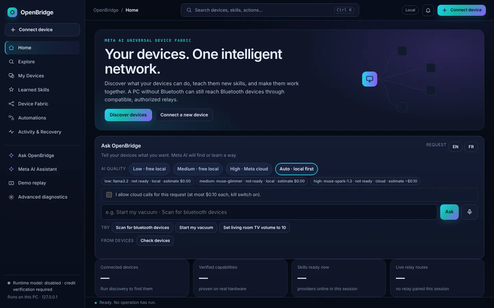
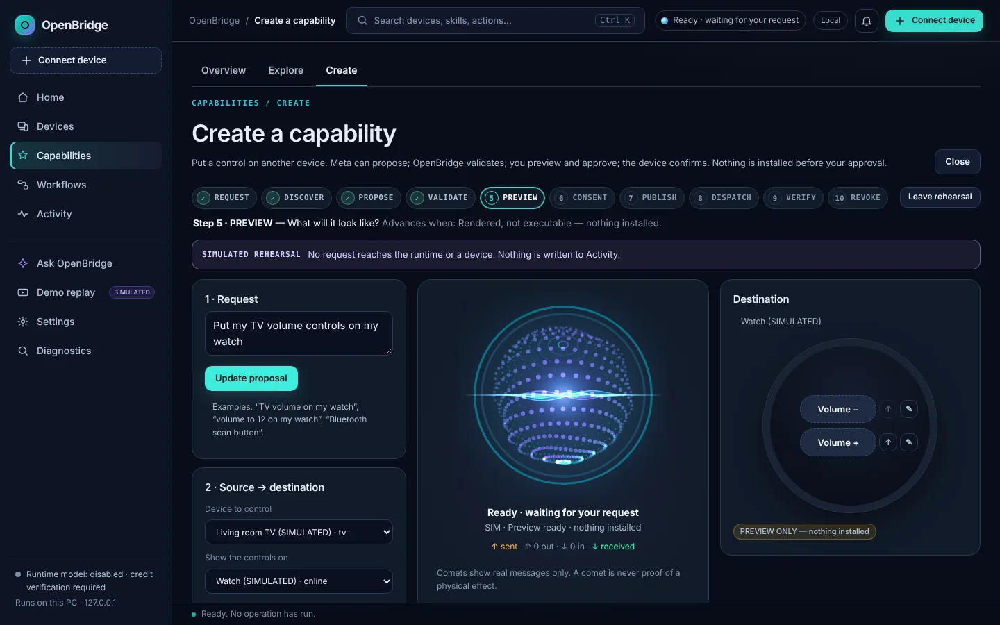
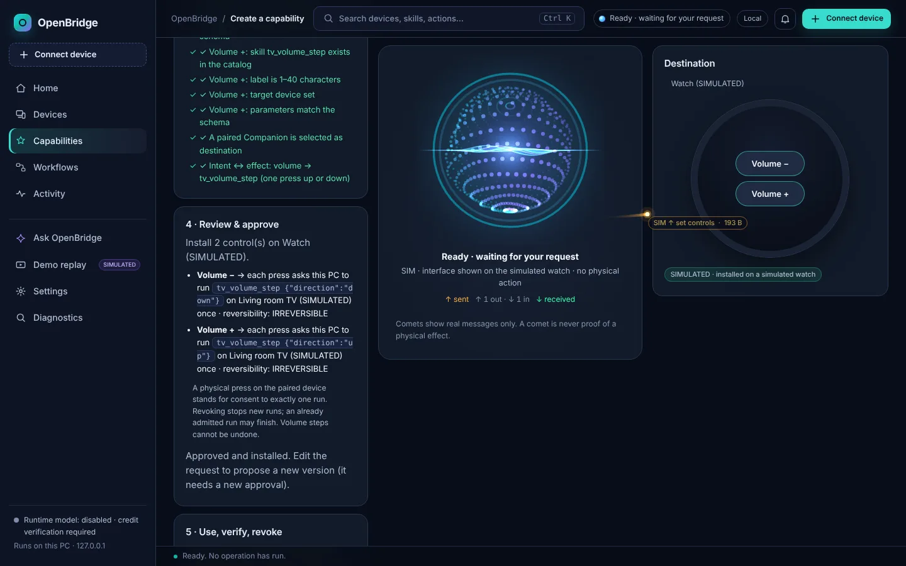

# OpenBridge UI V2 — Hybrid Intelligent Workspace (handover)

Branch `feat/ui-v2-workspace`, based on `origin/main` `ae1194a`. Sources of truth: `refonteui/01_BLUEPRINT_UIUX_OPENBRIDGE.md`
and `refonteui/02_CAHIER_DES_CHARGES_ET_PROMPT_MUSE.md` (owner folder, not in the repo). No backend contract, permission
rule or API was changed; the only server change is registering the new static assets.

## What shipped

| Area | Result | Where |
|---|---|---|
| Navigation | 5 primary sections (Home, Devices, Capabilities, Workflows, Activity) + Ask, Demo (SIMULATED), Settings, Diagnostics. One AI entry. Section sub-tabs (Devices: Devices · Network; Capabilities: Overview · Explore · Create). Legacy routes (`#/skills`, `#/fabric`, `#/automations`, `#/explore`, `#/advanced`, `#/replay`) still work. `Alt+1…5` = sections, `Ctrl+K` palette (focus returns to the opener). | `index.html`, `shell.js` |
| Classic fallback | Settings → Layout → Classic, or `?ui=classic`. Same pages, same tests. | `shell.js`, `workspace_v2.css` |
| Design tokens | Blueprint §2 palette as `--v2-*`, emerald IN `#34FFAA`, amber OUT `#FFB040`, 15–16 px body, 2 px+ focus ring. | `theme/workspace_v2.css` → `style.css` (generated) |
| Orb | Canvas2D port of `VoiceOrbView`: 18×46 = 828 points, same palettes (parsed from the Java in tests), noise, projection, core, 3 ribbons, ring pulse, thinking arcs, 6 states. | `motion/orb_canvas.js` |
| Comets | Port of `FlowOverlayView`: quadratic Bézier, 16-sample trails, 3-layer head, ≤48 alive, ≤256 queued, ≤4 spawned/dir/frame, ≤8 labels, `↑/↓ op · size`, labels never on the orb or each other. | `motion/flow_canvas.js` |
| Engine | One controller, one rAF loop, one orb canvas moved between stages, one pointer-transparent flow layer under dialogs. Stops when hidden / off-screen / nothing to draw; 30 fps idle; adaptive lite mode; DPR ≤ 2. | `motion/motion_controller.js` |
| Real events only | POSTs to `/api/…` (OUT on send, IN on successful reply), model endpoints ⇒ THINKING while in flight, execution replies ⇒ verified / not confirmed / failed from the reported state, HTTP refusal ⇒ no IN comet + reason, runtime events `remote_request` / `remote_controls` / `ui_plan_installed` / `relay_reconnected` / `receipt`, microphone and speech from Ask. History events never animate. | `motion/motion_state.js` |
| Motion preference | Full / Reduced / Off, default follows `prefers-reduced-motion`; flows on/off; labels on/off; performance Auto/Balanced/Low. Reduced/Off: static orb, text + counters only. | `views/settings_view.js` |
| Home | Ask first (model choices in collapsed **Model settings**; cloud consent shown only when the cloud tier could be used), orb stage with textual state, first-run block (Discover / offline demo SIMULATED / Connect), no empty statistics, 3–4 device cards ranked ready → read-only → detected, next step, recent activity, insights. | `index.html`, `command_center.js`, `shell.js` |
| Devices | Status filter (All / Ready / Needs setup / Read-only) + category filter, Cards / List / Network over the same data, readiness separate from proof ("Hardware-verified" chip), reset filters, Studio link only for a TV this PC may control. | `shell.js` |
| Capability Studio | 10-step contractual stepper; live path on real endpoints (`/api/fabric`, `/api/v2/routes`, `/api/v2/skills`, `POST /api/v2/remote_controls` with `consent: true`, `/remote_controls/invoke`, revoke = empty controls); typed templates; deterministic validation (server re-checks); PREVIEW ONLY watch; label rename/reorder invalidates consent; ACK ≠ physical effect; press receipts from runtime events; rehearsal mode fully SIMULATED with no runtime request. | `views/studio_view.js` |
| Workflows | Task cards + signed workflow receipts with per-node states (VERIFIED, EXECUTED = sent not verified, FAILED, BLOCKED, INCONCLUSIVE, SKIPPED, CANCELLED); existing sequence builder kept. | `views/workflows_view.js` |
| Activity | Filters All / Completed / Needs attention / Refused / Simulated; existing agent and SIMULATED sandbox kept. | `shell.js` |

## Mode terminology (shown on screen)

- **SIMULATED** — synthetic data or a rehearsal; never reaches a device. Comets carry the `SIM` prefix.
- **REPLAY** — playback of recorded receipts (Demo replay).
- **TEST** — the motion test harness in Settings; banner "TEST HARNESS" while active. Never network traffic.
- **PREVIEW ONLY** — rendered, not executable, nothing installed.
- **Acknowledged by the Companion** — the device received the controls. Not a physical effect.
- **Sent · effect not verified** — dispatched, no independent read-back (e.g. volume step).
- **Verified by read-back** — only when the receipt says VERIFIED.

## FAQ

**Does a comet prove that a device did something?** No. A comet means a real message was sent or received. Physical
effects are only claimed from receipts (VERIFIED) and are written as text.

**Why does the orb not move on my machine?** Your OS asks for reduced motion, or Settings → Motion is Reduced/Off,
or the orb is off-screen / the tab is hidden. All states stay readable as text.

**Why no comets on the Devices page?** Comets are anchored to the orb (Home, Studio, Settings). Without an orb on
screen they are counted, not drawn (same as the Companion when its orb is not laid out).

**Comets arrive late for watch presses.** Runtime events are polled every 8 s by the existing shell; the comet is
real but delayed. A push channel would be a backend change (not done).

**How do I go back to the old UI?** Settings → Layout → Classic, or open `/?ui=classic`.

## Verification (this branch)

```text
python -m dev.build_web_theme --check                     # theme sources == style.css
python -m unittest discover -s tests -q                   # 2095 tests; 1 pre-existing env failure (see below)
python -m unittest tests.unit.test_ui_v2 -v               # 13 static parity/wiring tests
python -m tests.e2e.ui_v2_smoke                           # new browser smoke (added to CI, Linux + macOS)
python -m tests.e2e.{command_center,route_inspector,control_consent,agent_portal,offline,guided,fabric,demo_replay}_smoke
python scripts/verify/ui_v2_capture.py --out artifacts/ui_v2/after   # 7 views × 7 viewports, fails on overflow/errors
```

`tests.e2e.ui_v2_smoke` checks: Ask above the fold at 1280×720; 0 events ⇒ 0 comets; OUT starts at the orb and IN ends
at it, with the Companion colours; an HTTP refusal produces no IN comet; 100 navigations keep one orb canvas, one flow
layer and no idle loop; hidden tab ⇒ no frames; Ctrl+K/Esc focus return; Alt+2; harness labelled TEST; Motion Off stops
everything; `prefers-reduced-motion` ⇒ static orb; Studio rehearsal never calls the runtime; Studio live path sends
`consent: true`, exact typed params, and revokes with an empty list; classic fallback; no overflow 390→3440 px.

Pre-existing failure, unrelated to the UI: `unit.test_meta_only_network_trace.…test_a_non_meta_destination_would_be_caught`
fails only in a sandbox where outbound HTTPS is forced through a proxy (it also fails on `ae1194a` unchanged there).

## Known limitations / follow-ups

1. Replay does not emit REPLAY comets yet (its own staged UI is unchanged).
2. Studio proposals come from typed templates; the Meta parse path is used by Ask, not yet wired into Studio.
3. Studio ACK = signed relay reply to `set_controls`. Layout-revision ACK (`applied_revision`) applies to Meta UIViewPlans
   (`/api/v2/manifests/ui_install`), which the Studio does not author yet.
4. Workflows DAG editor (advanced view) not built; the textual list is the accessible representation.
5. Real-hardware screenshots of the Studio were not produced here (no paired Companion in the build sandbox). Do not
   present the rehearsal as hardware proof.
6. axe-core audit not run (no new dependency added); keyboard, focus and live-region behaviour are covered by the smoke.

## Before / after (real screenshots of this branch, headless Chromium, no hardware)

| Before (main) | After (V2) |
|---|---|
|  |  |

Studio (SIMULATED rehearsal, clearly labelled — not hardware proof): 


Also: `screens/after-home-390.webp`, `after-devices-1440.webp`, `after-workflows-1440.webp`, `after-settings-1440.webp`.
The full 7×7 grid is regenerated with `scripts/verify/ui_v2_capture.py` (output under `artifacts/`, git-ignored).
